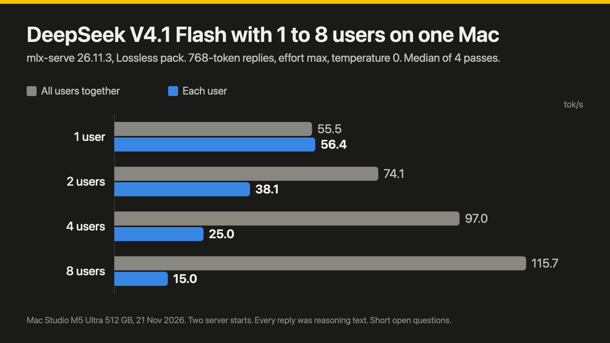
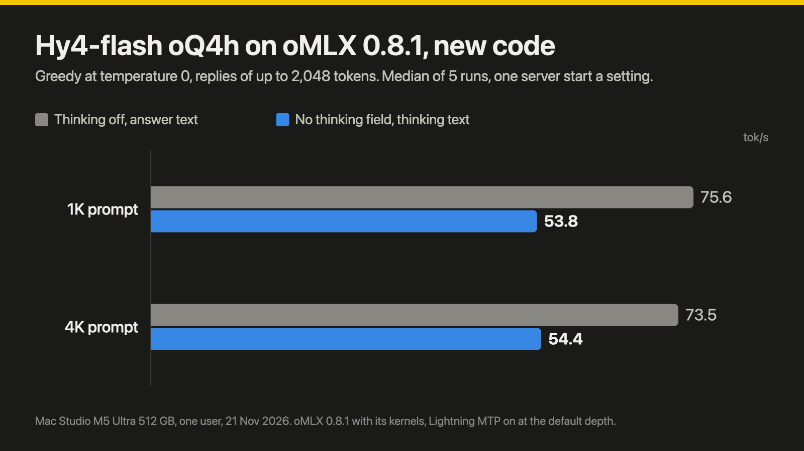
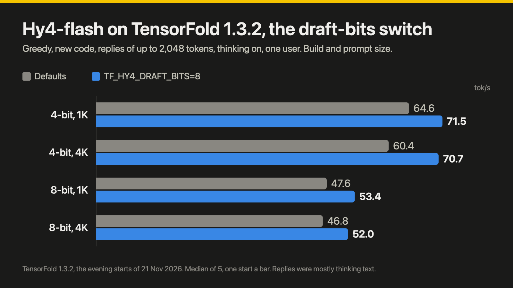
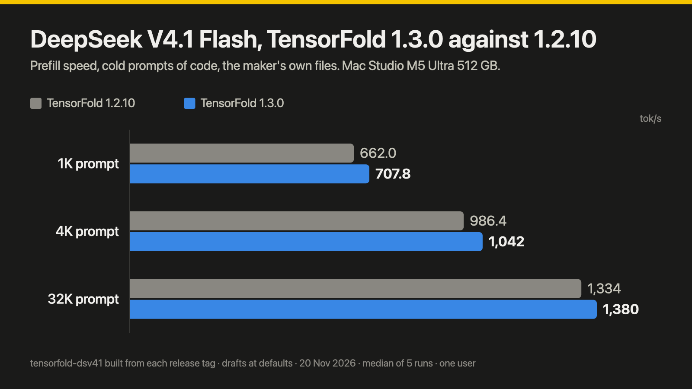

# M5 Ultra benchmarks

By Local LLM L-Plate. Follow [@LazyLocalLLM on X](https://x.com/LazyLocalLLM) for new benchmarks.

ELI5: I'm a learner with one Mac Studio M5 Ultra 512 GB, and I time local AI models on it. This page has the best speed I have measured for each model, then every finding behind it. Each finding is a folder with the report, the charts and every raw row, so you can check my arithmetic.

## Executive summary

ELI5: The page in six lines. Every figure here is recomputed from the raw rows each time the page is built.

Updated 21 Nov 2026 14:57 SGT. Decode speed in tok/s, one user, one Mac.

- **Fastest on new code.** Qwen3.8 27B, 4-bit wrote 328.9 tok/s on TensorFold 1.3.2. Next are Qwen3.8 Flash Next, 4-bit at 206.8 and Qwen3.8 Flash Next, 6-bit at 200.1.
- **Fastest in daily use.** Qwen3.8 27B, 4-bit wrote 161.3 tok/s on TensorFold 1.3.2. Next are Qwen3.8 Flash Next, 4-bit at 129.7 and Qwen3.8 Flash Next, 6-bit at 114.1.
- **Two speeds per model.** Max is greedy at temperature 0 while the model writes new code. Median is the model's own sampler on mixed text, which is closer to daily use.
- **Coverage.** 18 models, 150 setups and 14 findings.
- **Newest finding.** Finding 14, 21 Nov 2026. [Inkling 2 Mini on oMLX 0.8.1, max and median speed](findings/14_inkling2_mini_omlx_081).
- **Check it.** Every figure links to a folder with the rows it came from. If I have set an engine up wrong, [open an issue](https://github.com/LazyLocalLLM/m5-ultra-512-benchmarks/issues).

## Benchmark summary

ELI5: The fastest setup I found for each model, one line each. The same tables, with the notes on how to read them, are in [benchmark_summary](benchmark_summary).

- **Filter it.** Open [summary.csv](benchmark_summary/summary.csv). GitHub shows that file as a table with a search box, so you can type a model, an engine or a kind and see only those lines.
- **Unfold it.** Under "Every setup measured" below, click a model to see all of its setups.
- "not run yet" means I have not measured it. A line marked "older release" has been replaced by a newer run.

### Best per model

The exact setup behind each figure is one click away, under "Every setup measured". "Reply text" says whether the timed replies were the model's answer or its reasoning. A reasoning speed is not an answer speed.

| Model | Max tok/s | Median tok/s | Reply text | Engine | Finding |
|---|---|---|---|---|---|
| DeepSeek V4.1 Flash 1017, Lossless | **95.3** | **57.9** | answer | mlx-serve 26.11.3 | [8](findings/08_dsv41_mlxserve_26113) |
| GLM-5.3, 4-bit | **24.6** | **24.5** | reasoning | oMLX 0.8.0 with its kernels | [9](findings/09_omlx_080_four_models) |
| GLM-5.3, 4-bit, draft head joined here | **23.4** | **25.0** | reasoning | oMLX 0.8.0 with its kernels | [9](findings/09_omlx_080_four_models) |
| GLM-5.3 Flash, 6-bit | not run yet | **57.8** | reasoning | oMLX 0.7.3 with its kernels | [2](findings/02_ten_models_4k_to_1m) |
| GLM-5.3 Flash, 4-bit | **80.2** | **67.8** | reasoning | oMLX 0.8.0 with its kernels | [9](findings/09_omlx_080_four_models) |
| Inkling 2 Small | **51.6** | **42.2** | mostly reasoning | oMLX 0.8.0 with its kernels | [9](findings/09_omlx_080_four_models) |
| Qwen3.8 27B, 4-bit | **328.9** | **161.3** | answer | TensorFold 1.3.2 | [11](findings/11_qwen38_tensorfold_132) |
| Qwen3.8 27B, full | **6.9** | **7.1** | answer | mlx-serve 26.11.3 | [8](findings/08_dsv41_mlxserve_26113) |
| Qwen3.8 Flash Next, 4-bit | **206.8** | **129.7** | answer | TensorFold 1.3.2 | [11](findings/11_qwen38_tensorfold_132) |
| Qwen3.8 Flash Next, 6-bit | **200.1** | **114.1** | answer | TensorFold 1.3.2 | [11](findings/11_qwen38_tensorfold_132) |
| Qwen3.8 Flash Next, full | **54.2** | **33.6** | answer | oMLX 0.8.0 with its kernels | [9](findings/09_omlx_080_four_models) |
| DeepSeek V4.1 Flash 1017, oQ4e-mtp | **86.2** | **57.9** | answer | oMLX 0.8.0 with its kernels | [5](findings/05_dsv41_omlx_080_max_push) |
| DeepSeek V4.1 Flash 1017, maker's files | **75.6** | **44.5** | answer | TensorFold 1.3.0 | [6](findings/06_dsv41_tensorfold_130_max_push), [4](findings/04_dsv41_tensorfold_130) |
| Hy4-flash, 4-bit | **65.3** | **50.0** | reasoning | TensorFold 1.3.2 | [10](findings/10_hy4_flash_tensorfold_132) |
| Hy4-flash, 8-bit | **50.8** | **36.8** | reasoning | TensorFold 1.3.2 | [10](findings/10_hy4_flash_tensorfold_132) |
| Hy4-flash, oQ4h | **75.6** | **54.0** | answer for max, reasoning for median | oMLX 0.8.1 with its kernels | [12](findings/12_hy4_flash_omlx_081) |
| Inkling 2 Mini, oQ4e | **96.3** | **65.9** | reasoning | oMLX 0.8.1 with its kernels | [14](findings/14_inkling2_mini_omlx_081) |
| Inkling 2 Mini, oQ3e | **105.1** | **67.1** | reasoning | oMLX 0.8.1 with its kernels | [14](findings/14_inkling2_mini_omlx_081) |

### Ceiling on easy text

ELI5: Two tests hand the model text it can guess almost perfectly, copying the prompt and counting from 1. The speed is far above real work, so I keep these apart from Max.

| Model | Copy task tok/s | Counting toy tok/s | Engine | Finding |
|---|---|---|---|---|
| DeepSeek V4.1 Flash 1017, Lossless | **167.0** | **121.5** | mlx-serve 26.11.3 | [8](findings/08_dsv41_mlxserve_26113) |
| Qwen3.8 27B, 4-bit | **814.3** | **448.9** | TensorFold 1.3.2 | [11](findings/11_qwen38_tensorfold_132) |
| Qwen3.8 Flash Next, 4-bit | **351.6** | **369.3** | TensorFold 1.3.2 | [11](findings/11_qwen38_tensorfold_132) |
| Qwen3.8 Flash Next, 6-bit | **260.0** | **296.4** | TensorFold 1.3.2 | [11](findings/11_qwen38_tensorfold_132) |
| Qwen3.8 Flash Next, full | **120.1** | **51.5** | oMLX 0.8.0 with its kernels | [9](findings/09_omlx_080_four_models) |
| DeepSeek V4.1 Flash 1017, oQ4e-mtp | **118.3** | **114.0** | oMLX 0.8.0 with its kernels | [5](findings/05_dsv41_omlx_080_max_push) |
| DeepSeek V4.1 Flash 1017, maker's files | **159.0** | **111.9** | TensorFold 1.3.0 | [6](findings/06_dsv41_tensorfold_130_max_push) |
| Hy4-flash, oQ4h | **101.0** | **97.4** | oMLX 0.8.1 with its kernels | [12](findings/12_hy4_flash_omlx_081) |

### Every setup measured

ELI5: Everything behind the tables above, including the setups that were not the fastest. Click a model to open its lines. The range is the slowest and fastest single run.

<details>
<summary><b>DeepSeek V4.1 Flash 1017, Lossless</b>, 14 setups</summary>

| Kind | Engine and setup | Sampler | Prompt | Reply tokens | Decode tok/s | Range | Runs | Date | Run | Finding |
|---|---|---|---|---|---|---|---|---|---|---|
| max | mlx-serve 26.11.3, warmup-full, defaults with --no-decode-attn-quant, second start, lm head 8-bit by the log, prompt lookup drafts on | greedy, temperature 0 | 4K code | 2,048 | 95.3 | 90.1 to 100.3 | 5 | 2026-11-20 | `4d0f49b9ac43` | [8](findings/08_dsv41_mlxserve_26113) |
| max | mlx-serve 26.11.3, warmup-full, defaults, first start, lm head 8-bit by the log, prompt lookup drafts on | greedy, temperature 0 | 4K code | 2,048 | 93.8 | 86.1 to 99.8 | 5 | 2026-11-20 | `ddee83910540` | [8](findings/08_dsv41_mlxserve_26113) |
| max | mlx-serve 26.11.3, warmup-full, defaults with --no-decode-attn-quant, second start, lm head 8-bit by the log, prompt lookup drafts on | greedy, temperature 0 | 1K code | 512 | 93.2 | 72.4 to 94.4 | 5 | 2026-11-20 | `4d0f49b9ac43` | [8](findings/08_dsv41_mlxserve_26113) |
| max | mlx-serve 26.11.3, warmup-full, lm head kept dense by the log (MLX_SERVE_DSV41_HEAD8=0), --no-decode-attn-quant, prompt lookup drafts on | greedy, temperature 0 | 4K code | 2,048 | 91.6 | 87.7 to 96.7 | 5 | 2026-11-21 | `18b1cdba2631` | [8](findings/08_dsv41_mlxserve_26113) |
| max | mlx-serve 26.11.3, warmup-full, defaults with --no-decode-attn-quant, second start, lm head 8-bit by the log, prompt lookup drafts on | greedy, temperature 0 | 1K code | 2,048 | 91.4 | 83.6 to 98.6 | 5 | 2026-11-20 | `4d0f49b9ac43` | [8](findings/08_dsv41_mlxserve_26113) |
| max | mlx-serve 26.11.3, warmup-full, lm head kept dense by the log (MLX_SERVE_DSV41_HEAD8=0), --no-decode-attn-quant, prompt lookup drafts on | greedy, temperature 0 | 1K code | 2,048 | 90.2 | 85.2 to 97.7 | 5 | 2026-11-21 | `18b1cdba2631` | [8](findings/08_dsv41_mlxserve_26113) |
| copy task | mlx-serve 26.11.3, warmup-full, defaults, first start, lm head 8-bit by the log, prompt lookup drafts on | greedy, temperature 0 | 1K code | 512 | 167.0 | 159.0 to 169.0 | 5 | 2026-11-20 | `ddee83910540` | [8](findings/08_dsv41_mlxserve_26113) |
| copy task | mlx-serve 26.11.3, warmup-full, defaults with --no-decode-attn-quant, second start, lm head 8-bit by the log, prompt lookup drafts on | greedy, temperature 0 | 1K code | 512 | 165.1 | 159.5 to 170.1 | 5 | 2026-11-20 | `4d0f49b9ac43` | [8](findings/08_dsv41_mlxserve_26113) |
| counting toy | mlx-serve 26.11.3, warmup-full, defaults, first start, lm head 8-bit by the log, prompt lookup drafts on | greedy, temperature 0 | 4K code | 512 | 121.5 | 121.3 to 121.9 | 5 | 2026-11-20 | `ddee83910540` | [8](findings/08_dsv41_mlxserve_26113) |
| counting toy | mlx-serve 26.11.3, warmup-full, defaults with --no-decode-attn-quant, second start, lm head 8-bit by the log, prompt lookup drafts on | greedy, temperature 0 | 1K code | 512 | 121.5 | 121.2 to 121.9 | 5 | 2026-11-20 | `4d0f49b9ac43` | [8](findings/08_dsv41_mlxserve_26113) |
| median | mlx-serve 26.11.2, defaults, prompt lookup drafts on, older release | temperature 1.0, top-p 1.0 | 4K mixed | 512 | 58.3 | 51.3 to 70.6 | 5 | 2026-11-17 | `a227c80d0e61` | [2](findings/02_ten_models_4k_to_1m) |
| median | mlx-serve 26.11.3, warmup-full, lm head kept dense by the log (MLX_SERVE_DSV41_HEAD8=0), --no-decode-attn-quant, prompt lookup drafts on | temperature 1.0, top-p 1.0 | 4K mixed | 512 | 57.9 | 49.7 to 59.2 | 5 | 2026-11-21 | `18b1cdba2631` | [8](findings/08_dsv41_mlxserve_26113) |
| median | mlx-serve 26.11.3, warmup-full, defaults, first start, lm head 8-bit by the log, prompt lookup drafts on | temperature 1.0, top-p 1.0 | 4K mixed | 512 | 57.5 | 50.9 to 65.6 | 5 | 2026-11-20 | `ddee83910540` | [8](findings/08_dsv41_mlxserve_26113) |
| median | mlx-serve 26.11.3, warmup-full, defaults with --no-decode-attn-quant, second start, lm head 8-bit by the log, prompt lookup drafts on | temperature 1.0, top-p 1.0 | 4K mixed | 512 | 56.4 | 52.6 to 61.4 | 5 | 2026-11-20 | `4d0f49b9ac43` | [8](findings/08_dsv41_mlxserve_26113) |

</details>

<details>
<summary><b>GLM-5.3, 4-bit</b>, 3 setups</summary>

| Kind | Engine and setup | Sampler | Prompt | Reply tokens | Decode tok/s | Range | Runs | Date | Run | Finding |
|---|---|---|---|---|---|---|---|---|---|---|
| max | oMLX 0.8.0 with its kernels, MTP off, reply is reasoning text, 512-token replies | greedy, temperature 0 | 4K code | 512 | 24.6 | 24.5 to 24.7 | 5 | 2026-11-20 | `2641f174f97a` | [9](findings/09_omlx_080_four_models) |
| median | oMLX 0.8.0 with its kernels, MTP off, reply is reasoning text | temperature 1.0, top-p 0.95 | 4K mixed | 512 | 24.5 | 24.5 to 24.5 | 5 | 2026-11-20 | `2641f174f97a` | [9](findings/09_omlx_080_four_models) |
| median | oMLX 0.7.3 with its kernels, MTP off, older release | temperature 1.0, top-p 0.95 | 4K mixed | 512 | 24.3 | 24.2 to 24.3 | 5 | 2026-11-17 | `626f0c1b4ad9` | [2](findings/02_ten_models_4k_to_1m) |

</details>

<details>
<summary><b>GLM-5.3, 4-bit, draft head joined here</b>, 2 setups</summary>

| Kind | Engine and setup | Sampler | Prompt | Reply tokens | Decode tok/s | Range | Runs | Date | Run | Finding |
|---|---|---|---|---|---|---|---|---|---|---|
| max | oMLX 0.8.0 with its kernels, MTP on, default depth, reply is reasoning text, 512-token replies | greedy, temperature 0 | 4K code | 512 | 23.4 | 22.2 to 24.4 | 5 | 2026-11-21 | `1cdf9099760b` | [9](findings/09_omlx_080_four_models) |
| median | oMLX 0.8.0 with its kernels, MTP on, default depth, reply is reasoning text | temperature 1.0, top-p 0.95 | 4K mixed | 512 | 25.0 | 23.0 to 29.0 | 5 | 2026-11-21 | `1cdf9099760b` | [9](findings/09_omlx_080_four_models) |

</details>

<details>
<summary><b>GLM-5.3 Flash, 6-bit</b>, 1 setup</summary>

| Kind | Engine and setup | Sampler | Prompt | Reply tokens | Decode tok/s | Range | Runs | Date | Run | Finding |
|---|---|---|---|---|---|---|---|---|---|---|
| median | oMLX 0.7.3 with its kernels, MTP on | temperature 1.0, top-p 0.95 | 4K mixed | 512 | 57.8 | 55.6 to 69.0 | 5 | 2026-11-17 | `2b64d54e7e5c` | [2](findings/02_ten_models_4k_to_1m) |

</details>

<details>
<summary><b>GLM-5.3 Flash, 4-bit</b>, 6 setups</summary>

| Kind | Engine and setup | Sampler | Prompt | Reply tokens | Decode tok/s | Range | Runs | Date | Run | Finding |
|---|---|---|---|---|---|---|---|---|---|---|
| max | oMLX 0.8.0 with its kernels, MTP on, default depth, reply is reasoning text | greedy, temperature 0 | 1K code | 2,048 | 80.2 | 68.4 to 87.6 | 5 | 2026-11-21 | `8f12a00bcc4f` | [9](findings/09_omlx_080_four_models) |
| max | oMLX 0.8.0 with its kernels, MTP on, default depth, reply is reasoning text | greedy, temperature 0 | 4K code | 2,048 | 74.7 | 68.9 to 81.3 | 5 | 2026-11-21 | `8f12a00bcc4f` | [9](findings/09_omlx_080_four_models) |
| max | oMLX 0.8.0 with its kernels, MTP on, fixed depth 4, reply is reasoning text | greedy, temperature 0 | 1K code | 2,048 | 71.7 | 66.4 to 80.9 | 5 | 2026-11-21 | `605e0068ff28` | [9](findings/09_omlx_080_four_models) |
| max | oMLX 0.8.0 with its kernels, MTP on, fixed depth 4, reply is reasoning text | greedy, temperature 0 | 4K code | 2,048 | 68.9 | 62.1 to 74.9 | 5 | 2026-11-21 | `605e0068ff28` | [9](findings/09_omlx_080_four_models) |
| median | oMLX 0.7.3 with its kernels, MTP on, older release | temperature 1.0, top-p 0.95 | 4K mixed | 512 | 68.8 | 61.0 to 76.1 | 5 | 2026-11-17 | `8453ec3a372d` | [2](findings/02_ten_models_4k_to_1m) |
| median | oMLX 0.8.0 with its kernels, MTP on, default depth, reply is reasoning text | temperature 1.0, top-p 0.95 | 4K mixed | 512 | 67.8 | 63.2 to 72.2 | 5 | 2026-11-21 | `8f12a00bcc4f` | [9](findings/09_omlx_080_four_models) |

</details>

<details>
<summary><b>Inkling 2 Small</b>, 4 setups</summary>

| Kind | Engine and setup | Sampler | Prompt | Reply tokens | Decode tok/s | Range | Runs | Date | Run | Finding |
|---|---|---|---|---|---|---|---|---|---|---|
| max | oMLX 0.8.0 with its kernels, DSpark draft on, default depth, reply is mostly reasoning text | greedy, temperature 0 | 1K code | 2,048 | 51.6 | 46.9 to 51.9 | 5 | 2026-11-21 | `818c28dbb625` | [9](findings/09_omlx_080_four_models) |
| max | oMLX 0.8.0 with its kernels, DSpark draft on, default depth, reply is mostly reasoning text | greedy, temperature 0 | 4K code | 2,048 | 48.6 | 46.0 to 58.7 | 5 | 2026-11-21 | `818c28dbb625` | [9](findings/09_omlx_080_four_models) |
| median | oMLX 0.8.0 with its kernels, DSpark draft on, default depth, reply is mostly reasoning text | temperature 1.0, top-p 1.0 | 4K mixed | 512 | 42.2 | 39.7 to 46.0 | 5 | 2026-11-21 | `818c28dbb625` | [9](findings/09_omlx_080_four_models) |
| median | oMLX main 624cff0e with its kernels, DSpark draft on, older release | temperature 1.0, top-p 1.0 | 4K mixed | 512 | 41.3 | 38.5 to 42.9 | 5 | 2026-11-17 | `5c4d781c0e3d` | [2](findings/02_ten_models_4k_to_1m) |

</details>

<details>
<summary><b>Qwen3.8 27B, 4-bit</b>, 18 setups</summary>

| Kind | Engine and setup | Sampler | Prompt | Reply tokens | Decode tok/s | Range | Runs | Date | Run | Finding |
|---|---|---|---|---|---|---|---|---|---|---|
| max | TensorFold 1.3.0, DFlash2 drafter (z-lab), defaults, older release | greedy, temperature 0 | 1K code | 2,048 | 331.3 | 245.7 to 342.1 | 5 | 2026-11-20 | `f2d856e22771` | [7](findings/07_qwen38_tensorfold_130) |
| max | TensorFold 1.3.2, DFlash2 drafter (z-lab), defaults, second start | greedy, temperature 0 | 1K code | 2,048 | 328.9 | 301.3 to 349.7 | 5 | 2026-11-21 | `ab1caacd2961` | [11](findings/11_qwen38_tensorfold_132) |
| max | TensorFold 1.3.0, DFlash2 drafter (z-lab), defaults, older release | greedy, temperature 0 | 4K code | 2,048 | 250.8 | 217.1 to 332.2 | 5 | 2026-11-20 | `f2d856e22771` | [7](findings/07_qwen38_tensorfold_130) |
| max | TensorFold 1.3.2, DFlash2 drafter (z-lab), defaults, second start | greedy, temperature 0 | 1K code | 512 | 243.6 | 225.6 to 274.1 | 5 | 2026-11-21 | `ab1caacd2961` | [11](findings/11_qwen38_tensorfold_132) |
| max | TensorFold 1.3.2, DFlash2 drafter (z-lab), defaults, second start | greedy, temperature 0 | 4K code | 2,048 | 241.6 | 223.4 to 298.6 | 5 | 2026-11-21 | `ab1caacd2961` | [11](findings/11_qwen38_tensorfold_132) |
| max | TensorFold 1.3.0, DFlash2 drafter (z-lab), defaults, older release | greedy, temperature 0 | 1K code | 512 | 227.0 | 222.2 to 278.6 | 5 | 2026-11-20 | `f2d856e22771` | [7](findings/07_qwen38_tensorfold_130) |
| max | mlx-lm 0.32.2, defaults, the baseline, 20 Nov run | greedy, temperature 0 | 1K code | 2,048 | 45.1 | 45.0 to 45.2 | 5 | 2026-11-20 | `0c5446c7acc1` | [7](findings/07_qwen38_tensorfold_130) |
| copy task | TensorFold 1.3.0, DFlash2 drafter (z-lab), defaults, long copy block, older release | greedy, temperature 0 | 4K code | 2,048 | 824.0 | 734.9 to 832.0 | 5 | 2026-11-20 | `44a8ff4a173a` | [7](findings/07_qwen38_tensorfold_130) |
| copy task | TensorFold 1.3.2, DFlash2 drafter (z-lab), defaults, second start | greedy, temperature 0 | 4K code | 2,048 | 814.3 | 705.9 to 825.8 | 5 | 2026-11-21 | `ab1caacd2961` | [11](findings/11_qwen38_tensorfold_132) |
| counting toy | TensorFold 1.3.0, DFlash2 drafter (z-lab), defaults, older release | greedy, temperature 0 | 1K code | 512 | 450.8 | 169.0 to 454.8 | 5 | 2026-11-20 | `f2d856e22771` | [7](findings/07_qwen38_tensorfold_130) |
| counting toy | TensorFold 1.3.2, DFlash2 drafter (z-lab), defaults, second start | greedy, temperature 0 | 1K code | 512 | 448.9 | 163.8 to 453.2 | 5 | 2026-11-21 | `ab1caacd2961` | [11](findings/11_qwen38_tensorfold_132) |
| median | TensorFold 1.3.2, DFlash2 drafter (z-lab), defaults, second start | temperature 0.7, top-p 0.8, top-k 20 | 4K mixed | 512 | 161.3 | 142.5 to 178.4 | 5 | 2026-11-21 | `ab1caacd2961` | [11](findings/11_qwen38_tensorfold_132) |
| median | TensorFold 1.2.8, DFlash2 drafter (z-lab), older release | temperature 0.7, top-p 0.8, top-k 20 | 4K mixed | 512 | 154.2 | 136.9 to 219.4 | 5 | 2026-11-17 | `a798cea8b67e` | [2](findings/02_ten_models_4k_to_1m) |
| median | TensorFold 1.3.0, DFlash2 drafter (z-lab), defaults, older release | temperature 0.7, top-p 0.8, top-k 20 | 4K mixed | 512 | 148.2 | 128.2 to 178.6 | 5 | 2026-11-20 | `f2d856e22771` | [7](findings/07_qwen38_tensorfold_130) |
| median | TensorFold 1.2.7, DFlash2 drafter (z-lab), older release | temperature 0.7, top-p 0.8, top-k 20 | 1K mixed | 512 | 145.7 | 138.4 to 182.9 | 5 | 2026-11-13 | `f6775745e273` | [1](findings/01_tensorfold_qwen38-27b_4bit) |
| median | TensorFold 1.2.7, no draft model, older release | temperature 0.7, top-p 0.8, top-k 20 | 1K mixed | 512 | 48.7 | 48.6 to 48.7 | 5 | 2026-11-13 | `eabffb505d52` | [1](findings/01_tensorfold_qwen38-27b_4bit) |
| median | mlx-lm 0.32.2, defaults, the baseline | temperature 0.7, top-p 0.8, top-k 20 | 1K mixed | 512 | 44.5 | 44.4 to 44.5 | 5 | 2026-11-13 | `3ad3a150c4d0` | [1](findings/01_tensorfold_qwen38-27b_4bit) |
| median | mlx-lm 0.32.2, defaults, the baseline, 20 Nov run | temperature 0.7, top-p 0.8, top-k 20 | 4K mixed | 512 | 43.6 | 43.6 to 43.7 | 5 | 2026-11-20 | `0c5446c7acc1` | [7](findings/07_qwen38_tensorfold_130) |

</details>

<details>
<summary><b>Qwen3.8 27B, full</b>, 4 setups</summary>

| Kind | Engine and setup | Sampler | Prompt | Reply tokens | Decode tok/s | Range | Runs | Date | Run | Finding |
|---|---|---|---|---|---|---|---|---|---|---|
| max | mlx-serve 26.11.3, warmup-full, defaults (lossy decode copies engaged, by the log), prompt lookup drafts on | greedy, temperature 0 | 4K code | 512 | 6.9 | 6.5 to 7.4 | 5 | 2026-11-20 | `8594b4fe926a` | [8](findings/08_dsv41_mlxserve_26113) |
| median | mlx-serve 26.11.2, defaults, prompt lookup drafts on, older release | temperature 0.7, top-p 0.8, top-k 20 | 4K mixed | 512 | 8.8 | 8.3 to 9.8 | 5 | 2026-11-17 | `a30a665ca3ee` | [2](findings/02_ten_models_4k_to_1m) |
| median | mlx-serve 26.11.3, defaults without --warmup-full (lossy decode copies engaged, by the log), prompt lookup drafts on | temperature 0.7, top-p 0.8, top-k 20 | 4K mixed | 512 | 7.1 | 6.6 to 7.6 | 5 | 2026-11-21 | `5619fdacb103` | [8](findings/08_dsv41_mlxserve_26113) |
| median | mlx-serve 26.11.3, warmup-full, defaults (lossy decode copies engaged, by the log), prompt lookup drafts on | temperature 0.7, top-p 0.8, top-k 20 | 4K mixed | 512 | 6.8 | 6.8 to 6.9 | 5 | 2026-11-20 | `8594b4fe926a` | [8](findings/08_dsv41_mlxserve_26113) |

</details>

<details>
<summary><b>Qwen3.8 Flash Next, 4-bit</b>, 13 setups</summary>

| Kind | Engine and setup | Sampler | Prompt | Reply tokens | Decode tok/s | Range | Runs | Date | Run | Finding |
|---|---|---|---|---|---|---|---|---|---|---|
| max | TensorFold 1.3.2, MTP on, recipe line, defaults, second start | greedy, temperature 0 | 1K code | 2,048 | 206.8 | 191.7 to 257.5 | 5 | 2026-11-21 | `70284626631f` | [11](findings/11_qwen38_tensorfold_132) |
| max | TensorFold 1.3.0, MTP on, recipe line, defaults, older release | greedy, temperature 0 | 1K code | 2,048 | 204.4 | 176.6 to 247.5 | 5 | 2026-11-20 | `7bf80be3a997` | [7](findings/07_qwen38_tensorfold_130) |
| max | TensorFold 1.3.0, MTP on, recipe line, defaults, older release | greedy, temperature 0 | 4K code | 512 | 194.4 | 169.7 to 217.0 | 5 | 2026-11-20 | `7bf80be3a997` | [7](findings/07_qwen38_tensorfold_130) |
| max | TensorFold 1.3.2, MTP on, recipe line, defaults, second start | greedy, temperature 0 | 4K code | 512 | 179.1 | 176.1 to 183.6 | 5 | 2026-11-21 | `70284626631f` | [11](findings/11_qwen38_tensorfold_132) |
| copy task | TensorFold 1.3.2, MTP on, recipe line, defaults, second start | greedy, temperature 0 | 1K code | 512 | 351.6 | 262.9 to 371.7 | 5 | 2026-11-21 | `70284626631f` | [11](findings/11_qwen38_tensorfold_132) |
| copy task | TensorFold 1.3.2, MTP on, recipe line, defaults, second start | greedy, temperature 0 | 4K code | 2,048 | 312.3 | 277.4 to 344.1 | 5 | 2026-11-21 | `70284626631f` | [11](findings/11_qwen38_tensorfold_132) |
| copy task | TensorFold 1.3.0, MTP on, recipe line, defaults, older release | greedy, temperature 0 | 1K code | 512 | 298.1 | 247.3 to 330.5 | 5 | 2026-11-20 | `7bf80be3a997` | [7](findings/07_qwen38_tensorfold_130) |
| copy task | TensorFold 1.3.0, MTP on, recipe line, defaults, long copy block, older release | greedy, temperature 0 | 4K code | 2,048 | 292.2 | 261.8 to 320.0 | 5 | 2026-11-20 | `37a4c93bd874` | [7](findings/07_qwen38_tensorfold_130) |
| counting toy | TensorFold 1.3.2, MTP on, recipe line, defaults, second start | greedy, temperature 0 | 1K code | 512 | 369.3 | 359.4 to 370.0 | 5 | 2026-11-21 | `70284626631f` | [11](findings/11_qwen38_tensorfold_132) |
| counting toy | TensorFold 1.3.0, MTP on, recipe line, defaults, older release | greedy, temperature 0 | 1K code | 512 | 344.7 | 336.2 to 344.9 | 5 | 2026-11-20 | `7bf80be3a997` | [7](findings/07_qwen38_tensorfold_130) |
| median | TensorFold 1.3.2, MTP on, recipe line, defaults, second start | temperature 0.7, top-p 0.8, top-k 20 | 4K mixed | 512 | 129.7 | 123.5 to 134.1 | 5 | 2026-11-21 | `70284626631f` | [11](findings/11_qwen38_tensorfold_132) |
| median | TensorFold 1.2.8, MTP on, recipe line, older release | temperature 0.7, top-p 0.8, top-k 20 | 4K mixed | 512 | 129.2 | 123.9 to 139.2 | 5 | 2026-11-17 | `72fae37b87f0` | [2](findings/02_ten_models_4k_to_1m) |
| median | TensorFold 1.3.0, MTP on, recipe line, defaults, older release | temperature 0.7, top-p 0.8, top-k 20 | 4K mixed | 512 | 126.7 | 115.9 to 131.9 | 5 | 2026-11-20 | `7bf80be3a997` | [7](findings/07_qwen38_tensorfold_130) |

</details>

<details>
<summary><b>Qwen3.8 Flash Next, 6-bit</b>, 13 setups</summary>

| Kind | Engine and setup | Sampler | Prompt | Reply tokens | Decode tok/s | Range | Runs | Date | Run | Finding |
|---|---|---|---|---|---|---|---|---|---|---|
| max | TensorFold 1.3.2, MTP on, recipe line, defaults, second start | greedy, temperature 0 | 1K code | 2,048 | 200.1 | 188.9 to 219.8 | 5 | 2026-11-21 | `51735d12713b` | [11](findings/11_qwen38_tensorfold_132) |
| max | TensorFold 1.3.2, MTP on, recipe line, defaults, second start | greedy, temperature 0 | 1K code | 512 | 195.1 | 186.9 to 201.4 | 5 | 2026-11-21 | `51735d12713b` | [11](findings/11_qwen38_tensorfold_132) |
| max | TensorFold 1.3.0, MTP on, recipe line, defaults, older release | greedy, temperature 0 | 1K code | 2,048 | 193.0 | 178.5 to 212.3 | 5 | 2026-11-21 | `2bc45b1272e8` | [7](findings/07_qwen38_tensorfold_130) |
| max | TensorFold 1.3.0, MTP on, recipe line, defaults, older release | greedy, temperature 0 | 1K code | 512 | 188.2 | 177.9 to 192.6 | 5 | 2026-11-21 | `2bc45b1272e8` | [7](findings/07_qwen38_tensorfold_130) |
| copy task | TensorFold 1.3.2, MTP on, recipe line, defaults, second start | greedy, temperature 0 | 1K code | 512 | 260.0 | 213.3 to 283.3 | 5 | 2026-11-21 | `51735d12713b` | [11](findings/11_qwen38_tensorfold_132) |
| copy task | TensorFold 1.3.0, MTP on, recipe line, defaults, older release | greedy, temperature 0 | 1K code | 512 | 254.4 | 208.5 to 276.9 | 5 | 2026-11-21 | `2bc45b1272e8` | [7](findings/07_qwen38_tensorfold_130) |
| copy task | TensorFold 1.3.2, MTP on, recipe line, defaults, second start | greedy, temperature 0 | 4K code | 2,048 | 253.6 | 233.1 to 276.6 | 5 | 2026-11-21 | `51735d12713b` | [11](findings/11_qwen38_tensorfold_132) |
| copy task | TensorFold 1.3.0, MTP on, recipe line, defaults, older release | greedy, temperature 0 | 4K code | 2,048 | 247.7 | 223.1 to 268.9 | 5 | 2026-11-21 | `2bc45b1272e8` | [7](findings/07_qwen38_tensorfold_130) |
| counting toy | TensorFold 1.3.2, MTP on, recipe line, defaults, second start | greedy, temperature 0 | 1K code | 512 | 296.4 | 290.2 to 297.1 | 5 | 2026-11-21 | `51735d12713b` | [11](findings/11_qwen38_tensorfold_132) |
| counting toy | TensorFold 1.3.0, MTP on, recipe line, defaults, older release | greedy, temperature 0 | 1K code | 512 | 290.0 | 283.9 to 290.3 | 5 | 2026-11-21 | `2bc45b1272e8` | [7](findings/07_qwen38_tensorfold_130) |
| median | TensorFold 1.3.0, MTP on, recipe line, defaults, older release | temperature 0.7, top-p 0.8, top-k 20 | 4K mixed | 512 | 117.4 | 112.0 to 122.0 | 5 | 2026-11-21 | `2bc45b1272e8` | [7](findings/07_qwen38_tensorfold_130) |
| median | TensorFold 1.3.2, MTP on, recipe line, defaults, second start | temperature 0.7, top-p 0.8, top-k 20 | 4K mixed | 512 | 114.1 | 110.6 to 121.5 | 5 | 2026-11-21 | `51735d12713b` | [11](findings/11_qwen38_tensorfold_132) |
| median | TensorFold 1.2.8, MTP on, recipe line, older release | temperature 0.7, top-p 0.8, top-k 20 | 4K mixed | 512 | 114.0 | 108.6 to 125.6 | 5 | 2026-11-17 | `ea26b8919e88` | [2](findings/02_ten_models_4k_to_1m) |

</details>

<details>
<summary><b>Qwen3.8 Flash Next, full</b>, 11 setups</summary>

| Kind | Engine and setup | Sampler | Prompt | Reply tokens | Decode tok/s | Range | Runs | Date | Run | Finding |
|---|---|---|---|---|---|---|---|---|---|---|
| max | oMLX 0.8.0 with its kernels, MTP on (built-in head), fixed depth 4, second start | greedy, temperature 0 | 4K code | 2,048 | 54.2 | 47.0 to 60.7 | 5 | 2026-11-21 | `5f6db4faf823` | [9](findings/09_omlx_080_four_models) |
| max | oMLX 0.8.0 with its kernels, MTP on (built-in head), fixed depth 4, second start | greedy, temperature 0 | 1K code | 2,048 | 53.6 | 47.6 to 55.3 | 5 | 2026-11-21 | `5f6db4faf823` | [9](findings/09_omlx_080_four_models) |
| max | oMLX 0.8.0 with its kernels, MTP on (built-in head), default depth, second start | greedy, temperature 0 | 1K code | 2,048 | 49.4 | 46.9 to 52.6 | 5 | 2026-11-21 | `57b0f4425846` | [9](findings/09_omlx_080_four_models) |
| max | oMLX 0.8.0 with its kernels, MTP on (built-in head), default depth, second start | greedy, temperature 0 | 4K code | 2,048 | 48.5 | 45.3 to 51.4 | 5 | 2026-11-21 | `57b0f4425846` | [9](findings/09_omlx_080_four_models) |
| copy task | oMLX 0.8.0 with its kernels, MTP on (built-in head), default depth | greedy, temperature 0 | 1K code | 512 | 120.1 | 115.1 to 132.3 | 5 | 2026-11-21 | `6542a7f95175` | [9](findings/09_omlx_080_four_models) |
| copy task | oMLX 0.8.0 with its kernels, MTP on (built-in head), default depth | greedy, temperature 0 | 4K code | 512 | 116.9 | 98.2 to 125.2 | 5 | 2026-11-21 | `6542a7f95175` | [9](findings/09_omlx_080_four_models) |
| counting toy | oMLX 0.8.0 with its kernels, MTP on (built-in head), default depth | greedy, temperature 0 | 4K code | 512 | 51.5 | 51.1 to 52.6 | 5 | 2026-11-21 | `6542a7f95175` | [9](findings/09_omlx_080_four_models) |
| counting toy | oMLX 0.8.0 with its kernels, MTP on (built-in head), default depth | greedy, temperature 0 | 1K code | 512 | 49.5 | 47.6 to 51.8 | 5 | 2026-11-21 | `6542a7f95175` | [9](findings/09_omlx_080_four_models) |
| median | oMLX 0.7.3 with its kernels, MTP on (built-in head), older release | temperature 0.7, top-p 0.8, top-k 20 | 4K mixed | 512 | 34.9 | 32.2 to 35.9 | 5 | 2026-11-17 | `c4bbe7d3230c` | [2](findings/02_ten_models_4k_to_1m) |
| median | oMLX 0.8.0 with its kernels, MTP on (built-in head), fixed depth 4, second start | temperature 0.7, top-p 0.8, top-k 20 | 4K mixed | 512 | 33.6 | 31.8 to 40.2 | 5 | 2026-11-21 | `5f6db4faf823` | [9](findings/09_omlx_080_four_models) |
| median | oMLX 0.8.0 with its kernels, MTP on (built-in head), default depth | temperature 0.7, top-p 0.8, top-k 20 | 4K mixed | 512 | 33.2 | 31.5 to 34.6 | 5 | 2026-11-21 | `6542a7f95175` | [9](findings/09_omlx_080_four_models) |

</details>

<details>
<summary><b>DeepSeek V4.1 Flash 1017, oQ4e-mtp</b>, 14 setups</summary>

| Kind | Engine and setup | Sampler | Prompt | Reply tokens | Decode tok/s | Range | Runs | Date | Run | Finding |
|---|---|---|---|---|---|---|---|---|---|---|
| max | oMLX 0.8.0 with its kernels, MTP drafts on, fixed depth 5 | greedy, temperature 0 | 4K code | 2,048 | 86.2 | 73.8 to 86.8 | 5 | 2026-11-20 | `c15a39cf630a` | [5](findings/05_dsv41_omlx_080_max_push) |
| max | oMLX 0.8.0 with its kernels, MTP drafts on, fixed depth 5 | greedy, temperature 0 | 1K code | 2,048 | 84.4 | 78.2 to 85.5 | 5 | 2026-11-20 | `c15a39cf630a` | [5](findings/05_dsv41_omlx_080_max_push) |
| max | oMLX 0.8.0 with its kernels, MTP drafts on, default depth | greedy, temperature 0 | 1K code | 2,048 | 77.2 | 72.5 to 78.7 | 5 | 2026-11-20 | `7ece67645192` | [5](findings/05_dsv41_omlx_080_max_push) |
| max | oMLX 0.8.0 with its kernels, MTP drafts on, default depth | greedy, temperature 0 | 1K code | 512 | 71.2 | 65.7 to 73.1 | 5 | 2026-11-20 | `800dd0f8839c` | [3](findings/03_dsv41_omlx_080) |
| max | oMLX 0.8.0 with its kernels, MTP drafts on, default depth | greedy, temperature 0 | 1K code | 128 | 58.2 | 52.4 to 60.1 | 5 | 2026-11-20 | `800dd0f8839c` | [3](findings/03_dsv41_omlx_080) |
| copy task | oMLX 0.8.0 with its kernels, MTP drafts on, fixed depth 5 | greedy, temperature 0 | 4K code | 512 | 118.3 | 110.7 to 121.0 | 5 | 2026-11-20 | `b1703d1d52b6` | [5](findings/05_dsv41_omlx_080_max_push) |
| copy task | oMLX 0.8.0 with its kernels, MTP drafts on, fixed depth 5 | greedy, temperature 0 | 1K code | 512 | 114.7 | 113.6 to 118.1 | 5 | 2026-11-20 | `b1703d1d52b6` | [5](findings/05_dsv41_omlx_080_max_push) |
| copy task | oMLX 0.8.0 with its kernels, MTP drafts on, default depth | greedy, temperature 0 | 4K code | 512 | 98.3 | 93.3 to 99.9 | 5 | 2026-11-20 | `526b05fc2a44` | [5](findings/05_dsv41_omlx_080_max_push) |
| counting toy | oMLX 0.8.0 with its kernels, MTP drafts on, fixed depth 5 | greedy, temperature 0 | 4K code | 512 | 114.0 | 113.7 to 114.3 | 5 | 2026-11-20 | `b1703d1d52b6` | [5](findings/05_dsv41_omlx_080_max_push) |
| counting toy | oMLX 0.8.0 with its kernels, MTP drafts on, fixed depth 5 | greedy, temperature 0 | 1K code | 512 | 113.0 | 111.9 to 114.0 | 5 | 2026-11-20 | `b1703d1d52b6` | [5](findings/05_dsv41_omlx_080_max_push) |
| counting toy | oMLX 0.8.0 with its kernels, MTP drafts on, default depth | greedy, temperature 0 | 4K code | 512 | 90.6 | 90.4 to 90.8 | 5 | 2026-11-20 | `526b05fc2a44` | [5](findings/05_dsv41_omlx_080_max_push) |
| median | oMLX 0.8.0 with its kernels, MTP drafts on, default depth, second start | temperature 1.0, top-p 1.0 | 4K mixed | 512 | 57.9 | 53.3 to 59.8 | 5 | 2026-11-20 | `cfff183a181f` | [5](findings/05_dsv41_omlx_080_max_push) |
| median | oMLX 0.8.0 with its kernels, MTP drafts on, default depth | temperature 1.0, top-p 1.0 | 4K mixed | 512 | 56.5 | 55.1 to 58.5 | 5 | 2026-11-20 | `800dd0f8839c` | [3](findings/03_dsv41_omlx_080) |
| median | oMLX 0.8.0 with its kernels, MTP drafts on, fixed depth 5 | temperature 1.0, top-p 1.0 | 4K mixed | 512 | 50.5 | 48.1 to 57.3 | 5 | 2026-11-20 | `c15a39cf630a` | [5](findings/05_dsv41_omlx_080_max_push) |

</details>

<details>
<summary><b>DeepSeek V4.1 Flash 1017, maker's files</b>, 10 setups</summary>

| Kind | Engine and setup | Sampler | Prompt | Reply tokens | Decode tok/s | Range | Runs | Date | Run | Finding |
|---|---|---|---|---|---|---|---|---|---|---|
| max | TensorFold 1.3.0, drafts at defaults (DSpark and copies) | greedy, temperature 0 | 4K code | 2,048 | 75.6 | 69.9 to 79.4 | 5 | 2026-11-20 | `dd80ad7aa9fa` | [6](findings/06_dsv41_tensorfold_130_max_push) |
| max | TensorFold 1.3.0, drafts at defaults (DSpark and copies) | greedy, temperature 0 | 1K code | 512 | 70.5 | 65.9 to 73.9 | 5 | 2026-11-20 | `778e5c808b88` | [4](findings/04_dsv41_tensorfold_130) |
| max | TensorFold 1.3.0, drafts at defaults (DSpark and copies) | greedy, temperature 0 | 1K code | 2,048 | 69.6 | 66.4 to 74.9 | 5 | 2026-11-20 | `dd80ad7aa9fa` | [6](findings/06_dsv41_tensorfold_130_max_push) |
| max | TensorFold 1.3.0, drafts at defaults (DSpark and copies) | greedy, temperature 0 | 1K code | 128 | 62.6 | 56.7 to 66.0 | 5 | 2026-11-20 | `778e5c808b88` | [4](findings/04_dsv41_tensorfold_130) |
| copy task | TensorFold 1.3.0, drafts at defaults (DSpark and copies) | greedy, temperature 0 | 1K code | 512 | 159.0 | 151.5 to 162.8 | 5 | 2026-11-20 | `dd80ad7aa9fa` | [6](findings/06_dsv41_tensorfold_130_max_push) |
| copy task | TensorFold 1.3.0, drafts at defaults (DSpark and copies), long copy block | greedy, temperature 0 | 4K code | 2,048 | 148.8 | 143.1 to 150.4 | 5 | 2026-11-20 | `dd80ad7aa9fa` | [6](findings/06_dsv41_tensorfold_130_max_push) |
| copy task | TensorFold 1.3.0, drafts at defaults (DSpark and copies) | greedy, temperature 0 | 4K code | 512 | 142.1 | 139.7 to 147.4 | 5 | 2026-11-20 | `dd80ad7aa9fa` | [6](findings/06_dsv41_tensorfold_130_max_push) |
| counting toy | TensorFold 1.3.0, drafts at defaults (DSpark and copies) | greedy, temperature 0 | 4K code | 512 | 111.9 | 111.2 to 112.7 | 5 | 2026-11-20 | `dd80ad7aa9fa` | [6](findings/06_dsv41_tensorfold_130_max_push) |
| counting toy | TensorFold 1.3.0, drafts at defaults (DSpark and copies) | greedy, temperature 0 | 1K code | 512 | 107.4 | 101.5 to 113.3 | 5 | 2026-11-20 | `dd80ad7aa9fa` | [6](findings/06_dsv41_tensorfold_130_max_push) |
| median | TensorFold 1.3.0, drafts at defaults (DSpark and copies) | temperature 1.0, top-p 1.0 | 4K mixed | 512 | 44.5 | 41.1 to 48.2 | 5 | 2026-11-20 | `778e5c808b88` | [4](findings/04_dsv41_tensorfold_130) |

</details>

<details>
<summary><b>Hy4-flash, 4-bit</b>, 6 setups</summary>

| Kind | Engine and setup | Sampler | Prompt | Reply tokens | Decode tok/s | Range | Runs | Date | Run | Finding |
|---|---|---|---|---|---|---|---|---|---|---|
| max | TensorFold 1.3.2, DFly2 drafts on, thinking on, reply is reasoning text | greedy, temperature 0 | 4K code | 2,048 | 65.3 | 62.4 to 67.3 | 5 | 2026-11-21 | `b1f754c43ae4` | [10](findings/10_hy4_flash_tensorfold_132) |
| max | TensorFold 1.3.2, DFly2 drafts on, thinking on, reply is reasoning text | greedy, temperature 0 | 1K code | 2,048 | 63.2 | 58.3 to 65.9 | 5 | 2026-11-21 | `b1f754c43ae4` | [10](findings/10_hy4_flash_tensorfold_132) |
| max | TensorFold 1.3.2, drafts off, thinking on, reply is reasoning text, 512-token replies | greedy, temperature 0 | 1K code | 512 | 43.0 | 41.1 to 43.0 | 5 | 2026-11-21 | `df5b641735e6` | [10](findings/10_hy4_flash_tensorfold_132) |
| max | TensorFold 1.3.2, drafts off, thinking on, reply is reasoning text, 512-token replies | greedy, temperature 0 | 4K code | 512 | 42.2 | 42.1 to 42.4 | 5 | 2026-11-21 | `df5b641735e6` | [10](findings/10_hy4_flash_tensorfold_132) |
| median | TensorFold 1.3.2, DFly2 drafts on, thinking on, reply is reasoning text | temperature 0.9, top-p 1.0 | 4K mixed | 512 | 50.0 | 43.7 to 55.6 | 5 | 2026-11-21 | `b1f754c43ae4` | [10](findings/10_hy4_flash_tensorfold_132) |
| median | TensorFold 1.3.2, drafts off, thinking on, reply is reasoning text | temperature 0.9, top-p 1.0 | 4K mixed | 512 | 41.3 | 41.1 to 41.4 | 5 | 2026-11-21 | `df5b641735e6` | [10](findings/10_hy4_flash_tensorfold_132) |

</details>

<details>
<summary><b>Hy4-flash, 8-bit</b>, 6 setups</summary>

| Kind | Engine and setup | Sampler | Prompt | Reply tokens | Decode tok/s | Range | Runs | Date | Run | Finding |
|---|---|---|---|---|---|---|---|---|---|---|
| max | TensorFold 1.3.2, DFly2 drafts on, thinking on, reply is reasoning text | greedy, temperature 0 | 1K code | 2,048 | 50.8 | 46.4 to 55.0 | 5 | 2026-11-21 | `bdcd2d9ede41` | [10](findings/10_hy4_flash_tensorfold_132) |
| max | TensorFold 1.3.2, DFly2 drafts on, thinking on, reply is reasoning text | greedy, temperature 0 | 4K code | 2,048 | 50.4 | 43.5 to 51.3 | 5 | 2026-11-21 | `bdcd2d9ede41` | [10](findings/10_hy4_flash_tensorfold_132) |
| max | TensorFold 1.3.2, drafts off, thinking on, reply is reasoning text, 512-token replies | greedy, temperature 0 | 1K code | 512 | 34.4 | 33.2 to 34.6 | 5 | 2026-11-21 | `b8e543b952e1` | [10](findings/10_hy4_flash_tensorfold_132) |
| max | TensorFold 1.3.2, drafts off, thinking on, reply is reasoning text, 512-token replies | greedy, temperature 0 | 4K code | 512 | 34.0 | 33.9 to 34.2 | 5 | 2026-11-21 | `b8e543b952e1` | [10](findings/10_hy4_flash_tensorfold_132) |
| median | TensorFold 1.3.2, DFly2 drafts on, thinking on, reply is reasoning text | temperature 0.9, top-p 1.0 | 4K mixed | 512 | 36.8 | 35.7 to 47.5 | 5 | 2026-11-21 | `bdcd2d9ede41` | [10](findings/10_hy4_flash_tensorfold_132) |
| median | TensorFold 1.3.2, drafts off, thinking on, reply is reasoning text | temperature 0.9, top-p 1.0 | 4K mixed | 512 | 33.2 | 33.2 to 33.3 | 5 | 2026-11-21 | `b8e543b952e1` | [10](findings/10_hy4_flash_tensorfold_132) |

</details>

<details>
<summary><b>Hy4-flash, oQ4h</b>, 16 setups</summary>

| Kind | Engine and setup | Sampler | Prompt | Reply tokens | Decode tok/s | Range | Runs | Date | Run | Finding |
|---|---|---|---|---|---|---|---|---|---|---|
| max | oMLX 0.8.1 with its kernels, Lightning MTP on, default depth, thinking off | greedy, temperature 0 | 1K code | 2,048 | 75.6 | 72.7 to 76.8 | 5 | 2026-11-21 | `61f1f5a70d04` | [12](findings/12_hy4_flash_omlx_081) |
| max | oMLX 0.8.1 with its kernels, Lightning MTP on, default depth, thinking off | greedy, temperature 0 | 4K code | 2,048 | 73.5 | 67.0 to 78.6 | 5 | 2026-11-21 | `61f1f5a70d04` | [12](findings/12_hy4_flash_omlx_081) |
| max | oMLX 0.8.1 with its kernels, Lightning MTP on, default depth, no thinking setting, reply is reasoning text | greedy, temperature 0 | 4K code | 2,048 | 54.4 | 50.0 to 57.8 | 5 | 2026-11-21 | `7b6ccfb9c907` | [12](findings/12_hy4_flash_omlx_081) |
| max | oMLX 0.8.1 with its kernels, Lightning MTP on, default depth, no thinking setting, reply is reasoning text | greedy, temperature 0 | 1K code | 2,048 | 53.8 | 52.7 to 56.4 | 5 | 2026-11-21 | `7b6ccfb9c907` | [12](findings/12_hy4_flash_omlx_081) |
| max | oMLX 0.8.1 with its kernels, Lightning MTP off, thinking off | greedy, temperature 0 | 4K code | 2,048 | 35.5 | 35.4 to 35.5 | 5 | 2026-11-21 | `7a70518485cc` | [12](findings/12_hy4_flash_omlx_081) |
| max | oMLX 0.8.1 with its kernels, Lightning MTP off, no thinking setting, reply is reasoning text | greedy, temperature 0 | 4K code | 2,048 | 35.5 | 35.4 to 35.6 | 5 | 2026-11-21 | `0404d67792d9` | [12](findings/12_hy4_flash_omlx_081) |
| max | oMLX 0.8.1 with its kernels, Lightning MTP off, no thinking setting, reply is reasoning text | greedy, temperature 0 | 1K code | 2,048 | 35.2 | 35.1 to 35.4 | 5 | 2026-11-21 | `0404d67792d9` | [12](findings/12_hy4_flash_omlx_081) |
| max | oMLX 0.8.1 with its kernels, Lightning MTP off, thinking off | greedy, temperature 0 | 1K code | 2,048 | 35.1 | 35.0 to 35.4 | 5 | 2026-11-21 | `7a70518485cc` | [12](findings/12_hy4_flash_omlx_081) |
| copy task | oMLX 0.8.1 with its kernels, Lightning MTP on, default depth, thinking off | greedy, temperature 0 | 1K code | 512 | 101.0 | 94.3 to 103.0 | 5 | 2026-11-21 | `61f1f5a70d04` | [12](findings/12_hy4_flash_omlx_081) |
| copy task | oMLX 0.8.1 with its kernels, Lightning MTP on, default depth, thinking off | greedy, temperature 0 | 4K code | 512 | 92.1 | 88.1 to 93.3 | 5 | 2026-11-21 | `61f1f5a70d04` | [12](findings/12_hy4_flash_omlx_081) |
| counting toy | oMLX 0.8.1 with its kernels, Lightning MTP on, default depth, thinking off | greedy, temperature 0 | 1K code | 512 | 97.4 | 92.1 to 98.9 | 5 | 2026-11-21 | `61f1f5a70d04` | [12](findings/12_hy4_flash_omlx_081) |
| counting toy | oMLX 0.8.1 with its kernels, Lightning MTP on, default depth, thinking off | greedy, temperature 0 | 4K code | 512 | 92.0 | 91.3 to 92.0 | 5 | 2026-11-21 | `61f1f5a70d04` | [12](findings/12_hy4_flash_omlx_081) |
| median | oMLX 0.8.1 with its kernels, Lightning MTP on, default depth, no thinking setting, reply is reasoning text | temperature 0.9, top-p 1.0 | 4K mixed | 512 | 54.0 | 50.4 to 57.9 | 5 | 2026-11-21 | `7b6ccfb9c907` | [12](findings/12_hy4_flash_omlx_081) |
| median | oMLX 0.8.1 with its kernels, Lightning MTP on, default depth, thinking off | temperature 0.9, top-p 1.0 | 4K mixed | 512 | 53.7 | 50.8 to 57.5 | 5 | 2026-11-21 | `61f1f5a70d04` | [12](findings/12_hy4_flash_omlx_081) |
| median | oMLX 0.8.1 with its kernels, Lightning MTP off, thinking off | temperature 0.9, top-p 1.0 | 4K mixed | 512 | 35.5 | 35.5 to 35.6 | 5 | 2026-11-21 | `7a70518485cc` | [12](findings/12_hy4_flash_omlx_081) |
| median | oMLX 0.8.1 with its kernels, Lightning MTP off, no thinking setting, reply is reasoning text | temperature 0.9, top-p 1.0 | 4K mixed | 512 | 35.5 | 35.4 to 35.6 | 5 | 2026-11-21 | `0404d67792d9` | [12](findings/12_hy4_flash_omlx_081) |

</details>

<details>
<summary><b>Inkling 2 Mini, oQ4e</b>, 6 setups</summary>

| Kind | Engine and setup | Sampler | Prompt | Reply tokens | Decode tok/s | Range | Runs | Date | Run | Finding |
|---|---|---|---|---|---|---|---|---|---|---|
| max | oMLX 0.8.1 with its kernels, DSpark draft on, default depth, reply is reasoning text | greedy, temperature 0 | 1K code | 2,048 | 96.3 | 83.1 to 97.3 | 5 | 2026-11-21 | `a3cf6857c4b5` | [14](findings/14_inkling2_mini_omlx_081) |
| max | oMLX 0.8.1 with its kernels, DSpark draft on, default depth, reply is reasoning text | greedy, temperature 0 | 4K code | 2,048 | 80.1 | 79.5 to 98.3 | 5 | 2026-11-21 | `a3cf6857c4b5` | [14](findings/14_inkling2_mini_omlx_081) |
| max | oMLX 0.8.1 with its kernels, DSpark draft off, reply is reasoning text | greedy, temperature 0 | 1K code | 2,048 | 54.5 | 54.3 to 54.5 | 5 | 2026-11-21 | `fe2a52ddebd0` | [14](findings/14_inkling2_mini_omlx_081) |
| max | oMLX 0.8.1 with its kernels, DSpark draft off, reply is reasoning text | greedy, temperature 0 | 4K code | 2,048 | 53.7 | 53.6 to 53.9 | 5 | 2026-11-21 | `fe2a52ddebd0` | [14](findings/14_inkling2_mini_omlx_081) |
| median | oMLX 0.8.1 with its kernels, DSpark draft on, default depth, reply is reasoning text | temperature 1.0, top-p 1.0 | 4K mixed | 512 | 65.9 | 59.2 to 67.7 | 5 | 2026-11-21 | `a3cf6857c4b5` | [14](findings/14_inkling2_mini_omlx_081) |
| median | oMLX 0.8.1 with its kernels, DSpark draft off, reply is reasoning text | temperature 1.0, top-p 1.0 | 4K mixed | 512 | 54.4 | 54.3 to 54.6 | 5 | 2026-11-21 | `fe2a52ddebd0` | [14](findings/14_inkling2_mini_omlx_081) |

</details>

<details>
<summary><b>Inkling 2 Mini, oQ3e</b>, 3 setups</summary>

| Kind | Engine and setup | Sampler | Prompt | Reply tokens | Decode tok/s | Range | Runs | Date | Run | Finding |
|---|---|---|---|---|---|---|---|---|---|---|
| max | oMLX 0.8.1 with its kernels, DSpark draft on, default depth, reply is reasoning text | greedy, temperature 0 | 4K code | 2,048 | 105.1 | 92.2 to 111.9 | 5 | 2026-11-21 | `472bfd081962` | [14](findings/14_inkling2_mini_omlx_081) |
| max | oMLX 0.8.1 with its kernels, DSpark draft on, default depth, reply is reasoning text | greedy, temperature 0 | 1K code | 2,048 | 100.6 | 87.6 to 105.7 | 5 | 2026-11-21 | `472bfd081962` | [14](findings/14_inkling2_mini_omlx_081) |
| median | oMLX 0.8.1 with its kernels, DSpark draft on, default depth, reply is reasoning text | temperature 1.0, top-p 1.0 | 4K mixed | 512 | 67.1 | 61.3 to 83.1 | 5 | 2026-11-21 | `472bfd081962` | [14](findings/14_inkling2_mini_omlx_081) |

</details>

## Findings

ELI5: Each finding is one question, one run of an hour or two, and one report. Newest first. Click a title for the full report and the raw rows.

### 14. [Inkling 2 Mini on oMLX 0.8.1, max and median speed](findings/14_inkling2_mini_omlx_081)

Runs of 21 Nov 2026. oMLX 0.8.1 wrote 96.3 tok/s on Inkling 2 Mini oQ4e at its max and 65.9 with the model's own sampler, on the day the model came out. With drafts off the same build wrote 54.5 and 54.4, so the drafts gave 1.8 times at the max. The smaller oQ3e build wrote 105.1 and 67.1. Every timed reply was reasoning text, though the request switched thinking off. The server held 16.6 GiB.

<details>
<summary>Chart</summary>


</details>

### 13. [DeepSeek V4.1 Flash with 1 to 8 users on one Mac, mlx-serve 26.11.3](findings/13_dsv41_mlxserve_several_users)

Runs of 21 Nov 2026. One Mac wrote 55.5 to 57.4 tok/s for one user on DeepSeek V4.1 Flash at full precision on stock mlx-serve 26.11.3, and 115.0 to 116.2 tok/s in total with 8 users at once, about 15 each. Short open questions, 768-token replies, reasoning effort max, temperature 0, the test of a public two-Mac write-up. Every reply was reasoning text, and the drafts hardly landed, so this is close to plain decoding.

<details>
<summary>Chart</summary>



</details>

### 12. [Tencent Hy4-flash on oMLX 0.8.1, with thinking off and on](findings/12_hy4_flash_omlx_081)

Runs of 21 Nov 2026. oMLX 0.8.1 wrote 75.6 tok/s on Hy4-flash oQ4h on new code with thinking switched off, and 53.7 with the model's own sampler. Those replies are answer text. With no thinking setting the model thinks, and oMLX wrote 54.4 and 54.0. Thinking off built the 46-token prompt the model's own chat template renders for it, and the replies I read back were clean. With drafts off the build wrote about 35 tok/s, so the drafts gave 2.1 to 2.2 times on answer text.

<details>
<summary>Chart</summary>



</details>

### 11. [Three Qwen builds on TensorFold 1.3.2, a version refresh](findings/11_qwen38_tensorfold_132)

Runs of 21 Nov 2026. On TensorFold 1.3.2, on two server starts, Qwen3.8 27B 4-bit wrote 315.1 and 328.9 tok/s at its max and 157.4 and 161.3 with its own sampler. Qwen3.8 Flash Next 4-bit wrote 219.4 and 206.8, and the 6-bit build 199.8 and 200.1. On each build 250 of 250 short greedy answers match 1.3.0. On easy text Flash Next 4-bit wrote 7% faster than on 1.3.0 on both starts. The DeepSeek server did not compile at the 1.3.2 tag here, so that line stays on 1.3.0.

<details>
<summary>Chart</summary>


</details>

### 10. [Tencent Hy4-flash on TensorFold 1.3.2, max and median speed](findings/10_hy4_flash_tensorfold_132)

Runs of 21 Nov 2026. TensorFold 1.3.2 wrote 65.3 tok/s on Hy4-flash 4-bit and 50.8 on the 8-bit build at their max, with thinking on. With the model's own sampler it wrote 50.0 and 36.8. With drafts off the builds wrote 42.2 and 34.0 on code. All but one of 90 timed replies were reasoning text. With thinking switched off through the API the replies went off course on both builds, so there is no thinking-off line.

<details>
<summary>Chart</summary>



</details>

### 9. [Four more models on oMLX 0.8.0, max and median speed](findings/09_omlx_080_four_models)

Runs of 20 to 21 Nov 2026. On oMLX 0.8.0, GLM-5.3 Flash 4-bit wrote 80.2 tok/s at its max and 67.8 with its own sampler. Inkling 2 Small wrote 51.6 and 42.2. Qwen3.8 Flash Next at full precision wrote 53.6 with draft depth fixed at 4, 49.4 at the default, and 33.6 and 33.2 with its own sampler. GLM-5.3 4-bit wrote 24.6 and 24.5. Three of the four wrote reasoning text.

<details>
<summary>Chart</summary>


</details>

### 8. [DeepSeek V4.1 Flash on mlx-serve 26.11.3, pushing the max](findings/08_dsv41_mlxserve_26113)

Runs of 20 Nov 2026. mlx-serve 26.11.3 wrote 93.8 and 95.3 tok/s on the Lossless pack on two starts, on new code at its defaults with replies of up to 2,048 tokens at a 4K prompt. With the model's own sampler it wrote 57.5. With the output head kept dense, one start wrote 91.6 on the same code test and 57.9 sampled, and 179 of 250 short greedy answers matched the default start. Copying the prompt it wrote 167.0 and counting from 1 it wrote 121.5. The defaults are not bit-exact, by the server log. Qwen3.8 27B full wrote 6.8 tok/s sampled on one start.

<details>
<summary>Chart</summary>


</details>

### 7. [Qwen3.8 27B and Flash Next on TensorFold 1.3.0, pushing the max](findings/07_qwen38_tensorfold_130)

Runs of 20 Nov 2026. TensorFold 1.3.0 wrote 331.3 tok/s on Qwen3.8 27B 4-bit on new code with replies of up to 2,048 tokens at a 1K prompt, 7.3 times `mlx-lm` 0.32.2 on the same weights, and 148.2 with the model's own sampler at 4K, 3.4 times. Copying the prompt it wrote 824.0. Flash Next 4-bit wrote 204.4, 126.7 sampled and 292.2 copying. Flash Next 6-bit wrote 193.0 and 117.4 sampled.

<details>
<summary>Chart</summary>


</details>

### 6. [DeepSeek V4.1 Flash on TensorFold 1.3.0, pushing the max](findings/06_dsv41_tensorfold_130_max_push)

Runs of 20 Nov 2026. At its defaults TensorFold 1.3.0 wrote 76.4 and 75.6 tok/s on two starts on new code with replies of up to 2,048 tokens at a 4K prompt. With 512-token replies at a 1K prompt it wrote 159.1 tok/s copying the prompt and 106.9 counting from 1. None of six draft settings separated from the defaults, with cell medians at 0.95 to 1.06 times.

<details>
<summary>Chart</summary>


</details>

### 5. [DeepSeek V4.1 Flash on oMLX 0.8.0, pushing the max](findings/05_dsv41_omlx_080_max_push)

Runs of 20 Nov 2026. With draft depth fixed at 5 and replies of up to 2,048 tokens, oMLX 0.8.0 wrote 84.1 and 81.3 tok/s on new code at a 1K prompt on two starts, against 77.2 and 76.2 at the default depth. With 512-token replies at a 4K prompt the same setting wrote 118.3 tok/s copying the prompt and 114.0 counting from 1. With the model's own sampler fixed depth 5 was slower, 50.5 against 57.9 tok/s.

<details>
<summary>Chart</summary>


</details>

### 4. [DeepSeek V4.1 Flash on TensorFold 1.3.0 against 1.2.10](findings/04_dsv41_tensorfold_130)

Runs of 20 Nov 2026. On two server starts each, in both orders, TensorFold 1.3.0 read prompts 3% to 11% faster than 1.2.10 and wrote at the same speed with drafts on, 70.5 against 69.5 tok/s greedy on code. 17 of 68 replies on 1.3.0 held one pause of 0.25 to 0.58 s, and none did on 1.2.10. With drafts off, on one start each, 1.3.0 wrote 40.5 tok/s against 44.7.

<details>
<summary>Chart</summary>



</details>

### 3. [DeepSeek V4.1 Flash on oMLX 0.8.0, max and median speed](findings/03_dsv41_omlx_080)

Runs of 20 Nov 2026. oMLX 0.8.0 wrote 71.2 tok/s on DeepSeek V4.1 Flash oQ4e-mtp, greedy on code at its default draft depth, and 56.5 with the model's own sampler on mixed text. Deeper draft settings gave 65.8 to 78.7, inside the noise between server starts.

<details>
<summary>Chart</summary>


</details>

### 2. [Ten open-weight models, from 4K to 1M tokens](findings/02_ten_models_4k_to_1m)

Runs of 16 to 18 Nov 2026. Qwen3.8 Flash Next 4-bit wrote 124.1 tok/s at a 128K prompt and 93.2 at 1M. DeepSeek V4.1 Flash 1017 Lossless wrote 55.0 to 58.3 tok/s at every length from 4K to 1M.

<details>
<summary>Chart</summary>


</details>

### 1. [TensorFold with a draft model on Qwen3.8-27B 4-bit](findings/01_tensorfold_qwen38-27b_4bit)

Runs of 13 Nov 2026. TensorFold 1.2.7 with the DFlash2 draft wrote 145.7 tok/s at a 1K prompt. `mlx-lm` 0.32.2 wrote 44.5 on the same weights. That is 3.3 times.

<details>
<summary>Chart</summary>


</details>

## The machine

- Mac Studio, Apple M5 Ultra, 80-core GPU, 512 GB, macOS 27.2.
- One harness for every engine. Engines run with the network closed.

## How to read a finding

- **`README.md`** is the report. It names the engine and its version, the weights and their commit, the settings, the date and the number of runs behind every figure.
- **`rows.csv`** has one line per request, straight from my bench database. **`runs.csv`** has one line per run, with engine, version, settings and sampler.
- **Medians.** Each figure is the middle of its runs. A report gives the range where the runs varied.
- **Not a ranking of engines.** Each engine runs at the best setup I found for it, and a report says which one.

## Check it yourself

From the top of this repository, with Python 3.9 or newer and nothing else installed.

```bash
python3 tools/summarize.py findings/02_ten_models_4k_to_1m
```

It prints the median and range of each run and prompt size from that folder's `rows.csv` and `runs.csv`.

## Corrections

If I've set an engine up wrong, [open an issue](https://github.com/LazyLocalLLM/m5-ultra-512-benchmarks/issues). I'll rerun it and post the fix.

## Licence

Data, charts and text under CC BY 4.0. Code under MIT. See [LICENSE.md](LICENSE.md).

Follow [@LazyLocalLLM on X](https://x.com/LazyLocalLLM) for new benchmarks.
