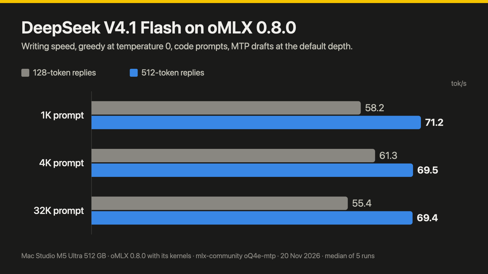

# M5 Ultra benchmarks

By Local LLM L-Plate. Follow [@LazyLocalLLM on X](https://x.com/LazyLocalLLM) for new benchmarks.

ELI5: I'm a learner with one Mac Studio M5 Ultra 512 GB, and I time local AI models on it. This page has the best speed I have measured for each model, then every finding behind it. Each finding is a folder with the report, the charts and every raw row, so you can check my arithmetic.

## Executive summary

ELI5: The page in seven lines. Every figure here is recomputed from the raw rows each time the page is built.

Updated 22 Nov 2026 18:41 SGT. Decode speed in tok/s, one user, one Mac.

- **Fastest on new code.** Qwen3.8 27B, 4-bit wrote 315.3 tok/s on TensorFold 1.3.3. Next are Qwen3.8 Flash Next, 4-bit at 209.5 and Qwen3.8 Flash Next, 6-bit at 201.3.
- **Fastest in daily use.** Qwen3.8 27B, 4-bit wrote 164.1 tok/s on TensorFold 1.3.3. Next are Qwen3.8 Flash Next, 4-bit at 130.9 and Qwen3.8 Flash Next, 6-bit at 114.5.
- **Two speeds per model.** Max is greedy at temperature 0 while the model writes new code. Median is the model's own sampler on mixed text, which is closer to daily use.
- **Prefill too.** The table also has how fast each model read a cold prompt, with the prompt size.
- **Coverage.** 20 models, 272 setups and 20 findings.
- **Newest finding.** Finding 20, 22 Nov 2026. [Inkling 2 Mini on the mlx-serve 26.11.4 pre-release, max and median speed](findings/20_inkling2_mini_mlxserve_pre).
- **Check it.** Every figure links to a folder with the rows it came from. If I have set an engine up wrong, [open an issue](https://github.com/LazyLocalLLM/m5-ultra-512-benchmarks/issues).

## Benchmark summary

ELI5: The fastest setup I found for each model, one line each. The same tables, with the notes on how to read them, are in [benchmark_summary](benchmark_summary).

- **Filter it.** Open [summary.csv](benchmark_summary/summary.csv). GitHub shows that file as a table with a search box, so you can type a model, an engine or a kind and see only those lines.
- **Unfold it.** Under "Every setup measured" below, click a model to see all of its setups.
- "not run yet" means I have not measured it. A line marked "older release" has been replaced by a newer run.
- **Find the model.** Each model name links to the weights I ran. The row with a draft head joined here links to the base weights, and [finding 9](findings/09_omlx_080_four_models) has the join steps.

### Best per model

The exact setup behind each figure is one click away, under "Every setup measured". "Reply text" says whether the timed replies were the model's answer or its reasoning. A reasoning speed is not an answer speed.

- **Prefill** is how fast the engine read a cold prompt, the prompt's tokens divided by the time to the first token. Each figure is the middle of every timed request on one engine release, at one prompt size and one kind of text. The cell names both. Reading speed changes with both, so compare two cells only where they match.
- **Prefill engine.** The cell shows the best line of the engine of the best max, on a current release. Another engine is shown, and named, only where it read more than 5% faster on the same text at the same size. Every engine's line at every size is in [prefill.csv](benchmark_summary/prefill.csv).

| Model | Max tok/s | Median tok/s | Prefill tok/s | Reply text | Engine | Finding |
|---|---|---|---|---|---|---|
| [DeepSeek V4.1 Flash 1017, Lossless](https://huggingface.co/ddalcu/DeepSeek-V4.1-Flash-1017-MLX-Serve-Lossless) | **95.3** | **57.9** | **3,187.2**, 4K mixed prompt | answer | mlx-serve 26.11.3 | [8](findings/08_dsv41_mlxserve_26113) |
| [GLM-5.3, 4-bit](https://huggingface.co/mlx-community/GLM-5.3-4bit) | **24.6** | **24.5** | **645.7**, 4K mixed prompt | reasoning | oMLX 0.8.0 with its kernels | [9](findings/09_omlx_080_four_models) |
| [GLM-5.3, 4-bit, draft head joined here](https://huggingface.co/mlx-community/GLM-5.3-4bit) | **23.4** | **25.0** | **646.9**, 4K mixed prompt | reasoning | oMLX 0.8.0 with its kernels | [9](findings/09_omlx_080_four_models) |
| [GLM-5.3 Flash, 6-bit](https://huggingface.co/Jundot/GLM-5.3-Flash-oQ6e-mtp) | not run yet | **57.8** | **1,858.8**, 4K mixed prompt | reasoning | oMLX 0.7.3 with its kernels | [2](findings/02_ten_models_4k_to_1m) |
| [GLM-5.3 Flash, oQ4e](https://huggingface.co/Jundot/GLM-5.3-Flash-oQ4e-mtp) | **84.8** | **70.9** | **2,182.4**, 4K mixed prompt, on oMLX 0.8.2 with its kernels | answer for max, reasoning for median | TensorFold 1.3.3 for max, oMLX 0.8.2 with its kernels for median | [19](findings/19_tensorfold_133_refresh), [16](findings/16_omlx_082_refresh) |
| [Inkling 2 Small](https://huggingface.co/mlx-community/Inkling-2-Small-oQ4e) | **52.7** | **41.3** | **1,259.3**, 4K code prompt | mostly reasoning | oMLX 0.8.2 with its kernels | [16](findings/16_omlx_082_refresh) |
| [Qwen3.8 27B, 4-bit](https://huggingface.co/TensorFold/Qwen3.8-27B-MLX-4bit) | **315.3** | **164.1** | **1,865.7**, 4K mixed prompt | answer | TensorFold 1.3.3 | [19](findings/19_tensorfold_133_refresh) |
| [Qwen3.8 27B, full](https://huggingface.co/mlx-community/Qwen3.8-27B-bf16) | **6.9** | **7.1** | **1,885.2**, 4K code prompt | answer | mlx-serve 26.11.3 | [8](findings/08_dsv41_mlxserve_26113) |
| [Qwen3.8 Flash Next, 4-bit](https://huggingface.co/TensorFold/Qwen3.8-Flash-Next-MLX-4bit-MTP) | **209.5** | **130.9** | **4,071.7**, 4K code prompt | answer | TensorFold 1.3.3 | [19](findings/19_tensorfold_133_refresh) |
| [Qwen3.8 Flash Next, 6-bit](https://huggingface.co/TensorFold/Qwen3.8-Flash-Next-MLX-6bit-MTP) | **201.3** | **114.5** | **3,841.0**, 4K mixed prompt | answer | TensorFold 1.3.3 | [19](findings/19_tensorfold_133_refresh) |
| [Qwen3.8 Flash Next, full](https://huggingface.co/Qwen/Qwen3.8-Flash-Next) | **54.3** | **34.6** | **3,224.1**, 4K code prompt | answer | oMLX 0.8.2 with its kernels | [16](findings/16_omlx_082_refresh) |
| [DeepSeek V4.1 Flash 1017, oQ4e-mtp](https://huggingface.co/mlx-community/DeepSeek-V4.1-Flash-1017-oQ4e-mtp) | **86.2** | **57.9** | **3,758.0**, 32K code prompt | answer | oMLX 0.8.0 with its kernels | [5](findings/05_dsv41_omlx_080_max_push), [3](findings/03_dsv41_omlx_080) |
| [DeepSeek V4.1 Flash 1017, maker's files](https://huggingface.co/deepseek-ai/DeepSeek-V4.1-Flash-1017) | **108.0** | **74.5** | **1,509.0**, 32K code prompt | answer | TensorFold 1.3.3 | [18](findings/18_dsv41_tensorfold_133) |
| [GLM-5.3 Flash, 4-bit](https://huggingface.co/TensorFold/GLM-5.3-Flash-MLX-4bit-MTP) | **102.8** | **84.2** | **2,234.3**, 4K mixed prompt, on oMLX 0.8.1 with its kernels | answer | TensorFold 1.3.3 | [19](findings/19_tensorfold_133_refresh), [15](findings/15_glm53_flash_two_builds) |
| [Hy4-flash, 4-bit](https://huggingface.co/TensorFold/Hy4-flash-MLX-4bit-MTP) | **73.3** | **54.5** | **1,649.9**, 1K code prompt | reasoning | TensorFold 1.3.3 | [19](findings/19_tensorfold_133_refresh) |
| [Hy4-flash, 8-bit](https://huggingface.co/TensorFold/Hy4-flash-MLX-8bit-MTP) | **55.2** | **44.8** | **1,235.8**, 1K code prompt | reasoning | TensorFold 1.3.3 | [19](findings/19_tensorfold_133_refresh) |
| [Hy4-flash, oQ4h](https://huggingface.co/Jundot/Hy4-flash-oQ4h-mtp) | **76.8** | **54.0** | **1,529.9**, 4K code prompt | answer for max, reasoning for median | oMLX 0.8.2 with its kernels for max, oMLX 0.8.1 with its kernels for median | [16](findings/16_omlx_082_refresh), [12](findings/12_hy4_flash_omlx_081) |
| [Inkling 2 Mini, oQ4e](https://huggingface.co/mlx-community/Inkling-2-Mini-oQ4e-mtp) | **88.5** | **66.2** | **2,791.3**, 4K code prompt | reasoning | oMLX 0.8.2 with its kernels | [16](findings/16_omlx_082_refresh) |
| [Inkling 2 Mini, oQ3e](https://huggingface.co/mlx-community/Inkling-2-Mini-oQ3e-mtp) | **105.1** | **67.1** | **2,850.7**, 4K code prompt | reasoning | oMLX 0.8.1 with its kernels | [14](findings/14_inkling2_mini_omlx_081) |
| [Inkling 2 Mini, 8-bit](https://huggingface.co/ddalcu/Inkling-2-Mini-MLX-8bit) | **146.8** | **104.5** | **4,932.1**, 4K code prompt | reasoning | mlx-serve 26.11.4-pre-release.1, main at 2fe9be83 | [20](findings/20_inkling2_mini_mlxserve_pre) |

### Ceiling on easy text

ELI5: Two tests hand the model text it can guess almost perfectly, copying the prompt and counting from 1. The speed is far above real work, so I keep these apart from Max.

| Model | Copy task tok/s | Counting toy tok/s | Engine | Finding |
|---|---|---|---|---|
| [DeepSeek V4.1 Flash 1017, Lossless](https://huggingface.co/ddalcu/DeepSeek-V4.1-Flash-1017-MLX-Serve-Lossless) | **167.0** | **121.5** | mlx-serve 26.11.3 | [8](findings/08_dsv41_mlxserve_26113) |
| [GLM-5.3 Flash, oQ4e](https://huggingface.co/Jundot/GLM-5.3-Flash-oQ4e-mtp) | **155.9** | **96.7** | TensorFold 1.3.3 | [19](findings/19_tensorfold_133_refresh) |
| [Qwen3.8 27B, 4-bit](https://huggingface.co/TensorFold/Qwen3.8-27B-MLX-4bit) | **810.8** | **449.7** | TensorFold 1.3.3 | [19](findings/19_tensorfold_133_refresh) |
| [Qwen3.8 Flash Next, 4-bit](https://huggingface.co/TensorFold/Qwen3.8-Flash-Next-MLX-4bit-MTP) | **322.3** | **369.5** | TensorFold 1.3.3 | [19](findings/19_tensorfold_133_refresh) |
| [Qwen3.8 Flash Next, 6-bit](https://huggingface.co/TensorFold/Qwen3.8-Flash-Next-MLX-6bit-MTP) | **260.1** | **296.2** | TensorFold 1.3.3 | [19](findings/19_tensorfold_133_refresh) |
| [Qwen3.8 Flash Next, full](https://huggingface.co/Qwen/Qwen3.8-Flash-Next) | **128.7** | **51.4** | oMLX 0.8.2 with its kernels | [16](findings/16_omlx_082_refresh) |
| [DeepSeek V4.1 Flash 1017, oQ4e-mtp](https://huggingface.co/mlx-community/DeepSeek-V4.1-Flash-1017-oQ4e-mtp) | **118.3** | **114.0** | oMLX 0.8.0 with its kernels | [5](findings/05_dsv41_omlx_080_max_push) |
| [DeepSeek V4.1 Flash 1017, maker's files](https://huggingface.co/deepseek-ai/DeepSeek-V4.1-Flash-1017) | **186.9** | **138.1** | TensorFold 1.3.3 | [18](findings/18_dsv41_tensorfold_133) |
| [GLM-5.3 Flash, 4-bit](https://huggingface.co/TensorFold/GLM-5.3-Flash-MLX-4bit-MTP) | **174.5** | **113.6** | TensorFold 1.3.3 | [19](findings/19_tensorfold_133_refresh) |
| [Hy4-flash, oQ4h](https://huggingface.co/Jundot/Hy4-flash-oQ4h-mtp) | **100.9** | **97.4** | oMLX 0.8.2 with its kernels | [16](findings/16_omlx_082_refresh) |

### Every setup measured

ELI5: Everything behind the tables above, including the setups that were not the fastest. Click a model to open its lines. The range is the slowest and fastest single run.

<details>
<summary><b>DeepSeek V4.1 Flash 1017, Lossless</b>, 14 setups</summary>

| Kind | Engine and setup | Sampler | Prompt | Reply tokens | Decode tok/s | Range | Runs | Date | Run | Finding |
|---|---|---|---|---|---|---|---|---|---|---|
| max | mlx-serve 26.11.3, warmup-full, defaults with --no-decode-attn-quant, second start, lm head 8-bit by the log, prompt lookup drafts on | greedy, temperature 0 | 4K code | 2,048 | 95.3 | 90.1 to 100.3 | 5 | 2026-11-20 | `4d0f49b9ac43` | [8](findings/08_dsv41_mlxserve_26113) |
| max | mlx-serve 26.11.3, warmup-full, defaults, first start, lm head 8-bit by the log, prompt lookup drafts on | greedy, temperature 0 | 4K code | 2,048 | 93.8 | 86.1 to 99.8 | 5 | 2026-11-20 | `ddee83910540` | [8](findings/08_dsv41_mlxserve_26113) |
| max | mlx-serve 26.11.3, warmup-full, defaults with --no-decode-attn-quant, second start, lm head 8-bit by the log, prompt lookup drafts on | greedy, temperature 0 | 1K code | 512 | 93.2 | 72.4 to 94.4 | 5 | 2026-11-20 | `4d0f49b9ac43` | [8](findings/08_dsv41_mlxserve_26113) |
| max | mlx-serve 26.11.3, warmup-full, lm head kept dense by the log (MLX_SERVE_DSV41_HEAD8=0), --no-decode-attn-quant, prompt lookup drafts on | greedy, temperature 0 | 4K code | 2,048 | 91.6 | 87.7 to 96.7 | 5 | 2026-11-21 | `18b1cdba2631` | [8](findings/08_dsv41_mlxserve_26113) |
| max | mlx-serve 26.11.3, warmup-full, defaults with --no-decode-attn-quant, second start, lm head 8-bit by the log, prompt lookup drafts on | greedy, temperature 0 | 1K code | 2,048 | 91.4 | 83.6 to 98.6 | 5 | 2026-11-20 | `4d0f49b9ac43` | [8](findings/08_dsv41_mlxserve_26113) |
| max | mlx-serve 26.11.3, warmup-full, lm head kept dense by the log (MLX_SERVE_DSV41_HEAD8=0), --no-decode-attn-quant, prompt lookup drafts on | greedy, temperature 0 | 1K code | 2,048 | 90.2 | 85.2 to 97.7 | 5 | 2026-11-21 | `18b1cdba2631` | [8](findings/08_dsv41_mlxserve_26113) |
| copy task | mlx-serve 26.11.3, warmup-full, defaults, first start, lm head 8-bit by the log, prompt lookup drafts on | greedy, temperature 0 | 1K code | 512 | 167.0 | 159.0 to 169.0 | 5 | 2026-11-20 | `ddee83910540` | [8](findings/08_dsv41_mlxserve_26113) |
| copy task | mlx-serve 26.11.3, warmup-full, defaults with --no-decode-attn-quant, second start, lm head 8-bit by the log, prompt lookup drafts on | greedy, temperature 0 | 1K code | 512 | 165.1 | 159.5 to 170.1 | 5 | 2026-11-20 | `4d0f49b9ac43` | [8](findings/08_dsv41_mlxserve_26113) |
| counting toy | mlx-serve 26.11.3, warmup-full, defaults, first start, lm head 8-bit by the log, prompt lookup drafts on | greedy, temperature 0 | 4K code | 512 | 121.5 | 121.3 to 121.9 | 5 | 2026-11-20 | `ddee83910540` | [8](findings/08_dsv41_mlxserve_26113) |
| counting toy | mlx-serve 26.11.3, warmup-full, defaults with --no-decode-attn-quant, second start, lm head 8-bit by the log, prompt lookup drafts on | greedy, temperature 0 | 1K code | 512 | 121.5 | 121.2 to 121.9 | 5 | 2026-11-20 | `4d0f49b9ac43` | [8](findings/08_dsv41_mlxserve_26113) |
| median | mlx-serve 26.11.2, defaults, prompt lookup drafts on, older release | temperature 1.0, top-p 1.0 | 4K mixed | 512 | 58.3 | 51.3 to 70.6 | 5 | 2026-11-17 | `a227c80d0e61` | [2](findings/02_ten_models_4k_to_1m) |
| median | mlx-serve 26.11.3, warmup-full, lm head kept dense by the log (MLX_SERVE_DSV41_HEAD8=0), --no-decode-attn-quant, prompt lookup drafts on | temperature 1.0, top-p 1.0 | 4K mixed | 512 | 57.9 | 49.7 to 59.2 | 5 | 2026-11-21 | `18b1cdba2631` | [8](findings/08_dsv41_mlxserve_26113) |
| median | mlx-serve 26.11.3, warmup-full, defaults, first start, lm head 8-bit by the log, prompt lookup drafts on | temperature 1.0, top-p 1.0 | 4K mixed | 512 | 57.5 | 50.9 to 65.6 | 5 | 2026-11-20 | `ddee83910540` | [8](findings/08_dsv41_mlxserve_26113) |
| median | mlx-serve 26.11.3, warmup-full, defaults with --no-decode-attn-quant, second start, lm head 8-bit by the log, prompt lookup drafts on | temperature 1.0, top-p 1.0 | 4K mixed | 512 | 56.4 | 52.6 to 61.4 | 5 | 2026-11-20 | `4d0f49b9ac43` | [8](findings/08_dsv41_mlxserve_26113) |

</details>

<details>
<summary><b>GLM-5.3, 4-bit</b>, 3 setups</summary>

| Kind | Engine and setup | Sampler | Prompt | Reply tokens | Decode tok/s | Range | Runs | Date | Run | Finding |
|---|---|---|---|---|---|---|---|---|---|---|
| max | oMLX 0.8.0 with its kernels, MTP off, reply is reasoning text, 512-token replies | greedy, temperature 0 | 4K code | 512 | 24.6 | 24.5 to 24.7 | 5 | 2026-11-20 | `2641f174f97a` | [9](findings/09_omlx_080_four_models) |
| median | oMLX 0.8.0 with its kernels, MTP off, reply is reasoning text | temperature 1.0, top-p 0.95 | 4K mixed | 512 | 24.5 | 24.5 to 24.5 | 5 | 2026-11-20 | `2641f174f97a` | [9](findings/09_omlx_080_four_models) |
| median | oMLX 0.7.3 with its kernels, MTP off, older release | temperature 1.0, top-p 0.95 | 4K mixed | 512 | 24.3 | 24.2 to 24.3 | 5 | 2026-11-17 | `626f0c1b4ad9` | [2](findings/02_ten_models_4k_to_1m) |

</details>

<details>
<summary><b>GLM-5.3, 4-bit, draft head joined here</b>, 2 setups</summary>

| Kind | Engine and setup | Sampler | Prompt | Reply tokens | Decode tok/s | Range | Runs | Date | Run | Finding |
|---|---|---|---|---|---|---|---|---|---|---|
| max | oMLX 0.8.0 with its kernels, MTP on, default depth, reply is reasoning text, 512-token replies | greedy, temperature 0 | 4K code | 512 | 23.4 | 22.2 to 24.4 | 5 | 2026-11-21 | `1cdf9099760b` | [9](findings/09_omlx_080_four_models) |
| median | oMLX 0.8.0 with its kernels, MTP on, default depth, reply is reasoning text | temperature 1.0, top-p 0.95 | 4K mixed | 512 | 25.0 | 23.0 to 29.0 | 5 | 2026-11-21 | `1cdf9099760b` | [9](findings/09_omlx_080_four_models) |

</details>

<details>
<summary><b>GLM-5.3 Flash, 6-bit</b>, 1 setup</summary>

| Kind | Engine and setup | Sampler | Prompt | Reply tokens | Decode tok/s | Range | Runs | Date | Run | Finding |
|---|---|---|---|---|---|---|---|---|---|---|
| median | oMLX 0.7.3 with its kernels, MTP on | temperature 1.0, top-p 0.95 | 4K mixed | 512 | 57.8 | 55.6 to 69.0 | 5 | 2026-11-17 | `2b64d54e7e5c` | [2](findings/02_ten_models_4k_to_1m) |

</details>

<details>
<summary><b>GLM-5.3 Flash, oQ4e</b>, 30 setups</summary>

| Kind | Engine and setup | Sampler | Prompt | Reply tokens | Decode tok/s | Range | Runs | Date | Run | Finding |
|---|---|---|---|---|---|---|---|---|---|---|
| max | TensorFold 1.3.3, MTP drafts, thinking off, a build made for another engine | greedy, temperature 0 | 4K code | 2,048 | 84.8 | 80.4 to 85.9 | 5 | 2026-11-22 | `0d05d0d3d24c` | [19](findings/19_tensorfold_133_refresh) |
| max | TensorFold 1.3.2, MTP drafts, thinking off, a build made for another engine, older release | greedy, temperature 0 | 4K code | 2,048 | 82.9 | 77.1 to 89.2 | 5 | 2026-11-21 | `787aea383796` | [15](findings/15_glm53_flash_two_builds) |
| max | TensorFold 1.3.3, MTP drafts, thinking off, a build made for another engine | greedy, temperature 0 | 1K code | 2,048 | 81.2 | 76.6 to 83.6 | 5 | 2026-11-22 | `0d05d0d3d24c` | [19](findings/19_tensorfold_133_refresh) |
| max | TensorFold 1.3.2, MTP drafts, thinking off, a build made for another engine, older release | greedy, temperature 0 | 1K code | 2,048 | 80.7 | 74.5 to 84.5 | 5 | 2026-11-21 | `787aea383796` | [15](findings/15_glm53_flash_two_builds) |
| max | oMLX 0.8.0 with its kernels, MTP on, default depth, reply is reasoning text, older release | greedy, temperature 0 | 1K code | 2,048 | 80.2 | 68.4 to 87.6 | 5 | 2026-11-21 | `8f12a00bcc4f` | [9](findings/09_omlx_080_four_models) |
| max | oMLX 0.8.1 with its kernels, MTP on, default depth, reply is reasoning text, older release | greedy, temperature 0 | 1K code | 2,048 | 78.7 | 73.7 to 86.2 | 5 | 2026-11-21 | `421e19a82f36` | [15](findings/15_glm53_flash_two_builds) |
| max | oMLX 0.8.2 with its kernels, MTP on, default depth, reply is reasoning text | greedy, temperature 0 | 1K code | 2,048 | 76.0 | 72.9 to 78.8 | 5 | 2026-11-21 | `34ae658e42ba` | [16](findings/16_omlx_082_refresh) |
| max | oMLX 0.8.0 with its kernels, MTP on, default depth, reply is reasoning text, older release | greedy, temperature 0 | 4K code | 2,048 | 74.7 | 68.9 to 81.3 | 5 | 2026-11-21 | `8f12a00bcc4f` | [9](findings/09_omlx_080_four_models) |
| max | oMLX 0.8.2 with its kernels, MTP on, default depth, reply is reasoning text | greedy, temperature 0 | 4K code | 2,048 | 73.9 | 69.3 to 81.1 | 5 | 2026-11-21 | `34ae658e42ba` | [16](findings/16_omlx_082_refresh) |
| max | oMLX 0.8.1 with its kernels, MTP on, default depth, reply is reasoning text, older release | greedy, temperature 0 | 4K code | 2,048 | 73.4 | 66.6 to 77.3 | 5 | 2026-11-21 | `421e19a82f36` | [15](findings/15_glm53_flash_two_builds) |
| max | oMLX 0.8.0 with its kernels, MTP on, fixed depth 4, reply is reasoning text | greedy, temperature 0 | 1K code | 2,048 | 71.7 | 66.4 to 80.9 | 5 | 2026-11-21 | `605e0068ff28` | [9](findings/09_omlx_080_four_models) |
| max | oMLX 0.8.0 with its kernels, MTP on, fixed depth 4, reply is reasoning text | greedy, temperature 0 | 4K code | 2,048 | 68.9 | 62.1 to 74.9 | 5 | 2026-11-21 | `605e0068ff28` | [9](findings/09_omlx_080_four_models) |
| max | oMLX 0.8.1 with its kernels, MTP off, reply is reasoning text | greedy, temperature 0 | 1K code | 512 | 51.7 | 51.0 to 51.8 | 5 | 2026-11-21 | `9ab8740acc17` | [15](findings/15_glm53_flash_two_builds) |
| max | TensorFold 1.3.2, no drafts, thinking off, a build made for another engine | greedy, temperature 0 | 1K code | 512 | 50.9 | 50.5 to 51.0 | 5 | 2026-11-21 | `06d0073eb3e8` | [15](findings/15_glm53_flash_two_builds) |
| max | TensorFold 1.3.2, no drafts, thinking off, a build made for another engine | greedy, temperature 0 | 4K code | 512 | 50.9 | 50.9 to 50.9 | 5 | 2026-11-21 | `06d0073eb3e8` | [15](findings/15_glm53_flash_two_builds) |
| max | oMLX 0.8.1 with its kernels, MTP off, reply is reasoning text | greedy, temperature 0 | 4K code | 512 | 49.3 | 49.3 to 49.4 | 5 | 2026-11-21 | `9ab8740acc17` | [15](findings/15_glm53_flash_two_builds) |
| copy task | TensorFold 1.3.2, MTP drafts, thinking off, a build made for another engine, older release | greedy, temperature 0 | 1K code | 512 | 156.8 | 94.3 to 160.8 | 5 | 2026-11-21 | `787aea383796` | [15](findings/15_glm53_flash_two_builds) |
| copy task | TensorFold 1.3.3, MTP drafts, thinking off, a build made for another engine | greedy, temperature 0 | 1K code | 512 | 155.9 | 124.3 to 161.1 | 5 | 2026-11-22 | `0d05d0d3d24c` | [19](findings/19_tensorfold_133_refresh) |
| copy task | TensorFold 1.3.3, MTP drafts, thinking off, a build made for another engine | greedy, temperature 0 | 4K code | 512 | 148.8 | 98.6 to 157.5 | 5 | 2026-11-22 | `0d05d0d3d24c` | [19](findings/19_tensorfold_133_refresh) |
| copy task | TensorFold 1.3.2, MTP drafts, thinking off, a build made for another engine, older release | greedy, temperature 0 | 4K code | 512 | 146.5 | 105.9 to 157.6 | 5 | 2026-11-21 | `787aea383796` | [15](findings/15_glm53_flash_two_builds) |
| counting toy | TensorFold 1.3.3, MTP drafts, thinking off, a build made for another engine | greedy, temperature 0 | 4K code | 512 | 96.7 | 86.8 to 97.9 | 5 | 2026-11-22 | `0d05d0d3d24c` | [19](findings/19_tensorfold_133_refresh) |
| counting toy | TensorFold 1.3.2, MTP drafts, thinking off, a build made for another engine, older release | greedy, temperature 0 | 4K code | 512 | 96.3 | 86.7 to 99.5 | 5 | 2026-11-21 | `787aea383796` | [15](findings/15_glm53_flash_two_builds) |
| counting toy | TensorFold 1.3.2, MTP drafts, thinking off, a build made for another engine, older release | greedy, temperature 0 | 1K code | 512 | 95.2 | 83.1 to 96.5 | 5 | 2026-11-21 | `787aea383796` | [15](findings/15_glm53_flash_two_builds) |
| counting toy | TensorFold 1.3.3, MTP drafts, thinking off, a build made for another engine | greedy, temperature 0 | 1K code | 512 | 94.4 | 87.7 to 95.9 | 5 | 2026-11-22 | `0d05d0d3d24c` | [19](findings/19_tensorfold_133_refresh) |
| median | oMLX 0.8.2 with its kernels, MTP on, default depth, reply is reasoning text | temperature 1.0, top-p 0.95 | 4K mixed | 512 | 70.9 | 64.9 to 73.7 | 5 | 2026-11-21 | `34ae658e42ba` | [16](findings/16_omlx_082_refresh) |
| median | oMLX 0.8.1 with its kernels, MTP on, default depth, reply is reasoning text, older release | temperature 1.0, top-p 0.95 | 4K mixed | 512 | 69.7 | 66.9 to 73.3 | 5 | 2026-11-21 | `421e19a82f36` | [15](findings/15_glm53_flash_two_builds) |
| median | oMLX 0.7.3 with its kernels, MTP on, older release | temperature 1.0, top-p 0.95 | 4K mixed | 512 | 68.8 | 61.0 to 76.1 | 5 | 2026-11-17 | `8453ec3a372d` | [2](findings/02_ten_models_4k_to_1m) |
| median | oMLX 0.8.0 with its kernels, MTP on, default depth, reply is reasoning text, older release | temperature 1.0, top-p 0.95 | 4K mixed | 512 | 67.8 | 63.2 to 72.2 | 5 | 2026-11-21 | `8f12a00bcc4f` | [9](findings/09_omlx_080_four_models) |
| median | TensorFold 1.3.2, MTP drafts, thinking off, a build made for another engine, older release | temperature 1.0, top-p 0.95 | 4K mixed | 512 | 67.5 | 64.3 to 70.0 | 5 | 2026-11-21 | `787aea383796` | [15](findings/15_glm53_flash_two_builds) |
| median | TensorFold 1.3.3, MTP drafts, thinking off, a build made for another engine | temperature 1.0, top-p 0.95 | 4K mixed | 512 | 64.9 | 64.2 to 69.7 | 5 | 2026-11-22 | `0d05d0d3d24c` | [19](findings/19_tensorfold_133_refresh) |

</details>

<details>
<summary><b>Inkling 2 Small</b>, 7 setups</summary>

| Kind | Engine and setup | Sampler | Prompt | Reply tokens | Decode tok/s | Range | Runs | Date | Run | Finding |
|---|---|---|---|---|---|---|---|---|---|---|
| max | oMLX 0.8.2 with its kernels, DSpark draft on, default depth, reply is mostly reasoning text | greedy, temperature 0 | 1K code | 2,048 | 52.7 | 48.8 to 53.5 | 5 | 2026-11-21 | `fd37c30fd993` | [16](findings/16_omlx_082_refresh) |
| max | oMLX 0.8.0 with its kernels, DSpark draft on, default depth, reply is mostly reasoning text, older release | greedy, temperature 0 | 1K code | 2,048 | 51.6 | 46.9 to 51.9 | 5 | 2026-11-21 | `818c28dbb625` | [9](findings/09_omlx_080_four_models) |
| max | oMLX 0.8.0 with its kernels, DSpark draft on, default depth, reply is mostly reasoning text, older release | greedy, temperature 0 | 4K code | 2,048 | 48.6 | 46.0 to 58.7 | 5 | 2026-11-21 | `818c28dbb625` | [9](findings/09_omlx_080_four_models) |
| max | oMLX 0.8.2 with its kernels, DSpark draft on, default depth, reply is mostly reasoning text | greedy, temperature 0 | 4K code | 2,048 | 47.6 | 43.6 to 53.2 | 5 | 2026-11-21 | `fd37c30fd993` | [16](findings/16_omlx_082_refresh) |
| median | oMLX 0.8.0 with its kernels, DSpark draft on, default depth, reply is mostly reasoning text, older release | temperature 1.0, top-p 1.0 | 4K mixed | 512 | 42.2 | 39.7 to 46.0 | 5 | 2026-11-21 | `818c28dbb625` | [9](findings/09_omlx_080_four_models) |
| median | oMLX 0.8.2 with its kernels, DSpark draft on, default depth, reply is mostly reasoning text | temperature 1.0, top-p 1.0 | 4K mixed | 512 | 41.3 | 39.0 to 42.4 | 5 | 2026-11-21 | `fd37c30fd993` | [16](findings/16_omlx_082_refresh) |
| median | oMLX main 624cff0e with its kernels, DSpark draft on, older release | temperature 1.0, top-p 1.0 | 4K mixed | 512 | 41.3 | 38.5 to 42.9 | 5 | 2026-11-17 | `5c4d781c0e3d` | [2](findings/02_ten_models_4k_to_1m) |

</details>

<details>
<summary><b>Qwen3.8 27B, 4-bit</b>, 24 setups</summary>

| Kind | Engine and setup | Sampler | Prompt | Reply tokens | Decode tok/s | Range | Runs | Date | Run | Finding |
|---|---|---|---|---|---|---|---|---|---|---|
| max | TensorFold 1.3.0, DFlash2 drafter (z-lab), defaults, older release | greedy, temperature 0 | 1K code | 2,048 | 331.3 | 245.7 to 342.1 | 5 | 2026-11-20 | `f2d856e22771` | [7](findings/07_qwen38_tensorfold_130) |
| max | TensorFold 1.3.2, DFlash2 drafter (z-lab), defaults, second start, older release | greedy, temperature 0 | 1K code | 2,048 | 328.9 | 301.3 to 349.7 | 5 | 2026-11-21 | `ab1caacd2961` | [11](findings/11_qwen38_tensorfold_132) |
| max | TensorFold 1.3.3, DFlash2 drafter (z-lab), defaults | greedy, temperature 0 | 1K code | 2,048 | 315.3 | 286.3 to 366.3 | 5 | 2026-11-22 | `6a8e3b10559e` | [19](findings/19_tensorfold_133_refresh) |
| max | TensorFold 1.3.3, DFlash2 drafter (z-lab), defaults | greedy, temperature 0 | 1K code | 512 | 264.7 | 225.1 to 300.3 | 5 | 2026-11-22 | `6a8e3b10559e` | [19](findings/19_tensorfold_133_refresh) |
| max | TensorFold 1.3.0, DFlash2 drafter (z-lab), defaults, older release | greedy, temperature 0 | 4K code | 2,048 | 250.8 | 217.1 to 332.2 | 5 | 2026-11-20 | `f2d856e22771` | [7](findings/07_qwen38_tensorfold_130) |
| max | TensorFold 1.3.3, DFlash2 drafter (z-lab), defaults | greedy, temperature 0 | 4K code | 2,048 | 247.7 | 203.6 to 302.4 | 5 | 2026-11-22 | `6a8e3b10559e` | [19](findings/19_tensorfold_133_refresh) |
| max | TensorFold 1.3.2, DFlash2 drafter (z-lab), defaults, second start, older release | greedy, temperature 0 | 1K code | 512 | 243.6 | 225.6 to 274.1 | 5 | 2026-11-21 | `ab1caacd2961` | [11](findings/11_qwen38_tensorfold_132) |
| max | TensorFold 1.3.2, DFlash2 drafter (z-lab), defaults, second start, older release | greedy, temperature 0 | 4K code | 2,048 | 241.6 | 223.4 to 298.6 | 5 | 2026-11-21 | `ab1caacd2961` | [11](findings/11_qwen38_tensorfold_132) |
| max | TensorFold 1.3.0, DFlash2 drafter (z-lab), defaults, older release | greedy, temperature 0 | 1K code | 512 | 227.0 | 222.2 to 278.6 | 5 | 2026-11-20 | `f2d856e22771` | [7](findings/07_qwen38_tensorfold_130) |
| max | mlx-lm 0.32.2, defaults, the baseline, 20 Nov run | greedy, temperature 0 | 1K code | 2,048 | 45.1 | 45.0 to 45.2 | 5 | 2026-11-20 | `0c5446c7acc1` | [7](findings/07_qwen38_tensorfold_130) |
| copy task | TensorFold 1.3.0, DFlash2 drafter (z-lab), defaults, long copy block, older release | greedy, temperature 0 | 4K code | 2,048 | 824.0 | 734.9 to 832.0 | 5 | 2026-11-20 | `44a8ff4a173a` | [7](findings/07_qwen38_tensorfold_130) |
| copy task | TensorFold 1.3.2, DFlash2 drafter (z-lab), defaults, second start, older release | greedy, temperature 0 | 4K code | 2,048 | 814.3 | 705.9 to 825.8 | 5 | 2026-11-21 | `ab1caacd2961` | [11](findings/11_qwen38_tensorfold_132) |
| copy task | TensorFold 1.3.3, DFlash2 drafter (z-lab), defaults | greedy, temperature 0 | 4K code | 2,048 | 810.8 | 702.0 to 839.0 | 5 | 2026-11-22 | `6a8e3b10559e` | [19](findings/19_tensorfold_133_refresh) |
| counting toy | TensorFold 1.3.0, DFlash2 drafter (z-lab), defaults, older release | greedy, temperature 0 | 1K code | 512 | 450.8 | 169.0 to 454.8 | 5 | 2026-11-20 | `f2d856e22771` | [7](findings/07_qwen38_tensorfold_130) |
| counting toy | TensorFold 1.3.3, DFlash2 drafter (z-lab), defaults | greedy, temperature 0 | 1K code | 512 | 449.7 | 146.9 to 453.7 | 5 | 2026-11-22 | `6a8e3b10559e` | [19](findings/19_tensorfold_133_refresh) |
| counting toy | TensorFold 1.3.2, DFlash2 drafter (z-lab), defaults, second start, older release | greedy, temperature 0 | 1K code | 512 | 448.9 | 163.8 to 453.2 | 5 | 2026-11-21 | `ab1caacd2961` | [11](findings/11_qwen38_tensorfold_132) |
| median | TensorFold 1.3.3, DFlash2 drafter (z-lab), defaults, sixth start | temperature 0.7, top-p 0.8, top-k 20 | 4K mixed | 512 | 164.1 | 133.1 to 184.0 | 5 | 2026-11-22 | `e2420150405f` | [19](findings/19_tensorfold_133_refresh) |
| median | TensorFold 1.3.2, DFlash2 drafter (z-lab), defaults, second start, older release | temperature 0.7, top-p 0.8, top-k 20 | 4K mixed | 512 | 161.3 | 142.5 to 178.4 | 5 | 2026-11-21 | `ab1caacd2961` | [11](findings/11_qwen38_tensorfold_132) |
| median | TensorFold 1.2.8, DFlash2 drafter (z-lab), older release | temperature 0.7, top-p 0.8, top-k 20 | 4K mixed | 512 | 154.2 | 136.9 to 219.4 | 5 | 2026-11-17 | `a798cea8b67e` | [2](findings/02_ten_models_4k_to_1m) |
| median | TensorFold 1.3.0, DFlash2 drafter (z-lab), defaults, older release | temperature 0.7, top-p 0.8, top-k 20 | 4K mixed | 512 | 148.2 | 128.2 to 178.6 | 5 | 2026-11-20 | `f2d856e22771` | [7](findings/07_qwen38_tensorfold_130) |
| median | TensorFold 1.2.7, DFlash2 drafter (z-lab), older release | temperature 0.7, top-p 0.8, top-k 20 | 1K mixed | 512 | 145.7 | 138.4 to 182.9 | 5 | 2026-11-13 | `f6775745e273` | [1](findings/01_tensorfold_qwen38-27b_4bit) |
| median | TensorFold 1.2.7, no draft model, older release | temperature 0.7, top-p 0.8, top-k 20 | 1K mixed | 512 | 48.7 | 48.6 to 48.7 | 5 | 2026-11-13 | `eabffb505d52` | [1](findings/01_tensorfold_qwen38-27b_4bit) |
| median | mlx-lm 0.32.2, defaults, the baseline | temperature 0.7, top-p 0.8, top-k 20 | 1K mixed | 512 | 44.5 | 44.4 to 44.5 | 5 | 2026-11-13 | `3ad3a150c4d0` | [1](findings/01_tensorfold_qwen38-27b_4bit) |
| median | mlx-lm 0.32.2, defaults, the baseline, 20 Nov run | temperature 0.7, top-p 0.8, top-k 20 | 4K mixed | 512 | 43.6 | 43.6 to 43.7 | 5 | 2026-11-20 | `0c5446c7acc1` | [7](findings/07_qwen38_tensorfold_130) |

</details>

<details>
<summary><b>Qwen3.8 27B, full</b>, 4 setups</summary>

| Kind | Engine and setup | Sampler | Prompt | Reply tokens | Decode tok/s | Range | Runs | Date | Run | Finding |
|---|---|---|---|---|---|---|---|---|---|---|
| max | mlx-serve 26.11.3, warmup-full, defaults (lossy decode copies engaged, by the log), prompt lookup drafts on | greedy, temperature 0 | 4K code | 512 | 6.9 | 6.5 to 7.4 | 5 | 2026-11-20 | `8594b4fe926a` | [8](findings/08_dsv41_mlxserve_26113) |
| median | mlx-serve 26.11.2, defaults, prompt lookup drafts on, older release | temperature 0.7, top-p 0.8, top-k 20 | 4K mixed | 512 | 8.8 | 8.3 to 9.8 | 5 | 2026-11-17 | `a30a665ca3ee` | [2](findings/02_ten_models_4k_to_1m) |
| median | mlx-serve 26.11.3, defaults without --warmup-full (lossy decode copies engaged, by the log), prompt lookup drafts on | temperature 0.7, top-p 0.8, top-k 20 | 4K mixed | 512 | 7.1 | 6.6 to 7.6 | 5 | 2026-11-21 | `5619fdacb103` | [8](findings/08_dsv41_mlxserve_26113) |
| median | mlx-serve 26.11.3, warmup-full, defaults (lossy decode copies engaged, by the log), prompt lookup drafts on | temperature 0.7, top-p 0.8, top-k 20 | 4K mixed | 512 | 6.8 | 6.8 to 6.9 | 5 | 2026-11-20 | `8594b4fe926a` | [8](findings/08_dsv41_mlxserve_26113) |

</details>

<details>
<summary><b>Qwen3.8 Flash Next, 4-bit</b>, 20 setups</summary>

| Kind | Engine and setup | Sampler | Prompt | Reply tokens | Decode tok/s | Range | Runs | Date | Run | Finding |
|---|---|---|---|---|---|---|---|---|---|---|
| max | TensorFold 1.3.3, MTP on, recipe line, defaults | greedy, temperature 0 | 4K code | 2,048 | 209.5 | 174.4 to 229.6 | 5 | 2026-11-22 | `58be1ddd40c3` | [19](findings/19_tensorfold_133_refresh) |
| max | TensorFold 1.3.3, MTP on, recipe line, defaults | greedy, temperature 0 | 1K code | 2,048 | 206.8 | 192.0 to 263.1 | 5 | 2026-11-22 | `58be1ddd40c3` | [19](findings/19_tensorfold_133_refresh) |
| max | TensorFold 1.3.2, MTP on, recipe line, defaults, second start, older release | greedy, temperature 0 | 1K code | 2,048 | 206.8 | 191.7 to 257.5 | 5 | 2026-11-21 | `70284626631f` | [11](findings/11_qwen38_tensorfold_132) |
| max | TensorFold 1.3.0, MTP on, recipe line, defaults, older release | greedy, temperature 0 | 1K code | 2,048 | 204.4 | 176.6 to 247.5 | 5 | 2026-11-20 | `7bf80be3a997` | [7](findings/07_qwen38_tensorfold_130) |
| max | TensorFold 1.3.0, MTP on, recipe line, defaults, older release | greedy, temperature 0 | 4K code | 512 | 194.4 | 169.7 to 217.0 | 5 | 2026-11-20 | `7bf80be3a997` | [7](findings/07_qwen38_tensorfold_130) |
| max | TensorFold 1.3.3, MTP on, recipe line, defaults | greedy, temperature 0 | 4K code | 512 | 188.9 | 172.9 to 200.7 | 5 | 2026-11-22 | `58be1ddd40c3` | [19](findings/19_tensorfold_133_refresh) |
| max | TensorFold 1.3.2, MTP on, recipe line, defaults, second start, older release | greedy, temperature 0 | 4K code | 512 | 179.1 | 176.1 to 183.6 | 5 | 2026-11-21 | `70284626631f` | [11](findings/11_qwen38_tensorfold_132) |
| copy task | TensorFold 1.3.2, MTP on, recipe line, defaults, second start, older release | greedy, temperature 0 | 1K code | 512 | 351.6 | 262.9 to 371.7 | 5 | 2026-11-21 | `70284626631f` | [11](findings/11_qwen38_tensorfold_132) |
| copy task | TensorFold 1.3.3, MTP on, recipe line, defaults | greedy, temperature 0 | 1K code | 512 | 322.3 | 263.3 to 355.7 | 5 | 2026-11-22 | `58be1ddd40c3` | [19](findings/19_tensorfold_133_refresh) |
| copy task | TensorFold 1.3.2, MTP on, recipe line, defaults, second start, older release | greedy, temperature 0 | 4K code | 2,048 | 312.3 | 277.4 to 344.1 | 5 | 2026-11-21 | `70284626631f` | [11](findings/11_qwen38_tensorfold_132) |
| copy task | TensorFold 1.3.3, MTP on, recipe line, defaults | greedy, temperature 0 | 4K code | 2,048 | 312.1 | 280.8 to 344.7 | 5 | 2026-11-22 | `58be1ddd40c3` | [19](findings/19_tensorfold_133_refresh) |
| copy task | TensorFold 1.3.0, MTP on, recipe line, defaults, older release | greedy, temperature 0 | 1K code | 512 | 298.1 | 247.3 to 330.5 | 5 | 2026-11-20 | `7bf80be3a997` | [7](findings/07_qwen38_tensorfold_130) |
| copy task | TensorFold 1.3.0, MTP on, recipe line, defaults, long copy block, older release | greedy, temperature 0 | 4K code | 2,048 | 292.2 | 261.8 to 320.0 | 5 | 2026-11-20 | `37a4c93bd874` | [7](findings/07_qwen38_tensorfold_130) |
| counting toy | TensorFold 1.3.3, MTP on, recipe line, defaults | greedy, temperature 0 | 1K code | 512 | 369.5 | 360.5 to 370.2 | 5 | 2026-11-22 | `58be1ddd40c3` | [19](findings/19_tensorfold_133_refresh) |
| counting toy | TensorFold 1.3.2, MTP on, recipe line, defaults, second start, older release | greedy, temperature 0 | 1K code | 512 | 369.3 | 359.4 to 370.0 | 5 | 2026-11-21 | `70284626631f` | [11](findings/11_qwen38_tensorfold_132) |
| counting toy | TensorFold 1.3.0, MTP on, recipe line, defaults, older release | greedy, temperature 0 | 1K code | 512 | 344.7 | 336.2 to 344.9 | 5 | 2026-11-20 | `7bf80be3a997` | [7](findings/07_qwen38_tensorfold_130) |
| median | TensorFold 1.3.3, MTP on, recipe line, defaults | temperature 0.7, top-p 0.8, top-k 20 | 4K mixed | 512 | 130.9 | 120.7 to 135.4 | 5 | 2026-11-22 | `58be1ddd40c3` | [19](findings/19_tensorfold_133_refresh) |
| median | TensorFold 1.3.2, MTP on, recipe line, defaults, second start, older release | temperature 0.7, top-p 0.8, top-k 20 | 4K mixed | 512 | 129.7 | 123.5 to 134.1 | 5 | 2026-11-21 | `70284626631f` | [11](findings/11_qwen38_tensorfold_132) |
| median | TensorFold 1.2.8, MTP on, recipe line, older release | temperature 0.7, top-p 0.8, top-k 20 | 4K mixed | 512 | 129.2 | 123.9 to 139.2 | 5 | 2026-11-17 | `72fae37b87f0` | [2](findings/02_ten_models_4k_to_1m) |
| median | TensorFold 1.3.0, MTP on, recipe line, defaults, older release | temperature 0.7, top-p 0.8, top-k 20 | 4K mixed | 512 | 126.7 | 115.9 to 131.9 | 5 | 2026-11-20 | `7bf80be3a997` | [7](findings/07_qwen38_tensorfold_130) |

</details>

<details>
<summary><b>Qwen3.8 Flash Next, 6-bit</b>, 20 setups</summary>

| Kind | Engine and setup | Sampler | Prompt | Reply tokens | Decode tok/s | Range | Runs | Date | Run | Finding |
|---|---|---|---|---|---|---|---|---|---|---|
| max | TensorFold 1.3.3, MTP on, recipe line, defaults | greedy, temperature 0 | 1K code | 2,048 | 201.3 | 182.7 to 208.6 | 5 | 2026-11-22 | `e4b66d27e9cb` | [19](findings/19_tensorfold_133_refresh) |
| max | TensorFold 1.3.2, MTP on, recipe line, defaults, second start, older release | greedy, temperature 0 | 1K code | 2,048 | 200.1 | 188.9 to 219.8 | 5 | 2026-11-21 | `51735d12713b` | [11](findings/11_qwen38_tensorfold_132) |
| max | TensorFold 1.3.3, MTP on, recipe line, defaults | greedy, temperature 0 | 4K code | 2,048 | 197.3 | 176.7 to 217.8 | 5 | 2026-11-22 | `e4b66d27e9cb` | [19](findings/19_tensorfold_133_refresh) |
| max | TensorFold 1.3.2, MTP on, recipe line, defaults, second start, older release | greedy, temperature 0 | 1K code | 512 | 195.1 | 186.9 to 201.4 | 5 | 2026-11-21 | `51735d12713b` | [11](findings/11_qwen38_tensorfold_132) |
| max | TensorFold 1.3.0, MTP on, recipe line, defaults, older release | greedy, temperature 0 | 1K code | 2,048 | 193.0 | 178.5 to 212.3 | 5 | 2026-11-21 | `2bc45b1272e8` | [7](findings/07_qwen38_tensorfold_130) |
| max | TensorFold 1.3.0, MTP on, recipe line, defaults, older release | greedy, temperature 0 | 1K code | 512 | 188.2 | 177.9 to 192.6 | 5 | 2026-11-21 | `2bc45b1272e8` | [7](findings/07_qwen38_tensorfold_130) |
| max | TensorFold 1.3.3, MTP on, recipe line, defaults | greedy, temperature 0 | 1K code | 512 | 181.5 | 158.7 to 192.5 | 5 | 2026-11-22 | `e4b66d27e9cb` | [19](findings/19_tensorfold_133_refresh) |
| copy task | TensorFold 1.3.3, MTP on, recipe line, defaults | greedy, temperature 0 | 1K code | 512 | 260.1 | 213.0 to 283.0 | 5 | 2026-11-22 | `e4b66d27e9cb` | [19](findings/19_tensorfold_133_refresh) |
| copy task | TensorFold 1.3.2, MTP on, recipe line, defaults, second start, older release | greedy, temperature 0 | 1K code | 512 | 260.0 | 213.3 to 283.3 | 5 | 2026-11-21 | `51735d12713b` | [11](findings/11_qwen38_tensorfold_132) |
| copy task | TensorFold 1.3.0, MTP on, recipe line, defaults, older release | greedy, temperature 0 | 1K code | 512 | 254.4 | 208.5 to 276.9 | 5 | 2026-11-21 | `2bc45b1272e8` | [7](findings/07_qwen38_tensorfold_130) |
| copy task | TensorFold 1.3.2, MTP on, recipe line, defaults, second start, older release | greedy, temperature 0 | 4K code | 2,048 | 253.6 | 233.1 to 276.6 | 5 | 2026-11-21 | `51735d12713b` | [11](findings/11_qwen38_tensorfold_132) |
| copy task | TensorFold 1.3.3, MTP on, recipe line, defaults | greedy, temperature 0 | 4K code | 2,048 | 252.5 | 233.0 to 275.1 | 5 | 2026-11-22 | `e4b66d27e9cb` | [19](findings/19_tensorfold_133_refresh) |
| copy task | TensorFold 1.3.0, MTP on, recipe line, defaults, older release | greedy, temperature 0 | 4K code | 2,048 | 247.7 | 223.1 to 268.9 | 5 | 2026-11-21 | `2bc45b1272e8` | [7](findings/07_qwen38_tensorfold_130) |
| counting toy | TensorFold 1.3.2, MTP on, recipe line, defaults, second start, older release | greedy, temperature 0 | 1K code | 512 | 296.4 | 290.2 to 297.1 | 5 | 2026-11-21 | `51735d12713b` | [11](findings/11_qwen38_tensorfold_132) |
| counting toy | TensorFold 1.3.3, MTP on, recipe line, defaults | greedy, temperature 0 | 1K code | 512 | 296.2 | 290.2 to 297.4 | 5 | 2026-11-22 | `e4b66d27e9cb` | [19](findings/19_tensorfold_133_refresh) |
| counting toy | TensorFold 1.3.0, MTP on, recipe line, defaults, older release | greedy, temperature 0 | 1K code | 512 | 290.0 | 283.9 to 290.3 | 5 | 2026-11-21 | `2bc45b1272e8` | [7](findings/07_qwen38_tensorfold_130) |
| median | TensorFold 1.3.0, MTP on, recipe line, defaults, older release | temperature 0.7, top-p 0.8, top-k 20 | 4K mixed | 512 | 117.4 | 112.0 to 122.0 | 5 | 2026-11-21 | `2bc45b1272e8` | [7](findings/07_qwen38_tensorfold_130) |
| median | TensorFold 1.3.3, MTP on, recipe line, defaults | temperature 0.7, top-p 0.8, top-k 20 | 4K mixed | 512 | 114.5 | 112.7 to 127.1 | 5 | 2026-11-22 | `e4b66d27e9cb` | [19](findings/19_tensorfold_133_refresh) |
| median | TensorFold 1.3.2, MTP on, recipe line, defaults, second start, older release | temperature 0.7, top-p 0.8, top-k 20 | 4K mixed | 512 | 114.1 | 110.6 to 121.5 | 5 | 2026-11-21 | `51735d12713b` | [11](findings/11_qwen38_tensorfold_132) |
| median | TensorFold 1.2.8, MTP on, recipe line, older release | temperature 0.7, top-p 0.8, top-k 20 | 4K mixed | 512 | 114.0 | 108.6 to 125.6 | 5 | 2026-11-17 | `ea26b8919e88` | [2](findings/02_ten_models_4k_to_1m) |

</details>

<details>
<summary><b>Qwen3.8 Flash Next, full</b>, 21 setups</summary>

| Kind | Engine and setup | Sampler | Prompt | Reply tokens | Decode tok/s | Range | Runs | Date | Run | Finding |
|---|---|---|---|---|---|---|---|---|---|---|
| max | oMLX 0.8.2 with its kernels, MTP on (built-in head), fixed depth 4 | greedy, temperature 0 | 1K code | 2,048 | 54.3 | 50.2 to 55.4 | 5 | 2026-11-21 | `8f063cd2f425` | [16](findings/16_omlx_082_refresh) |
| max | oMLX 0.8.0 with its kernels, MTP on (built-in head), fixed depth 4, second start, older release | greedy, temperature 0 | 4K code | 2,048 | 54.2 | 47.0 to 60.7 | 5 | 2026-11-21 | `5f6db4faf823` | [9](findings/09_omlx_080_four_models) |
| max | oMLX 0.8.2 with its kernels, MTP on (built-in head), fixed depth 4 | greedy, temperature 0 | 4K code | 2,048 | 53.6 | 49.2 to 59.2 | 5 | 2026-11-21 | `8f063cd2f425` | [16](findings/16_omlx_082_refresh) |
| max | oMLX 0.8.0 with its kernels, MTP on (built-in head), fixed depth 4, second start, older release | greedy, temperature 0 | 1K code | 2,048 | 53.6 | 47.6 to 55.3 | 5 | 2026-11-21 | `5f6db4faf823` | [9](findings/09_omlx_080_four_models) |
| max | oMLX 0.8.2 with its kernels, MTP on (built-in head), default depth | greedy, temperature 0 | 1K code | 2,048 | 50.8 | 46.2 to 52.5 | 5 | 2026-11-21 | `fbc94b62491c` | [16](findings/16_omlx_082_refresh) |
| max | oMLX 0.8.0 with its kernels, MTP on (built-in head), default depth, second start, older release | greedy, temperature 0 | 1K code | 2,048 | 49.4 | 46.9 to 52.6 | 5 | 2026-11-21 | `57b0f4425846` | [9](findings/09_omlx_080_four_models) |
| max | oMLX 0.8.2 with its kernels, MTP on (built-in head), default depth | greedy, temperature 0 | 4K code | 2,048 | 49.1 | 44.9 to 53.6 | 5 | 2026-11-21 | `fbc94b62491c` | [16](findings/16_omlx_082_refresh) |
| max | oMLX 0.8.0 with its kernels, MTP on (built-in head), default depth, second start, older release | greedy, temperature 0 | 4K code | 2,048 | 48.5 | 45.3 to 51.4 | 5 | 2026-11-21 | `57b0f4425846` | [9](findings/09_omlx_080_four_models) |
| copy task | oMLX 0.8.2 with its kernels, MTP on (built-in head), default depth | greedy, temperature 0 | 1K code | 512 | 128.7 | 119.0 to 132.0 | 5 | 2026-11-21 | `fbc94b62491c` | [16](findings/16_omlx_082_refresh) |
| copy task | oMLX 0.8.0 with its kernels, MTP on (built-in head), default depth, older release | greedy, temperature 0 | 1K code | 512 | 120.1 | 115.1 to 132.3 | 5 | 2026-11-21 | `6542a7f95175` | [9](findings/09_omlx_080_four_models) |
| copy task | oMLX 0.8.2 with its kernels, MTP on (built-in head), default depth | greedy, temperature 0 | 4K code | 512 | 119.5 | 105.2 to 126.7 | 5 | 2026-11-21 | `fbc94b62491c` | [16](findings/16_omlx_082_refresh) |
| copy task | oMLX 0.8.0 with its kernels, MTP on (built-in head), default depth, older release | greedy, temperature 0 | 4K code | 512 | 116.9 | 98.2 to 125.2 | 5 | 2026-11-21 | `6542a7f95175` | [9](findings/09_omlx_080_four_models) |
| counting toy | oMLX 0.8.0 with its kernels, MTP on (built-in head), default depth, older release | greedy, temperature 0 | 4K code | 512 | 51.5 | 51.1 to 52.6 | 5 | 2026-11-21 | `6542a7f95175` | [9](findings/09_omlx_080_four_models) |
| counting toy | oMLX 0.8.2 with its kernels, MTP on (built-in head), default depth | greedy, temperature 0 | 4K code | 512 | 51.4 | 50.1 to 52.2 | 5 | 2026-11-21 | `fbc94b62491c` | [16](findings/16_omlx_082_refresh) |
| counting toy | oMLX 0.8.2 with its kernels, MTP on (built-in head), default depth | greedy, temperature 0 | 1K code | 512 | 50.2 | 48.9 to 51.4 | 5 | 2026-11-21 | `fbc94b62491c` | [16](findings/16_omlx_082_refresh) |
| counting toy | oMLX 0.8.0 with its kernels, MTP on (built-in head), default depth, older release | greedy, temperature 0 | 1K code | 512 | 49.5 | 47.6 to 51.8 | 5 | 2026-11-21 | `6542a7f95175` | [9](findings/09_omlx_080_four_models) |
| median | oMLX 0.7.3 with its kernels, MTP on (built-in head), older release | temperature 0.7, top-p 0.8, top-k 20 | 4K mixed | 512 | 34.9 | 32.2 to 35.9 | 5 | 2026-11-17 | `c4bbe7d3230c` | [2](findings/02_ten_models_4k_to_1m) |
| median | oMLX 0.8.2 with its kernels, MTP on (built-in head), default depth | temperature 0.7, top-p 0.8, top-k 20 | 4K mixed | 512 | 34.6 | 31.6 to 35.1 | 5 | 2026-11-21 | `fbc94b62491c` | [16](findings/16_omlx_082_refresh) |
| median | oMLX 0.8.0 with its kernels, MTP on (built-in head), fixed depth 4, second start, older release | temperature 0.7, top-p 0.8, top-k 20 | 4K mixed | 512 | 33.6 | 31.8 to 40.2 | 5 | 2026-11-21 | `5f6db4faf823` | [9](findings/09_omlx_080_four_models) |
| median | oMLX 0.8.2 with its kernels, MTP on (built-in head), fixed depth 4 | temperature 0.7, top-p 0.8, top-k 20 | 4K mixed | 512 | 33.3 | 31.9 to 33.9 | 5 | 2026-11-21 | `8f063cd2f425` | [16](findings/16_omlx_082_refresh) |
| median | oMLX 0.8.0 with its kernels, MTP on (built-in head), default depth, older release | temperature 0.7, top-p 0.8, top-k 20 | 4K mixed | 512 | 33.2 | 31.5 to 34.6 | 5 | 2026-11-21 | `6542a7f95175` | [9](findings/09_omlx_080_four_models) |

</details>

<details>
<summary><b>DeepSeek V4.1 Flash 1017, oQ4e-mtp</b>, 14 setups</summary>

| Kind | Engine and setup | Sampler | Prompt | Reply tokens | Decode tok/s | Range | Runs | Date | Run | Finding |
|---|---|---|---|---|---|---|---|---|---|---|
| max | oMLX 0.8.0 with its kernels, MTP drafts on, fixed depth 5 | greedy, temperature 0 | 4K code | 2,048 | 86.2 | 73.8 to 86.8 | 5 | 2026-11-20 | `c15a39cf630a` | [5](findings/05_dsv41_omlx_080_max_push) |
| max | oMLX 0.8.0 with its kernels, MTP drafts on, fixed depth 5 | greedy, temperature 0 | 1K code | 2,048 | 84.4 | 78.2 to 85.5 | 5 | 2026-11-20 | `c15a39cf630a` | [5](findings/05_dsv41_omlx_080_max_push) |
| max | oMLX 0.8.0 with its kernels, MTP drafts on, default depth | greedy, temperature 0 | 1K code | 2,048 | 77.2 | 72.5 to 78.7 | 5 | 2026-11-20 | `7ece67645192` | [5](findings/05_dsv41_omlx_080_max_push) |
| max | oMLX 0.8.0 with its kernels, MTP drafts on, default depth | greedy, temperature 0 | 1K code | 512 | 71.2 | 65.7 to 73.1 | 5 | 2026-11-20 | `800dd0f8839c` | [3](findings/03_dsv41_omlx_080) |
| max | oMLX 0.8.0 with its kernels, MTP drafts on, default depth | greedy, temperature 0 | 1K code | 128 | 58.2 | 52.4 to 60.1 | 5 | 2026-11-20 | `800dd0f8839c` | [3](findings/03_dsv41_omlx_080) |
| copy task | oMLX 0.8.0 with its kernels, MTP drafts on, fixed depth 5 | greedy, temperature 0 | 4K code | 512 | 118.3 | 110.7 to 121.0 | 5 | 2026-11-20 | `b1703d1d52b6` | [5](findings/05_dsv41_omlx_080_max_push) |
| copy task | oMLX 0.8.0 with its kernels, MTP drafts on, fixed depth 5 | greedy, temperature 0 | 1K code | 512 | 114.7 | 113.6 to 118.1 | 5 | 2026-11-20 | `b1703d1d52b6` | [5](findings/05_dsv41_omlx_080_max_push) |
| copy task | oMLX 0.8.0 with its kernels, MTP drafts on, default depth | greedy, temperature 0 | 4K code | 512 | 98.3 | 93.3 to 99.9 | 5 | 2026-11-20 | `526b05fc2a44` | [5](findings/05_dsv41_omlx_080_max_push) |
| counting toy | oMLX 0.8.0 with its kernels, MTP drafts on, fixed depth 5 | greedy, temperature 0 | 4K code | 512 | 114.0 | 113.7 to 114.3 | 5 | 2026-11-20 | `b1703d1d52b6` | [5](findings/05_dsv41_omlx_080_max_push) |
| counting toy | oMLX 0.8.0 with its kernels, MTP drafts on, fixed depth 5 | greedy, temperature 0 | 1K code | 512 | 113.0 | 111.9 to 114.0 | 5 | 2026-11-20 | `b1703d1d52b6` | [5](findings/05_dsv41_omlx_080_max_push) |
| counting toy | oMLX 0.8.0 with its kernels, MTP drafts on, default depth | greedy, temperature 0 | 4K code | 512 | 90.6 | 90.4 to 90.8 | 5 | 2026-11-20 | `526b05fc2a44` | [5](findings/05_dsv41_omlx_080_max_push) |
| median | oMLX 0.8.0 with its kernels, MTP drafts on, default depth, second start | temperature 1.0, top-p 1.0 | 4K mixed | 512 | 57.9 | 53.3 to 59.8 | 5 | 2026-11-20 | `cfff183a181f` | [5](findings/05_dsv41_omlx_080_max_push) |
| median | oMLX 0.8.0 with its kernels, MTP drafts on, default depth | temperature 1.0, top-p 1.0 | 4K mixed | 512 | 56.5 | 55.1 to 58.5 | 5 | 2026-11-20 | `800dd0f8839c` | [3](findings/03_dsv41_omlx_080) |
| median | oMLX 0.8.0 with its kernels, MTP drafts on, fixed depth 5 | temperature 1.0, top-p 1.0 | 4K mixed | 512 | 50.5 | 48.1 to 57.3 | 5 | 2026-11-20 | `c15a39cf630a` | [5](findings/05_dsv41_omlx_080_max_push) |

</details>

<details>
<summary><b>DeepSeek V4.1 Flash 1017, maker's files</b>, 18 setups</summary>

| Kind | Engine and setup | Sampler | Prompt | Reply tokens | Decode tok/s | Range | Runs | Date | Run | Finding |
|---|---|---|---|---|---|---|---|---|---|---|
| max | TensorFold 1.3.3, drafts at defaults (DSpark and copies), second start | greedy, temperature 0 | 4K code | 2,048 | 108.0 | 93.6 to 110.4 | 5 | 2026-11-22 | `d690d6b1059b` | [18](findings/18_dsv41_tensorfold_133) |
| max | TensorFold 1.3.3, drafts at defaults (DSpark and copies), second start | greedy, temperature 0 | 1K code | 512 | 101.0 | 81.9 to 102.9 | 5 | 2026-11-22 | `d690d6b1059b` | [18](findings/18_dsv41_tensorfold_133) |
| max | TensorFold 1.3.3, drafts at defaults (DSpark and copies), second start | greedy, temperature 0 | 1K code | 2,048 | 100.4 | 99.5 to 101.3 | 5 | 2026-11-22 | `d690d6b1059b` | [18](findings/18_dsv41_tensorfold_133) |
| max | TensorFold 1.3.0, drafts at defaults (DSpark and copies), older release | greedy, temperature 0 | 4K code | 2,048 | 75.2 | 67.7 to 79.4 | 5 | 2026-11-22 | `5b618f8c8234` | [18](findings/18_dsv41_tensorfold_133) |
| max | TensorFold 1.3.0, drafts at defaults (DSpark and copies), older release | greedy, temperature 0 | 1K code | 2,048 | 74.4 | 67.6 to 82.5 | 5 | 2026-11-22 | `5b618f8c8234` | [18](findings/18_dsv41_tensorfold_133) |
| max | TensorFold 1.3.0, drafts at defaults (DSpark and copies), older release | greedy, temperature 0 | 1K code | 512 | 71.0 | 59.2 to 78.5 | 5 | 2026-11-22 | `5b618f8c8234` | [18](findings/18_dsv41_tensorfold_133) |
| max | TensorFold 1.3.0, drafts at defaults (DSpark and copies) | greedy, temperature 0 | 1K code | 128 | 62.6 | 56.7 to 66.0 | 5 | 2026-11-20 | `778e5c808b88` | [4](findings/04_dsv41_tensorfold_130) |
| copy task | TensorFold 1.3.3, drafts at defaults (DSpark and copies), second start | greedy, temperature 0 | 1K code | 512 | 186.9 | 180.5 to 191.0 | 5 | 2026-11-22 | `d690d6b1059b` | [18](findings/18_dsv41_tensorfold_133) |
| copy task | TensorFold 1.3.3, drafts at defaults (DSpark and copies), second start | greedy, temperature 0 | 4K code | 512 | 179.9 | 173.0 to 188.3 | 5 | 2026-11-22 | `d690d6b1059b` | [18](findings/18_dsv41_tensorfold_133) |
| copy task | TensorFold 1.3.0, drafts at defaults (DSpark and copies), older release | greedy, temperature 0 | 1K code | 512 | 159.1 | 138.5 to 161.4 | 5 | 2026-11-22 | `5b618f8c8234` | [18](findings/18_dsv41_tensorfold_133) |
| copy task | TensorFold 1.3.0, drafts at defaults (DSpark and copies), long copy block | greedy, temperature 0 | 4K code | 2,048 | 148.8 | 143.1 to 150.4 | 5 | 2026-11-20 | `dd80ad7aa9fa` | [6](findings/06_dsv41_tensorfold_130_max_push) |
| copy task | TensorFold 1.3.0, drafts at defaults (DSpark and copies), older release | greedy, temperature 0 | 4K code | 512 | 145.9 | 124.1 to 149.2 | 5 | 2026-11-22 | `5b618f8c8234` | [18](findings/18_dsv41_tensorfold_133) |
| counting toy | TensorFold 1.3.3, drafts at defaults (DSpark and copies), second start | greedy, temperature 0 | 1K code | 512 | 138.1 | 135.3 to 139.3 | 5 | 2026-11-22 | `d690d6b1059b` | [18](findings/18_dsv41_tensorfold_133) |
| counting toy | TensorFold 1.3.3, drafts at defaults (DSpark and copies), second start | greedy, temperature 0 | 4K code | 512 | 137.7 | 136.7 to 138.0 | 5 | 2026-11-22 | `d690d6b1059b` | [18](findings/18_dsv41_tensorfold_133) |
| counting toy | TensorFold 1.3.0, drafts at defaults (DSpark and copies), older release | greedy, temperature 0 | 1K code | 512 | 110.0 | 100.2 to 110.7 | 5 | 2026-11-22 | `5b618f8c8234` | [18](findings/18_dsv41_tensorfold_133) |
| counting toy | TensorFold 1.3.0, drafts at defaults (DSpark and copies), older release | greedy, temperature 0 | 4K code | 512 | 109.5 | 100.4 to 112.3 | 5 | 2026-11-22 | `5b618f8c8234` | [18](findings/18_dsv41_tensorfold_133) |
| median | TensorFold 1.3.3, drafts at defaults (DSpark and copies), second start | temperature 1.0, top-p 1.0 | 4K mixed | 512 | 74.5 | 71.2 to 75.6 | 5 | 2026-11-22 | `d690d6b1059b` | [18](findings/18_dsv41_tensorfold_133) |
| median | TensorFold 1.3.0, drafts at defaults (DSpark and copies), older release | temperature 1.0, top-p 1.0 | 4K mixed | 512 | 45.7 | 44.1 to 47.2 | 5 | 2026-11-22 | `5b618f8c8234` | [18](findings/18_dsv41_tensorfold_133) |

</details>

<details>
<summary><b>GLM-5.3 Flash, 4-bit</b>, 24 setups</summary>

| Kind | Engine and setup | Sampler | Prompt | Reply tokens | Decode tok/s | Range | Runs | Date | Run | Finding |
|---|---|---|---|---|---|---|---|---|---|---|
| max | TensorFold 1.3.3, MTP drafts, thinking off | greedy, temperature 0 | 4K code | 2,048 | 102.8 | 97.3 to 107.2 | 5 | 2026-11-22 | `3a880091476a` | [19](findings/19_tensorfold_133_refresh) |
| max | TensorFold 1.3.3, MTP drafts, thinking off | greedy, temperature 0 | 1K code | 2,048 | 102.1 | 97.7 to 105.0 | 5 | 2026-11-22 | `3a880091476a` | [19](findings/19_tensorfold_133_refresh) |
| max | TensorFold 1.3.2, MTP drafts, thinking off, older release | greedy, temperature 0 | 4K code | 2,048 | 102.0 | 95.2 to 108.5 | 5 | 2026-11-21 | `33ba6147e087` | [15](findings/15_glm53_flash_two_builds) |
| max | TensorFold 1.3.3, DFlash2 draft model (incoai), thinking off | greedy, temperature 0 | 1K code | 2,048 | 101.6 | 97.8 to 107.8 | 5 | 2026-11-22 | `1e3c46e52f5f` | [19](findings/19_tensorfold_133_refresh) |
| max | TensorFold 1.3.2, MTP drafts, thinking off, older release | greedy, temperature 0 | 1K code | 2,048 | 101.4 | 99.6 to 104.4 | 5 | 2026-11-21 | `33ba6147e087` | [15](findings/15_glm53_flash_two_builds) |
| max | TensorFold 1.3.3, DFlash2 draft model (incoai), thinking off | greedy, temperature 0 | 4K code | 2,048 | 101.4 | 100.6 to 108.7 | 5 | 2026-11-22 | `1e3c46e52f5f` | [19](findings/19_tensorfold_133_refresh) |
| max | oMLX 0.8.1 with its kernels, MTP on, default depth, reply is reasoning text | greedy, temperature 0 | 4K code | 2,048 | 85.1 | 79.6 to 87.0 | 5 | 2026-11-21 | `4f9da10c3691` | [15](findings/15_glm53_flash_two_builds) |
| max | oMLX 0.8.1 with its kernels, MTP on, default depth, reply is reasoning text | greedy, temperature 0 | 1K code | 2,048 | 82.3 | 79.4 to 99.7 | 5 | 2026-11-21 | `4f9da10c3691` | [15](findings/15_glm53_flash_two_builds) |
| max | TensorFold 1.3.2, no drafts, thinking off | greedy, temperature 0 | 1K code | 512 | 73.4 | 72.4 to 73.6 | 5 | 2026-11-21 | `3b571bd4b948` | [15](findings/15_glm53_flash_two_builds) |
| max | TensorFold 1.3.2, no drafts, thinking off | greedy, temperature 0 | 4K code | 512 | 73.1 | 73.0 to 73.2 | 5 | 2026-11-21 | `3b571bd4b948` | [15](findings/15_glm53_flash_two_builds) |
| max | oMLX 0.8.1 with its kernels, MTP off, reply is reasoning text | greedy, temperature 0 | 1K code | 512 | 72.5 | 71.3 to 72.7 | 5 | 2026-11-21 | `5727fcf18ffb` | [15](findings/15_glm53_flash_two_builds) |
| max | oMLX 0.8.1 with its kernels, MTP off, reply is reasoning text | greedy, temperature 0 | 4K code | 512 | 68.9 | 68.8 to 69.0 | 5 | 2026-11-21 | `5727fcf18ffb` | [15](findings/15_glm53_flash_two_builds) |
| copy task | TensorFold 1.3.2, MTP drafts, thinking off, older release | greedy, temperature 0 | 1K code | 512 | 175.0 | 118.0 to 183.3 | 5 | 2026-11-21 | `33ba6147e087` | [15](findings/15_glm53_flash_two_builds) |
| copy task | TensorFold 1.3.2, MTP drafts, thinking off, older release | greedy, temperature 0 | 4K code | 512 | 174.5 | 107.2 to 177.2 | 5 | 2026-11-21 | `33ba6147e087` | [15](findings/15_glm53_flash_two_builds) |
| copy task | TensorFold 1.3.3, MTP drafts, thinking off | greedy, temperature 0 | 4K code | 512 | 174.5 | 146.8 to 176.4 | 5 | 2026-11-22 | `3a880091476a` | [19](findings/19_tensorfold_133_refresh) |
| copy task | TensorFold 1.3.3, MTP drafts, thinking off | greedy, temperature 0 | 1K code | 512 | 153.5 | 106.5 to 180.1 | 5 | 2026-11-22 | `3a880091476a` | [19](findings/19_tensorfold_133_refresh) |
| counting toy | TensorFold 1.3.3, MTP drafts, thinking off | greedy, temperature 0 | 4K code | 512 | 113.6 | 102.5 to 121.9 | 5 | 2026-11-22 | `3a880091476a` | [19](findings/19_tensorfold_133_refresh) |
| counting toy | TensorFold 1.3.2, MTP drafts, thinking off, older release | greedy, temperature 0 | 4K code | 512 | 111.1 | 105.5 to 116.1 | 5 | 2026-11-21 | `33ba6147e087` | [15](findings/15_glm53_flash_two_builds) |
| counting toy | TensorFold 1.3.2, MTP drafts, thinking off, older release | greedy, temperature 0 | 1K code | 512 | 105.6 | 98.0 to 107.6 | 5 | 2026-11-21 | `33ba6147e087` | [15](findings/15_glm53_flash_two_builds) |
| counting toy | TensorFold 1.3.3, MTP drafts, thinking off | greedy, temperature 0 | 1K code | 512 | 102.3 | 99.4 to 111.0 | 5 | 2026-11-22 | `3a880091476a` | [19](findings/19_tensorfold_133_refresh) |
| median | TensorFold 1.3.3, DFlash2 draft model (incoai), thinking off | temperature 1.0, top-p 0.95 | 4K mixed | 512 | 84.2 | 83.6 to 85.4 | 5 | 2026-11-22 | `1e3c46e52f5f` | [19](findings/19_tensorfold_133_refresh) |
| median | TensorFold 1.3.2, MTP drafts, thinking off, older release | temperature 1.0, top-p 0.95 | 4K mixed | 512 | 80.9 | 79.2 to 85.4 | 5 | 2026-11-21 | `33ba6147e087` | [15](findings/15_glm53_flash_two_builds) |
| median | TensorFold 1.3.3, MTP drafts, thinking off | temperature 1.0, top-p 0.95 | 4K mixed | 512 | 79.8 | 72.6 to 89.0 | 5 | 2026-11-22 | `3a880091476a` | [19](findings/19_tensorfold_133_refresh) |
| median | oMLX 0.8.1 with its kernels, MTP on, default depth, reply is reasoning text | temperature 1.0, top-p 0.95 | 4K mixed | 512 | 76.8 | 68.9 to 78.3 | 5 | 2026-11-21 | `4f9da10c3691` | [15](findings/15_glm53_flash_two_builds) |

</details>

<details>
<summary><b>Hy4-flash, 4-bit</b>, 15 setups</summary>

| Kind | Engine and setup | Sampler | Prompt | Reply tokens | Decode tok/s | Range | Runs | Date | Run | Finding |
|---|---|---|---|---|---|---|---|---|---|---|
| max | TensorFold 1.3.3, DFly2 drafts on, TF_HY4_DRAFT_BITS=8 (a switch from the source), thinking on, reply is reasoning text | greedy, temperature 0 | 4K code | 2,048 | 73.3 | 63.2 to 77.0 | 5 | 2026-11-22 | `95019a9ea00a` | [19](findings/19_tensorfold_133_refresh) |
| max | TensorFold 1.3.3, DFly2 drafts on, TF_HY4_DRAFT_BITS=8 (a switch from the source), thinking on, reply is reasoning text | greedy, temperature 0 | 1K code | 2,048 | 72.8 | 67.3 to 82.7 | 5 | 2026-11-22 | `95019a9ea00a` | [19](findings/19_tensorfold_133_refresh) |
| max | TensorFold 1.3.2, DFly2 drafts on, TF_HY4_DRAFT_BITS=8 (a switch from the source), thinking on, reply is reasoning text, second start, older release | greedy, temperature 0 | 1K code | 2,048 | 71.5 | 67.4 to 85.9 | 5 | 2026-11-21 | `b09695c3eab1` | [10](findings/10_hy4_flash_tensorfold_132) |
| max | TensorFold 1.3.2, DFly2 drafts on, TF_HY4_DRAFT_BITS=8 (a switch from the source), thinking on, reply is reasoning text, second start, older release | greedy, temperature 0 | 4K code | 2,048 | 70.7 | 61.1 to 77.4 | 5 | 2026-11-21 | `b09695c3eab1` | [10](findings/10_hy4_flash_tensorfold_132) |
| max | TensorFold 1.3.2, DFly2 drafts on, thinking on, reply is reasoning text, third start, older release | greedy, temperature 0 | 1K code | 2,048 | 64.6 | 56.4 to 78.8 | 5 | 2026-11-21 | `5498d94e70db` | [10](findings/10_hy4_flash_tensorfold_132) |
| max | TensorFold 1.3.3, DFly2 drafts on, thinking on, reply is reasoning text | greedy, temperature 0 | 4K code | 2,048 | 63.8 | 56.8 to 64.6 | 5 | 2026-11-22 | `9e3d9e5dce53` | [19](findings/19_tensorfold_133_refresh) |
| max | TensorFold 1.3.3, DFly2 drafts on, thinking on, reply is reasoning text | greedy, temperature 0 | 1K code | 2,048 | 61.8 | 57.3 to 73.0 | 5 | 2026-11-22 | `9e3d9e5dce53` | [19](findings/19_tensorfold_133_refresh) |
| max | TensorFold 1.3.2, DFly2 drafts on, thinking on, reply is reasoning text, third start, older release | greedy, temperature 0 | 4K code | 2,048 | 60.4 | 56.9 to 65.9 | 5 | 2026-11-21 | `5498d94e70db` | [10](findings/10_hy4_flash_tensorfold_132) |
| max | TensorFold 1.3.2, drafts off, thinking on, reply is reasoning text, 512-token replies | greedy, temperature 0 | 1K code | 512 | 43.0 | 41.1 to 43.0 | 5 | 2026-11-21 | `df5b641735e6` | [10](findings/10_hy4_flash_tensorfold_132) |
| max | TensorFold 1.3.2, drafts off, thinking on, reply is reasoning text, 512-token replies | greedy, temperature 0 | 4K code | 512 | 42.2 | 42.1 to 42.4 | 5 | 2026-11-21 | `df5b641735e6` | [10](findings/10_hy4_flash_tensorfold_132) |
| median | TensorFold 1.3.3, DFly2 drafts on, TF_HY4_DRAFT_BITS=8 (a switch from the source), thinking on, reply is reasoning text | temperature 0.9, top-p 1.0 | 4K mixed | 512 | 54.5 | 51.6 to 107.8 | 5 | 2026-11-22 | `95019a9ea00a` | [19](findings/19_tensorfold_133_refresh) |
| median | TensorFold 1.3.2, DFly2 drafts on, thinking on, reply is reasoning text, third start, older release | temperature 0.9, top-p 1.0 | 4K mixed | 512 | 51.3 | 44.0 to 70.4 | 5 | 2026-11-21 | `5498d94e70db` | [10](findings/10_hy4_flash_tensorfold_132) |
| median | TensorFold 1.3.2, DFly2 drafts on, TF_HY4_DRAFT_BITS=8 (a switch from the source), thinking on, reply is reasoning text, second start, older release | temperature 0.9, top-p 1.0 | 4K mixed | 512 | 51.0 | 49.4 to 59.1 | 5 | 2026-11-21 | `b09695c3eab1` | [10](findings/10_hy4_flash_tensorfold_132) |
| median | TensorFold 1.3.3, DFly2 drafts on, thinking on, reply is reasoning text | temperature 0.9, top-p 1.0 | 4K mixed | 512 | 44.2 | 43.3 to 71.6 | 5 | 2026-11-22 | `9e3d9e5dce53` | [19](findings/19_tensorfold_133_refresh) |
| median | TensorFold 1.3.2, drafts off, thinking on, reply is reasoning text | temperature 0.9, top-p 1.0 | 4K mixed | 512 | 41.3 | 41.1 to 41.4 | 5 | 2026-11-21 | `df5b641735e6` | [10](findings/10_hy4_flash_tensorfold_132) |

</details>

<details>
<summary><b>Hy4-flash, 8-bit</b>, 15 setups</summary>

| Kind | Engine and setup | Sampler | Prompt | Reply tokens | Decode tok/s | Range | Runs | Date | Run | Finding |
|---|---|---|---|---|---|---|---|---|---|---|
| max | TensorFold 1.3.3, DFly2 drafts on, TF_HY4_DRAFT_BITS=8 (a switch from the source), thinking on, reply is reasoning text | greedy, temperature 0 | 1K code | 2,048 | 55.2 | 51.6 to 60.6 | 5 | 2026-11-22 | `bfcced24637c` | [19](findings/19_tensorfold_133_refresh) |
| max | TensorFold 1.3.3, DFly2 drafts on, TF_HY4_DRAFT_BITS=8 (a switch from the source), thinking on, reply is reasoning text | greedy, temperature 0 | 4K code | 2,048 | 53.8 | 50.4 to 56.5 | 5 | 2026-11-22 | `bfcced24637c` | [19](findings/19_tensorfold_133_refresh) |
| max | TensorFold 1.3.2, DFly2 drafts on, TF_HY4_DRAFT_BITS=8 (a switch from the source), thinking on, reply is reasoning text, second start, older release | greedy, temperature 0 | 1K code | 2,048 | 53.4 | 51.7 to 57.7 | 5 | 2026-11-21 | `f3e0bbdd9f33` | [10](findings/10_hy4_flash_tensorfold_132) |
| max | TensorFold 1.3.2, DFly2 drafts on, TF_HY4_DRAFT_BITS=8 (a switch from the source), thinking on, reply is reasoning text, second start, older release | greedy, temperature 0 | 4K code | 2,048 | 52.0 | 48.1 to 55.3 | 5 | 2026-11-21 | `f3e0bbdd9f33` | [10](findings/10_hy4_flash_tensorfold_132) |
| max | TensorFold 1.3.2, DFly2 drafts on, thinking on, reply is reasoning text, second start, older release | greedy, temperature 0 | 1K code | 2,048 | 47.6 | 44.1 to 50.5 | 5 | 2026-11-21 | `a9fe24e89f10` | [10](findings/10_hy4_flash_tensorfold_132) |
| max | TensorFold 1.3.2, DFly2 drafts on, thinking on, reply is reasoning text, second start, older release | greedy, temperature 0 | 4K code | 2,048 | 46.8 | 41.8 to 51.3 | 5 | 2026-11-21 | `a9fe24e89f10` | [10](findings/10_hy4_flash_tensorfold_132) |
| max | TensorFold 1.3.3, DFly2 drafts on, thinking on, reply is reasoning text | greedy, temperature 0 | 1K code | 2,048 | 46.7 | 46.3 to 51.9 | 5 | 2026-11-22 | `998afef57c31` | [19](findings/19_tensorfold_133_refresh) |
| max | TensorFold 1.3.3, DFly2 drafts on, thinking on, reply is reasoning text | greedy, temperature 0 | 4K code | 2,048 | 46.2 | 43.4 to 47.7 | 5 | 2026-11-22 | `998afef57c31` | [19](findings/19_tensorfold_133_refresh) |
| max | TensorFold 1.3.2, drafts off, thinking on, reply is reasoning text, 512-token replies | greedy, temperature 0 | 1K code | 512 | 34.4 | 33.2 to 34.6 | 5 | 2026-11-21 | `b8e543b952e1` | [10](findings/10_hy4_flash_tensorfold_132) |
| max | TensorFold 1.3.2, drafts off, thinking on, reply is reasoning text, 512-token replies | greedy, temperature 0 | 4K code | 512 | 34.0 | 33.9 to 34.2 | 5 | 2026-11-21 | `b8e543b952e1` | [10](findings/10_hy4_flash_tensorfold_132) |
| median | TensorFold 1.3.3, DFly2 drafts on, TF_HY4_DRAFT_BITS=8 (a switch from the source), thinking on, reply is reasoning text | temperature 0.9, top-p 1.0 | 4K mixed | 512 | 44.8 | 39.2 to 49.4 | 5 | 2026-11-22 | `bfcced24637c` | [19](findings/19_tensorfold_133_refresh) |
| median | TensorFold 1.3.2, DFly2 drafts on, TF_HY4_DRAFT_BITS=8 (a switch from the source), thinking on, reply is reasoning text, second start, older release | temperature 0.9, top-p 1.0 | 4K mixed | 512 | 40.9 | 40.7 to 44.1 | 5 | 2026-11-21 | `f3e0bbdd9f33` | [10](findings/10_hy4_flash_tensorfold_132) |
| median | TensorFold 1.3.3, DFly2 drafts on, thinking on, reply is reasoning text | temperature 0.9, top-p 1.0 | 4K mixed | 512 | 38.2 | 35.3 to 48.6 | 5 | 2026-11-22 | `998afef57c31` | [19](findings/19_tensorfold_133_refresh) |
| median | TensorFold 1.3.2, DFly2 drafts on, thinking on, reply is reasoning text, second start, older release | temperature 0.9, top-p 1.0 | 4K mixed | 512 | 37.1 | 36.2 to 38.1 | 5 | 2026-11-21 | `a9fe24e89f10` | [10](findings/10_hy4_flash_tensorfold_132) |
| median | TensorFold 1.3.2, drafts off, thinking on, reply is reasoning text | temperature 0.9, top-p 1.0 | 4K mixed | 512 | 33.2 | 33.2 to 33.3 | 5 | 2026-11-21 | `b8e543b952e1` | [10](findings/10_hy4_flash_tensorfold_132) |

</details>

<details>
<summary><b>Hy4-flash, oQ4h</b>, 23 setups</summary>

| Kind | Engine and setup | Sampler | Prompt | Reply tokens | Decode tok/s | Range | Runs | Date | Run | Finding |
|---|---|---|---|---|---|---|---|---|---|---|
| max | oMLX 0.8.2 with its kernels, Lightning MTP on, default depth, thinking off | greedy, temperature 0 | 1K code | 2,048 | 76.8 | 72.5 to 78.4 | 5 | 2026-11-21 | `fab79618854c` | [16](findings/16_omlx_082_refresh) |
| max | oMLX 0.8.1 with its kernels, Lightning MTP on, default depth, thinking off, older release | greedy, temperature 0 | 1K code | 2,048 | 75.6 | 72.7 to 76.8 | 5 | 2026-11-21 | `61f1f5a70d04` | [12](findings/12_hy4_flash_omlx_081) |
| max | oMLX 0.8.2 with its kernels, Lightning MTP on, default depth, thinking off | greedy, temperature 0 | 4K code | 2,048 | 75.1 | 68.0 to 79.3 | 5 | 2026-11-21 | `fab79618854c` | [16](findings/16_omlx_082_refresh) |
| max | oMLX 0.8.1 with its kernels, Lightning MTP on, default depth, thinking off, older release | greedy, temperature 0 | 4K code | 2,048 | 73.5 | 67.0 to 78.6 | 5 | 2026-11-21 | `61f1f5a70d04` | [12](findings/12_hy4_flash_omlx_081) |
| max | oMLX 0.8.1 with its kernels, Lightning MTP on, default depth, no thinking setting, reply is reasoning text | greedy, temperature 0 | 4K code | 2,048 | 54.4 | 50.0 to 57.8 | 5 | 2026-11-21 | `7b6ccfb9c907` | [12](findings/12_hy4_flash_omlx_081) |
| max | oMLX 0.8.1 with its kernels, Lightning MTP on, default depth, no thinking setting, reply is reasoning text | greedy, temperature 0 | 1K code | 2,048 | 53.8 | 52.7 to 56.4 | 5 | 2026-11-21 | `7b6ccfb9c907` | [12](findings/12_hy4_flash_omlx_081) |
| max | oMLX 0.8.1 with its kernels, Lightning MTP off, thinking off | greedy, temperature 0 | 4K code | 2,048 | 35.5 | 35.4 to 35.5 | 5 | 2026-11-21 | `7a70518485cc` | [12](findings/12_hy4_flash_omlx_081) |
| max | oMLX 0.8.1 with its kernels, Lightning MTP off, no thinking setting, reply is reasoning text | greedy, temperature 0 | 4K code | 2,048 | 35.5 | 35.4 to 35.6 | 5 | 2026-11-21 | `0404d67792d9` | [12](findings/12_hy4_flash_omlx_081) |
| max | oMLX 0.8.1 with its kernels, Lightning MTP off, no thinking setting, reply is reasoning text | greedy, temperature 0 | 1K code | 2,048 | 35.2 | 35.1 to 35.4 | 5 | 2026-11-21 | `0404d67792d9` | [12](findings/12_hy4_flash_omlx_081) |
| max | oMLX 0.8.1 with its kernels, Lightning MTP off, thinking off | greedy, temperature 0 | 1K code | 2,048 | 35.1 | 35.0 to 35.4 | 5 | 2026-11-21 | `7a70518485cc` | [12](findings/12_hy4_flash_omlx_081) |
| copy task | oMLX 0.8.1 with its kernels, Lightning MTP on, default depth, thinking off, older release | greedy, temperature 0 | 1K code | 512 | 101.0 | 94.3 to 103.0 | 5 | 2026-11-21 | `61f1f5a70d04` | [12](findings/12_hy4_flash_omlx_081) |
| copy task | oMLX 0.8.2 with its kernels, Lightning MTP on, default depth, thinking off | greedy, temperature 0 | 1K code | 512 | 100.9 | 94.2 to 103.4 | 5 | 2026-11-21 | `fab79618854c` | [16](findings/16_omlx_082_refresh) |
| copy task | oMLX 0.8.1 with its kernels, Lightning MTP on, default depth, thinking off, older release | greedy, temperature 0 | 4K code | 512 | 92.1 | 88.1 to 93.3 | 5 | 2026-11-21 | `61f1f5a70d04` | [12](findings/12_hy4_flash_omlx_081) |
| copy task | oMLX 0.8.2 with its kernels, Lightning MTP on, default depth, thinking off | greedy, temperature 0 | 4K code | 512 | 91.7 | 87.6 to 93.6 | 5 | 2026-11-21 | `fab79618854c` | [16](findings/16_omlx_082_refresh) |
| counting toy | oMLX 0.8.2 with its kernels, Lightning MTP on, default depth, thinking off | greedy, temperature 0 | 1K code | 512 | 97.4 | 92.0 to 98.2 | 5 | 2026-11-21 | `fab79618854c` | [16](findings/16_omlx_082_refresh) |
| counting toy | oMLX 0.8.1 with its kernels, Lightning MTP on, default depth, thinking off, older release | greedy, temperature 0 | 1K code | 512 | 97.4 | 92.1 to 98.9 | 5 | 2026-11-21 | `61f1f5a70d04` | [12](findings/12_hy4_flash_omlx_081) |
| counting toy | oMLX 0.8.1 with its kernels, Lightning MTP on, default depth, thinking off, older release | greedy, temperature 0 | 4K code | 512 | 92.0 | 91.3 to 92.0 | 5 | 2026-11-21 | `61f1f5a70d04` | [12](findings/12_hy4_flash_omlx_081) |
| counting toy | oMLX 0.8.2 with its kernels, Lightning MTP on, default depth, thinking off | greedy, temperature 0 | 4K code | 512 | 91.5 | 91.3 to 92.1 | 5 | 2026-11-21 | `fab79618854c` | [16](findings/16_omlx_082_refresh) |
| median | oMLX 0.8.1 with its kernels, Lightning MTP on, default depth, no thinking setting, reply is reasoning text | temperature 0.9, top-p 1.0 | 4K mixed | 512 | 54.0 | 50.4 to 57.9 | 5 | 2026-11-21 | `7b6ccfb9c907` | [12](findings/12_hy4_flash_omlx_081) |
| median | oMLX 0.8.1 with its kernels, Lightning MTP on, default depth, thinking off, older release | temperature 0.9, top-p 1.0 | 4K mixed | 512 | 53.7 | 50.8 to 57.5 | 5 | 2026-11-21 | `61f1f5a70d04` | [12](findings/12_hy4_flash_omlx_081) |
| median | oMLX 0.8.2 with its kernels, Lightning MTP on, default depth, thinking off | temperature 0.9, top-p 1.0 | 4K mixed | 512 | 52.1 | 48.2 to 55.8 | 5 | 2026-11-21 | `fab79618854c` | [16](findings/16_omlx_082_refresh) |
| median | oMLX 0.8.1 with its kernels, Lightning MTP off, thinking off | temperature 0.9, top-p 1.0 | 4K mixed | 512 | 35.5 | 35.5 to 35.6 | 5 | 2026-11-21 | `7a70518485cc` | [12](findings/12_hy4_flash_omlx_081) |
| median | oMLX 0.8.1 with its kernels, Lightning MTP off, no thinking setting, reply is reasoning text | temperature 0.9, top-p 1.0 | 4K mixed | 512 | 35.5 | 35.4 to 35.6 | 5 | 2026-11-21 | `0404d67792d9` | [12](findings/12_hy4_flash_omlx_081) |

</details>

<details>
<summary><b>Inkling 2 Mini, oQ4e</b>, 9 setups</summary>

| Kind | Engine and setup | Sampler | Prompt | Reply tokens | Decode tok/s | Range | Runs | Date | Run | Finding |
|---|---|---|---|---|---|---|---|---|---|---|
| max | oMLX 0.8.1 with its kernels, DSpark draft on, default depth, reply is reasoning text, older release | greedy, temperature 0 | 1K code | 2,048 | 96.3 | 83.1 to 97.3 | 5 | 2026-11-21 | `a3cf6857c4b5` | [14](findings/14_inkling2_mini_omlx_081) |
| max | oMLX 0.8.2 with its kernels, DSpark draft on, default depth, reply is reasoning text, second start | greedy, temperature 0 | 1K code | 2,048 | 88.5 | 83.8 to 95.0 | 5 | 2026-11-22 | `2d6bd492fd78` | [16](findings/16_omlx_082_refresh) |
| max | oMLX 0.8.2 with its kernels, DSpark draft on, default depth, reply is reasoning text, second start | greedy, temperature 0 | 4K code | 2,048 | 85.3 | 82.7 to 96.8 | 5 | 2026-11-22 | `2d6bd492fd78` | [16](findings/16_omlx_082_refresh) |
| max | oMLX 0.8.1 with its kernels, DSpark draft on, default depth, reply is reasoning text, older release | greedy, temperature 0 | 4K code | 2,048 | 80.1 | 79.5 to 98.3 | 5 | 2026-11-21 | `a3cf6857c4b5` | [14](findings/14_inkling2_mini_omlx_081) |
| max | oMLX 0.8.1 with its kernels, DSpark draft off, reply is reasoning text | greedy, temperature 0 | 1K code | 2,048 | 54.5 | 54.3 to 54.5 | 5 | 2026-11-21 | `fe2a52ddebd0` | [14](findings/14_inkling2_mini_omlx_081) |
| max | oMLX 0.8.1 with its kernels, DSpark draft off, reply is reasoning text | greedy, temperature 0 | 4K code | 2,048 | 53.7 | 53.6 to 53.9 | 5 | 2026-11-21 | `fe2a52ddebd0` | [14](findings/14_inkling2_mini_omlx_081) |
| median | oMLX 0.8.2 with its kernels, DSpark draft on, default depth, reply is reasoning text, second start | temperature 1.0, top-p 1.0 | 4K mixed | 512 | 66.2 | 59.6 to 68.2 | 5 | 2026-11-22 | `2d6bd492fd78` | [16](findings/16_omlx_082_refresh) |
| median | oMLX 0.8.1 with its kernels, DSpark draft on, default depth, reply is reasoning text, older release | temperature 1.0, top-p 1.0 | 4K mixed | 512 | 65.9 | 59.2 to 67.7 | 5 | 2026-11-21 | `a3cf6857c4b5` | [14](findings/14_inkling2_mini_omlx_081) |
| median | oMLX 0.8.1 with its kernels, DSpark draft off, reply is reasoning text | temperature 1.0, top-p 1.0 | 4K mixed | 512 | 54.4 | 54.3 to 54.6 | 5 | 2026-11-21 | `fe2a52ddebd0` | [14](findings/14_inkling2_mini_omlx_081) |

</details>

<details>
<summary><b>Inkling 2 Mini, oQ3e</b>, 3 setups</summary>

| Kind | Engine and setup | Sampler | Prompt | Reply tokens | Decode tok/s | Range | Runs | Date | Run | Finding |
|---|---|---|---|---|---|---|---|---|---|---|
| max | oMLX 0.8.1 with its kernels, DSpark draft on, default depth, reply is reasoning text | greedy, temperature 0 | 4K code | 2,048 | 105.1 | 92.2 to 111.9 | 5 | 2026-11-21 | `472bfd081962` | [14](findings/14_inkling2_mini_omlx_081) |
| max | oMLX 0.8.1 with its kernels, DSpark draft on, default depth, reply is reasoning text | greedy, temperature 0 | 1K code | 2,048 | 100.6 | 87.6 to 105.7 | 5 | 2026-11-21 | `472bfd081962` | [14](findings/14_inkling2_mini_omlx_081) |
| median | oMLX 0.8.1 with its kernels, DSpark draft on, default depth, reply is reasoning text | temperature 1.0, top-p 1.0 | 4K mixed | 512 | 67.1 | 61.3 to 83.1 | 5 | 2026-11-21 | `472bfd081962` | [14](findings/14_inkling2_mini_omlx_081) |

</details>

<details>
<summary><b>Inkling 2 Mini, 8-bit</b>, 5 setups</summary>

| Kind | Engine and setup | Sampler | Prompt | Reply tokens | Decode tok/s | Range | Runs | Date | Run | Finding |
|---|---|---|---|---|---|---|---|---|---|---|
| max | mlx-serve 26.11.4-pre-release.1, main at 2fe9be83, drafts on as the engine picks them, reply is reasoning text, second start | greedy, temperature 0 | 1K code | 2,048 | 146.8 | 131.4 to 162.8 | 5 | 2026-11-22 | `3f129b289ed7` | [20](findings/20_inkling2_mini_mlxserve_pre) |
| max | mlx-serve 26.11.4-pre-release.1, main at 2fe9be83, drafts on as the engine picks them, reply is reasoning text, second start | greedy, temperature 0 | 4K code | 2,048 | 138.7 | 112.5 to 140.2 | 5 | 2026-11-22 | `3f129b289ed7` | [20](findings/20_inkling2_mini_mlxserve_pre) |
| max | mlx-serve 26.11.4-pre-release.1, main at 2fe9be83, drafts off (--no-mtp --no-drafter --no-pld), reply is reasoning text | greedy, temperature 0 | 1K code | 2,048 | 107.4 | 106.9 to 107.4 | 5 | 2026-11-22 | `8dddc3d76174` | [20](findings/20_inkling2_mini_mlxserve_pre) |
| max | mlx-serve 26.11.4-pre-release.1, main at 2fe9be83, drafts off (--no-mtp --no-drafter --no-pld), reply is reasoning text | greedy, temperature 0 | 4K code | 2,048 | 105.6 | 105.4 to 106.0 | 5 | 2026-11-22 | `8dddc3d76174` | [20](findings/20_inkling2_mini_mlxserve_pre) |
| median | mlx-serve 26.11.4-pre-release.1, main at 2fe9be83, drafts on as the engine picks them, reply is reasoning text | temperature 1.0, top-p 1.0 | 4K mixed | 512 | 104.5 | 102.9 to 107.3 | 5 | 2026-11-22 | `338b6385675f` | [20](findings/20_inkling2_mini_mlxserve_pre) |

</details>

## Findings

ELI5: Each finding is one question, one run of an hour or two, and one report. Newest first. Click a title for the full report and the raw rows.

### 20. [Inkling 2 Mini on the mlx-serve 26.11.4 pre-release, max and median speed](findings/20_inkling2_mini_mlxserve_pre)

Runs of 22 Nov 2026. mlx-serve 26.11.4-pre-release.1 wrote 146.8 tok/s on Inkling 2 Mini at its max, on its latest start, and 160.5 on the start before. With the model's own sampler it wrote 104.5. With its drafts off the same pack wrote 107.4, so text by text the drafts were faster on all 10 long code replies, with a middle ratio of 1.32. Every reply I read back was reasoning text, though the request switched thinking off.

<details>
<summary>Chart</summary>


</details>

### 19. [Seven builds on TensorFold 1.3.3, a version refresh](findings/19_tensorfold_133_refresh)

Runs of 22 Nov 2026. I see no speed change on TensorFold 1.3.3 on any of these seven builds. Text by text against the latest 1.3.2 start, the middle ratio sits between 0.96 and 1.06 on every test but two, and the replies I checked are the same. One was Qwen3.8 27B with its own sampler, 136.2 tok/s on its first 1.3.3 start against 161.3 on 1.3.2. Run again on one night, the two releases wrote 147.0 and 147.3 over 20 requests each, so that was a low start and not the release. The other is Hy4-flash 8-bit with the draft-bits switch and its own sampler, 1.08, with 1.3.3 faster on only 3 of 5 texts. One thing is new. GLM-5.3 Flash can now draft with a DFlash2 model on a Mac, and it wrote 84.2 tok/s with its own sampler against 79.8 with the built-in MTP drafts, with the same replies.

<details>
<summary>Chart</summary>


</details>

### 18. [DeepSeek V4.1 Flash on TensorFold 1.3.3, the release](findings/18_dsv41_tensorfold_133)

Runs of 22 Nov 2026. TensorFold 1.3.3 wrote 108.0 tok/s on DeepSeek V4.1 Flash at its max and 74.5 with the model's own sampler. TensorFold 1.3.0 wrote 75.2 and 45.7 on the same night, so 1.3.3 is 1.44 and 1.63 times as fast. It was faster on every same-text pair, 58 of 58 and 55 of 55, on two starts. The answers did not change. 250 of 250 short greedy answers match 1.3.0, and so do the replies to the engine author's own 16 prompts, greedy and sampled. The release matches the main-branch build of finding 17 in speed and in text.

<details>
<summary>Chart</summary>


</details>

### 17. [DeepSeek V4.1 Flash on TensorFold main at 1093b795, now in release 1.3.3](findings/17_dsv41_tensorfold_main_1093b795)

Runs of 22 Nov 2026. Now in a release. TensorFold 1.3.3 holds this change, and finding 18 is the run on the release. As written before the release. TensorFold main at 1093b795, not in a release yet, wrote 105.5 tok/s on DeepSeek V4.1 Flash at its max and 71.2 with the model's own sampler. TensorFold 1.3.0 wrote 74.5 and 44.6 on the same night, so main is 1.42 and 1.60 times as fast. It was faster on every same-text pair, 58 of 58 and 55 of 55, on two starts. The answers did not change. 250 of 250 short greedy answers match 1.3.0, and so do the replies to the author's own 16 prompts, greedy and sampled. On those 16 prompts I measured 102.3 tok/s, within 1% of the pull request's own table.

<details>
<summary>Chart</summary>


</details>

### 16. [Five models on oMLX 0.8.2, a version refresh](findings/16_omlx_082_refresh)

Runs of 21 and 22 Nov 2026. I see no speed change on oMLX 0.8.2 on any of the five models. Text by text against the earlier start, the middle ratio sits between 0.95 and 1.05 in every test. Hy4-flash oQ4h wrote the same text as on 0.8.1 on 100 of 100 short replies, and Qwen3.8 Flash Next full wrote the same answers as on 0.8.0 on 250 of 250. One line moved a lot by my own rule and I do not read it as a change. Inkling 2 Mini's max is 83.5 and then 88.5 tok/s on two 0.8.2 starts against 96.3 on the 0.8.1 start, with overlapping ranges.

<details>
<summary>Chart</summary>


</details>

### 15. [GLM-5.3 Flash, an all-4-bit build against a mixed 4-bit and 8-bit build](findings/15_glm53_flash_two_builds)

Runs of 21 Nov 2026. On TensorFold 1.3.2 with no drafts, TensorFold's all-4-bit build wrote 73.4 tok/s and the oQ4e build, which keeps 290 of its 419 tensors at 8 bits, wrote 50.9. oMLX 0.8.1 gave 72.5 and 51.7. With MTP drafts the all-4-bit build reached 102.0 tok/s at its max on TensorFold and oQ4e 82.9. The oQ4e build predicted fixed text slightly better, 0.4849 against 0.5079 nats a token, lower on 21 of 24 texts.

<details>
<summary>Chart</summary>


</details>

### 14. [Inkling 2 Mini on oMLX 0.8.1, max and median speed](findings/14_inkling2_mini_omlx_081)

Runs of 21 Nov 2026. oMLX 0.8.1 wrote 96.3 tok/s on Inkling 2 Mini oQ4e at its max and 65.9 with the model's own sampler, on the day the model came out. With drafts off the same build wrote 54.5 and 54.4, so the drafts gave 1.8 times at the max. The smaller oQ3e build wrote 105.1 and 67.1. Every timed reply was reasoning text, though the request switched thinking off. The server held 16.6 GiB.

<details>
<summary>Chart</summary>


</details>

### 13. [DeepSeek V4.1 Flash with 1 to 8 users on one Mac, mlx-serve 26.11.3](findings/13_dsv41_mlxserve_several_users)

Runs of 21 to 22 Nov 2026. One Mac wrote 55.5 to 57.4 tok/s for one user on DeepSeek V4.1 Flash at full precision on stock mlx-serve 26.11.3, and 115.0 to 116.2 tok/s in total with 8 users at once, about 15 each. Short open questions, 768-token replies, reasoning effort max, temperature 0, the test of a public two-Mac write-up. Every reply was reasoning text. With several users the drafts hardly landed. Added 22 Nov 2026. On a 3-bit pack, the one I take the write-up to have run on its one Studio, the same Mac wrote 61.1 to 69.8 tok/s for one user and 139.8 to 140.9 in total with 8 users, about 1.2 times the full-precision pack.

<details>
<summary>Chart</summary>


</details>

### 12. [Tencent Hy4-flash on oMLX 0.8.1, with thinking off and on](findings/12_hy4_flash_omlx_081)

Runs of 21 Nov 2026. oMLX 0.8.1 wrote 75.6 tok/s on Hy4-flash oQ4h on new code with thinking switched off, and 53.7 with the model's own sampler. Those replies are answer text. With no thinking setting the model thinks, and oMLX wrote 54.4 and 54.0. Thinking off built the 46-token prompt the model's own chat template renders for it, and the replies I read back were clean. With drafts off the build wrote about 35 tok/s, so the drafts gave 2.1 to 2.2 times on answer text.

<details>
<summary>Chart</summary>


</details>

### 11. [Three Qwen builds on TensorFold 1.3.2, a version refresh](findings/11_qwen38_tensorfold_132)

Runs of 21 Nov 2026. On TensorFold 1.3.2, on two server starts, Qwen3.8 27B 4-bit wrote 315.1 and 328.9 tok/s at its max and 157.4 and 161.3 with its own sampler. Qwen3.8 Flash Next 4-bit wrote 219.4 and 206.8, and the 6-bit build 199.8 and 200.1. On each build 250 of 250 short greedy answers match 1.3.0. On easy text Flash Next 4-bit wrote 7% faster than on 1.3.0 on both starts. The DeepSeek server did not compile at the 1.3.2 tag here, so that line stays on 1.3.0.

<details>
<summary>Chart</summary>


</details>

### 10. [Tencent Hy4-flash on TensorFold 1.3.2, max and median speed](findings/10_hy4_flash_tensorfold_132)

Runs of 21 Nov 2026. At its defaults TensorFold 1.3.2 wrote 65.3 and then 64.6 tok/s on Hy4-flash 4-bit at its max, on a morning and an evening start, and 50.8 and 47.6 on the 8-bit build, with thinking on. One switch from the engine's source, TF_HY4_DRAFT_BITS=8, was faster on every code text on both builds on two starts each. Against the default start of the same evening it wrote 71.5 against 64.6 on the 4-bit build and 53.4 against 47.6 on the 8-bit build, with the same text on 100 of 100 short replies. With drafts off the builds wrote 42.2 and 34.0 on code. Nearly every timed reply was reasoning text. With thinking switched off through the API the replies went off course on both builds, so there is no thinking-off line.

<details>
<summary>Chart</summary>


</details>

### 9. [Four more models on oMLX 0.8.0, max and median speed](findings/09_omlx_080_four_models)

Runs of 20 to 21 Nov 2026. On oMLX 0.8.0, GLM-5.3 Flash 4-bit wrote 80.2 tok/s at its max and 67.8 with its own sampler. Inkling 2 Small wrote 51.6 and 42.2. Qwen3.8 Flash Next at full precision wrote 53.6 with draft depth fixed at 4, 49.4 at the default, and 33.6 and 33.2 with its own sampler. GLM-5.3 4-bit wrote 24.6 and 24.5. Three of the four wrote reasoning text.

<details>
<summary>Chart</summary>


</details>

### 8. [DeepSeek V4.1 Flash on mlx-serve 26.11.3, pushing the max](findings/08_dsv41_mlxserve_26113)

Runs of 20 Nov 2026. mlx-serve 26.11.3 wrote 93.8 and 95.3 tok/s on the Lossless pack on two starts, on new code at its defaults with replies of up to 2,048 tokens at a 4K prompt. With the model's own sampler it wrote 57.5. With the output head kept dense, one start wrote 91.6 on the same code test and 57.9 sampled, and 179 of 250 short greedy answers matched the default start. Copying the prompt it wrote 167.0 and counting from 1 it wrote 121.5. The defaults are not bit-exact, by the server log. Qwen3.8 27B full wrote 6.8 tok/s sampled on one start.

<details>
<summary>Chart</summary>


</details>

### 7. [Qwen3.8 27B and Flash Next on TensorFold 1.3.0, pushing the max](findings/07_qwen38_tensorfold_130)

Runs of 20 Nov 2026. TensorFold 1.3.0 wrote 331.3 tok/s on Qwen3.8 27B 4-bit on new code with replies of up to 2,048 tokens at a 1K prompt, 7.3 times `mlx-lm` 0.32.2 on the same weights, and 148.2 with the model's own sampler at 4K, 3.4 times. Copying the prompt it wrote 824.0. Flash Next 4-bit wrote 204.4, 126.7 sampled and 292.2 copying. Flash Next 6-bit wrote 193.0 and 117.4 sampled.

<details>
<summary>Chart</summary>


</details>

### 6. [DeepSeek V4.1 Flash on TensorFold 1.3.0, pushing the max](findings/06_dsv41_tensorfold_130_max_push)

Runs of 20 Nov 2026. At its defaults TensorFold 1.3.0 wrote 76.4 and 75.6 tok/s on two starts on new code with replies of up to 2,048 tokens at a 4K prompt. With 512-token replies at a 1K prompt it wrote 159.1 tok/s copying the prompt and 106.9 counting from 1. None of six draft settings separated from the defaults, with cell medians at 0.95 to 1.06 times.

<details>
<summary>Chart</summary>


</details>

### 5. [DeepSeek V4.1 Flash on oMLX 0.8.0, pushing the max](findings/05_dsv41_omlx_080_max_push)

Runs of 20 Nov 2026. With draft depth fixed at 5 and replies of up to 2,048 tokens, oMLX 0.8.0 wrote 84.1 and 81.3 tok/s on new code at a 1K prompt on two starts, against 77.2 and 76.2 at the default depth. With 512-token replies at a 4K prompt the same setting wrote 118.3 tok/s copying the prompt and 114.0 counting from 1. With the model's own sampler fixed depth 5 was slower, 50.5 against 57.9 tok/s.

<details>
<summary>Chart</summary>


</details>

### 4. [DeepSeek V4.1 Flash on TensorFold 1.3.0 against 1.2.10](findings/04_dsv41_tensorfold_130)

Runs of 20 Nov 2026. On two server starts each, in both orders, TensorFold 1.3.0 read prompts 3% to 11% faster than 1.2.10 and wrote at the same speed with drafts on, 70.5 against 69.5 tok/s greedy on code. 17 of 68 replies on 1.3.0 held one pause of 0.25 to 0.58 s, and none did on 1.2.10. With drafts off, on one start each, 1.3.0 wrote 40.5 tok/s against 44.7.

<details>
<summary>Chart</summary>


</details>

### 3. [DeepSeek V4.1 Flash on oMLX 0.8.0, max and median speed](findings/03_dsv41_omlx_080)

Runs of 20 Nov 2026. oMLX 0.8.0 wrote 71.2 tok/s on DeepSeek V4.1 Flash oQ4e-mtp, greedy on code at its default draft depth, and 56.5 with the model's own sampler on mixed text. Deeper draft settings gave 65.8 to 78.7, inside the noise between server starts.

<details>
<summary>Chart</summary>



</details>

### 2. [Ten open-weight models, from 4K to 1M tokens](findings/02_ten_models_4k_to_1m)

Runs of 16 to 18 Nov 2026. Qwen3.8 Flash Next 4-bit wrote 124.1 tok/s at a 128K prompt and 93.2 at 1M. DeepSeek V4.1 Flash 1017 Lossless wrote 55.0 to 58.3 tok/s at every length from 4K to 1M.

<details>
<summary>Chart</summary>


</details>

### 1. [TensorFold with a draft model on Qwen3.8-27B 4-bit](findings/01_tensorfold_qwen38-27b_4bit)

Runs of 13 Nov 2026. TensorFold 1.2.7 with the DFlash2 draft wrote 145.7 tok/s at a 1K prompt. `mlx-lm` 0.32.2 wrote 44.5 on the same weights. That is 3.3 times.

<details>
<summary>Chart</summary>


</details>

## The machine

- Mac Studio, Apple M5 Ultra, 80-core GPU, 512 GB, macOS 27.2.
- One harness for every engine. Engines run with the network closed.

## How to read a finding

- **`README.md`** is the report. It names the engine and its version, the weights and their commit, the settings, the date and the number of runs behind every figure.
- **`rows.csv`** has one line per request, straight from my bench database. **`runs.csv`** has one line per run, with engine, version, settings and sampler.
- **Medians.** Each figure is the middle of its runs. A report gives the range where the runs varied.
- **Not a ranking of engines.** Each engine runs at the best setup I found for it, and a report says which one.

## Check it yourself

From the top of this repository, with Python 3.9 or newer and nothing else installed.

```bash
python3 tools/summarize.py findings/02_ten_models_4k_to_1m
```

It prints the median and range of each run and prompt size from that folder's `rows.csv` and `runs.csv`.

## Corrections

If I've set an engine up wrong, [open an issue](https://github.com/LazyLocalLLM/m5-ultra-512-benchmarks/issues). I'll rerun it and post the fix.

## Licence

Data, charts and text under CC BY 4.0. Code under MIT. See [LICENSE.md](LICENSE.md).

Follow [@LazyLocalLLM on X](https://x.com/LazyLocalLLM) for new benchmarks.
