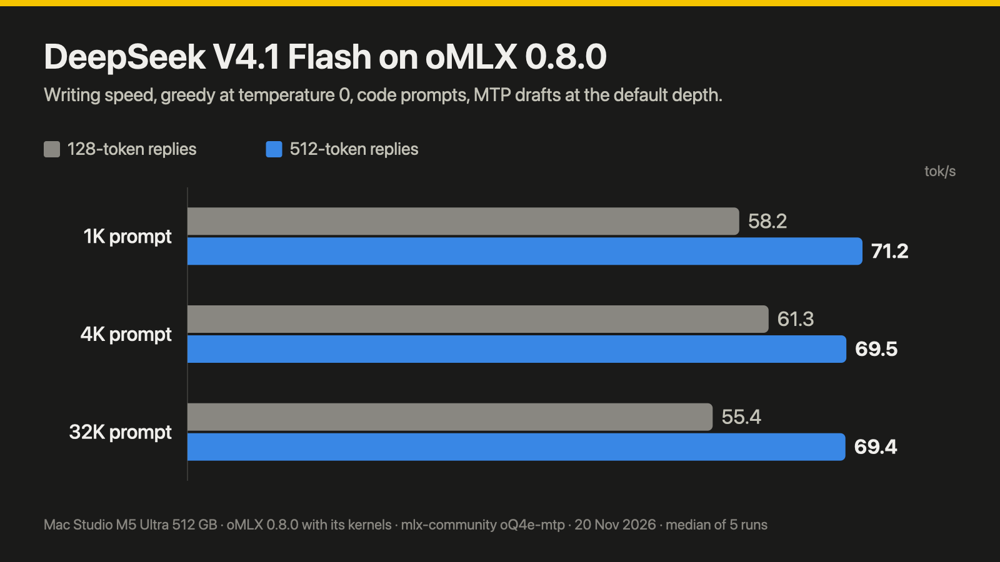

# Finding 3. DeepSeek V4.1 Flash on oMLX 0.8.0, max and median speed

By Local LLM L-Plate. Follow [@LazyLocalLLM on X](https://x.com/LazyLocalLLM) for new benchmarks.

ELI5: People quote one speed for a model, but the number moves with how you ask. I ran DeepSeek V4.1 Flash on the new oMLX release two ways. Once the fast way, with no randomness and code to continue. Once the everyday way, with the model's own sampler on mixed text. Then I turned oMLX's draft knob to see how much more it gives.

**oMLX 0.8.0 wrote 71.2 tok/s on DeepSeek V4.1 Flash 1017 oQ4e-mtp at its default draft depth, greedy at temperature 0, code, 512-token replies, 1K prompt. The same server wrote 56.5 tok/s with the model's own sampler on mixed text at a 4K prompt. Deeper draft settings moved the greedy figure to between 65.8 and 78.7, and two starts at the same depth differed by as much as any gain. Mac Studio M5 Ultra 512 GB, one user, median of 5 runs, 20 Nov 2026.**

## Chart

ELI5: Two bars per prompt size, both at oMLX's default draft depth. Grey is the short reply and blue is the long reply.



## Max speed

ELI5: Max speed is the best case. No randomness, code prompts, and the draft depth that ran fastest. Each cell is the middle of 5 runs, with the slowest and fastest run in brackets.

Greedy at temperature 0, code, 512-token replies, tok/s.

| Draft setting | 1K prompt | 4K prompt | 32K prompt | Mean of the three |
|---|---|---|---|---|
| Adaptive, default ceiling of 3 | 71.2 (65.7 to 73.1) | 69.5 (64.7 to 70.8) | 69.4 (68.0 to 71.3) | 70.0 |
| Adaptive, ceiling 5 | 73.3 (56.4 to 79.9) | 65.8 (65.2 to 77.6) | 66.8 (65.2 to 74.3) | 68.6 |
| Adaptive, ceiling 8, capped at 5 by oMLX | 72.1 (61.4 to 76.1) | 76.4 (65.0 to 80.0) | 72.2 (62.1 to 77.9) | 73.6 |
| Fixed depth 5 | 78.7 (62.8 to 85.7) | 69.5 (62.6 to 80.4) | 69.1 (60.6 to 69.8) | 72.4 |

Greedy at temperature 0, code, 128-token replies, tok/s.

| Draft setting | 1K prompt | 4K prompt | 32K prompt | Mean of the three |
|---|---|---|---|---|
| Adaptive, default ceiling of 3 | 58.2 (52.4 to 60.1) | 61.3 (54.6 to 66.3) | 55.4 (49.9 to 56.9) | 58.3 |
| Adaptive, ceiling 5 | 58.4 (55.3 to 67.4) | 58.9 (56.4 to 65.2) | 51.6 (51.0 to 62.2) | 56.3 |
| Adaptive, ceiling 8, capped at 5 by oMLX | 55.8 (50.4 to 64.9) | 57.5 (55.0 to 64.9) | 52.4 (48.7 to 63.5) | 55.2 |
| Fixed depth 5 | 62.5 (46.9 to 66.4) | 55.5 (55.0 to 64.1) | 48.8 (44.0 to 54.9) | 55.6 |

- **The highest cell is 78.7 tok/s.** Fixed depth 5, 1K prompt, 512-token replies. Its five runs went from 62.8 to 85.7.
- **The steadiest setting is the default.** In the 512-token table its widest cell spans 65.7 to 73.1.
- **Ceiling 8 ran as ceiling 5.** oMLX limits draft depth to the build's `dspark_block_size`, which is 5 in this build's `config.json`. The limit is at line 68 of `omlx/patches/deepseek_v41/mtp.py` in 0.8.0. The log of that start shows no draft deeper than 5. So the second and third rows are one setting run twice.
- **Those two starts differ by 7%.** Their means are 68.6 and 73.6, and 73.6 / 68.6 = 1.07 times. That is the noise between server starts here.
- **No tuned setting clearly beats the default.** The best tuned mean is 73.6 against the default's 70.0. That is 73.6 / 70.0 = 1.05 times, inside the 7% above.
- **Update, 20 Nov 2026 18:13 SGT.** [Finding 5](../05_dsv41_omlx_080_max_push) ran fixed depth 5 on four more server starts. With replies of up to 2,048 tokens it wrote 81.3 and 84.1 tok/s on new code at 1K, against 76.2 and 77.2 at the default depth.
- **Short replies wrote slower in every setting.** At the default, 58.2 against 71.2 at 1K. That is 58.2 / 71.2 = 0.82 times.
- **Drafts were accepted less often in short replies.** oMLX's log shows 73.3%, 71.8% and 70.2% of drafts accepted in the 128-token replies of the three tuned starts, and 82.8%, 85.2% and 82.2% in their 512-token replies. Each figure is the mean of 15 requests.
- **Answers did not change with depth.** Each tuned start gave the same 250 greedy answers as the default, 250 of 250 by hash.

## Median speed

ELI5: Median speed is the everyday case. The model's own sampler, and text that is part prose and part code.

One server start, default draft depth, 512-token replies.

| Text | Sampler | Prompt | Writing tok/s | Prefill tok/s | First token s |
|---|---|---|---|---|---|
| Mixed | temperature 1.0, top-p 1.0 | 4K | 56.5 (55.1 to 58.5) | 2,917.6 | 1.4 |
| Mixed | greedy | 1K | 59.4 (55.8 to 60.7) | 1,385.7 | 0.7 |
| Prose | greedy | 1K | 53.9 (51.4 to 57.2) | 1,019.7 | 1.0 |
| Code | greedy | 1K | 71.2 (65.7 to 73.1) | 785.2 | 1.2 |
| Code | greedy | 4K | 69.5 (64.7 to 70.8) | 2,430.8 | 1.7 |
| Code | greedy | 32K | 69.4 (68.0 to 71.3) | 3,789.3 | 8.8 |

- **Code is the fast text.** Greedy at 1K, code wrote 71.2, mixed 59.4 and prose 53.9.
- **A 32K prompt reached its first token in 8.8 s.** That is 31,664 prompt tokens read at 3,789.3 tok/s.

## Reference points

ELI5: Apple's own server can't load this file, so there is no baseline bar. The nearest row I have is the same model in a different file on a different engine.

- **`mlx-lm` 0.32.2 does not load this build.** On 13 Nov 2026 it refused with "Layers [1, 14] use engram memory, which this implementation does not have". So no multiple of `mlx-lm` can be given.
- **Finding 2, different weights and engine.** mlx-serve 26.11.2 on the Lossless pack wrote 58.3 tok/s at a 4K prompt, sampled, mixed text, 17 Nov 2026. oMLX 0.8.0 on oQ4e-mtp wrote 56.5 on the same test here. That is 56.5 / 58.3 = 0.97 times. The two rows use different weights and a different engine, so this is a reference point and not a race.

## The setup

ELI5: One engine, one set of weights, one switch changed between server starts.

- **Engine.** [oMLX](https://github.com/jundot/omlx) 0.8.0, the release of 18 Nov 2026, installed from the tagged source with its custom kernels built (`OMLX_WITH_CUSTOM_KERNEL=1`). Source tarball SHA-256 `8060f368a5b2eec46c75c1d7431d941a1b15ecb59a2409aab89ffb51392ea826`.
- **Weights.** [mlx-community/DeepSeek-V4.1-Flash-1017-oQ4e-mtp](https://huggingface.co/mlx-community/DeepSeek-V4.1-Flash-1017-oQ4e-mtp) @ 8080db68, 402.4 GiB, every file checked by hash.
- **Serve command.**

```bash
omlx serve --model-dir <models> --host 127.0.0.1 --port 8180 --max-concurrent-requests 1 --headless --no-hf-cache --base-path <home>
```

- **Model settings**, in oMLX's own `model_settings.json`. `mtp_enabled` true, `deepseek_v41_ced_prefill_enabled` true, `a8_prefill_enabled` false, `deepseek_v41_engram_ssd_offload` false.
- **The one switch.** `mtp_adaptive_max_depth` unset, 5 or 8, or `mtp_fixed_depth` 5. Set with the server stopped, then a fresh start. The log of each start shows the depths in use, 1 to 3, 1 to 5, 1 to 5 and 5.
- **Thinking** off.

| Run id | Draft setting | Started, SGT |
|---|---|---|
| `800dd0f8839c` | Adaptive, default ceiling | 20 Nov 2026 14:21 |
| `7573744519a5` | Adaptive, ceiling 5 | 20 Nov 2026 14:37 |
| `9de4dc0d1c87` | Adaptive, ceiling 8, capped at 5 by oMLX | 20 Nov 2026 14:50 |
| `62e53ca09706` | Fixed depth 5 | 20 Nov 2026 15:03 |

## How I measured

ELI5: Same Mac, same harness and same text rules as the earlier findings. Only the sampler, the text kind and the reply length are new.

- **Machine.** Mac Studio, Apple M5 Ultra, 80-core GPU, 512 GB, macOS 27.2, low power mode off.
- **Requests.** Chat requests through the model's chat template, streamed, one user at a time.
- **Greedy** means temperature 0 with no top-p or top-k sent. **Sampled** means the build's own sampler, temperature 1.0 and top-p 1.0.
- **Text.** Code, prose, or a mix in blocks of about 2,000 characters of prose and 6,000 of code, all from open-source docs and code. Each run gets new text, and each prompt starts with a new session line so no prompt cache can hit. Every timed request shows 0 cached tokens.
- **Sizes.** "1K", "4K" and "32K" are targets at 3.5 characters per token. The code prompts came to about 856, 4,100 and 31,664 tokens.
- **Replies.** 512 or 128 tokens. Every timed reply ran to its cap.
- **Repeats.** 5 timed runs per cell. Each block of cells began with one 16-token warm-up request.
- **Writing speed** is tokens per second from the first reply token to the last. **Prefill** is prompt tokens over the time to the first token. **First token** is seconds from sending the request.
- **Short replies and drafts.** The clock starts at the first streamed piece, so tokens that arrive in that piece are not timed. With drafts up to 5 deep and a 128-token reply that can shift a figure by about 5 / 128 = 3.9%.

## Things to know before you compare

ELI5: A speed is only comparable with another speed measured the same way.

- **oMLX's built-in benchmark is a different test.** It continues raw code with no chat template, at temperature 0, for 128 tokens, on one timed request. I read that in `omlx/admin/benchmark.py` at 0.8.0. The rows here are chat requests, so they will not match numbers from that benchmark.
- **Max is not what a chat feels like.** The sampled, mixed-text row is the one to plan around.
- **One build.** oQ4e-mtp is a 4-bit quant with the model's draft head kept. I did not score its answers against the maker's files.

## Check it yourself

ELI5: Every timed request is in this folder. You can redo every median.

- **`rows.csv`.** 146 raw rows from the bench database. The 135 timed requests and the 11 warm-ups.
- **`runs.csv`.** The 4 runs behind them, with engine, version, start time, settings and sampling.

From the top of this repository.

```bash
python3 tools/summarize.py findings/03_dsv41_omlx_080
```

It prints one line per run, text kind, prompt size, reply length and sampler, with the median and range.

## What I did not verify

- **Drafts off.** Every start here had MTP on, so this finding does not say what the draft head adds.
- **Peak memory.** This run did not log it.
- **Answer quality** of the oQ4e-mtp build.
- **Thinking on.**
- **Why short replies draft worse.** The acceptance figures are from oMLX's log. I did not look into the cause.
- **oMLX's built-in benchmark on this Mac.** Not run.

## Credit

- **Engine.** [oMLX](https://github.com/jundot/omlx) by [@jundotkim](https://x.com/jundotkim).
- **Model.** DeepSeek V4.1 Flash by DeepSeek.
- **Build.** The oQ4e-mtp quant by mlx-community.

If a setting here is wrong, open an issue and I will rerun it.

Follow [@LazyLocalLLM on X](https://x.com/LazyLocalLLM) for new benchmarks.
