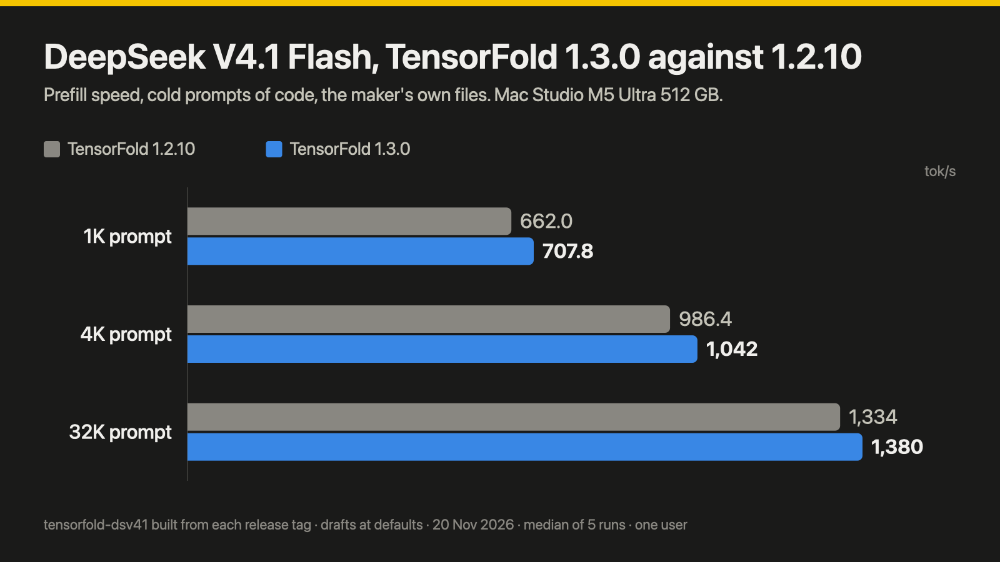

# Finding 4. DeepSeek V4.1 Flash on TensorFold 1.3.0 against 1.2.10

ELI5: TensorFold 1.3.0 came out on 20 Nov 2026 with a faster prompt kernel for DeepSeek V4.1 on Macs. I ran the new version and the one before it on the same Mac, the same files and the same prompts, a few hours after the release. Then I looked at how fast each reads a prompt, how fast each writes, and whether the writing is smooth.

**TensorFold 1.3.0 read DeepSeek V4.1 Flash prompts 3% to 10% faster than 1.2.10 in all seven cells, up to a 119,809-token prompt. It wrote at the same speed within the spread of the runs, 70.5 against 69.5 tok/s greedy on code at a 1K prompt. 11 of 48 replies on 1.3.0 held one pause of 0.25 to 0.58 s between two tokens. None of 48 did on 1.2.10. One server start for each version. Mac Studio M5 Ultra 512 GB, the maker's own files, drafts at defaults, one user, median of 5 runs, 20 Nov 2026.**

## Chart

ELI5: How many prompt tokens a second each version reads, at three prompt sizes. Higher is better.



## Reading the prompt

ELI5: Prefill is prompt tokens over the wait for the first token. Both versions got the same prompts, so each row is a like for like pair.

| Block | Prompt | Prompt tokens | 1.2.10 tok/s | 1.3.0 tok/s | 1.3.0 over 1.2.10 | First token, 1.2.10 | First token, 1.3.0 |
|---|---|---|---|---|---|---|---|
| Code, 512-token replies | 1K | 856 | 662.0 | 707.8 | 1.07 | 1.3 s | 1.2 s |
| Code, 512-token replies | 4K | 4,098 | 986.4 | 1,042.4 | 1.06 | 4.2 s | 4.0 s |
| Code, 512-token replies | 32K | 31,666 | 1,334.1 | 1,379.8 | 1.03 | 25.2 s | 23.6 s |
| Code, 128-token replies | 1K | 856 | 647.5 | 714.1 | 1.10 | 1.3 s | 1.2 s |
| Code, 128-token replies | 4K | 4,097 | 1,024.3 | 1,079.7 | 1.05 | 4.1 s | 3.8 s |
| Code, 128-token replies | 32K | 31,662 | 1,259.9 | 1,363.5 | 1.08 | 25.4 s | 23.2 s |
| Code, 128-token replies, 3 runs | 126K target | 115,186 | 1,285.4 | 1,360.1 | 1.06 | 90.0 s | 84.7 s |

- **1.3.0 was faster in all seven cells**, by 3% to 10%.
- **Prompt by prompt, 1.3.0 read 29 of the 30 prompts up to 32K faster.** The middle ratio of those 30 pairs is 1.07. The ratios run from 0.96 to 1.20.
- **At the longest prompt the two did not overlap.** The three 1.2.10 runs read 1,279.4 to 1,307.4 tok/s and the three 1.3.0 runs 1,352.0 to 1,372.9.
- **The release notes say the prompt attention kernel is about 1.5 times faster.** That is one kernel. These rows time the whole prompt, which has other parts, so the two figures measure different things.

## Writing the reply

ELI5: Decode is tokens a second from the first reply token to the last. Each cell is the middle of 5 runs, with the slowest and fastest in brackets.

| Test | Prompt | 1.2.10 tok/s | 1.3.0 tok/s |
|---|---|---|---|
| Greedy, code, 512-token replies | 1K | 69.5 (59.7 to 72.9) | 70.5 (65.9 to 73.9) |
| Greedy, code, 512-token replies | 4K | 69.7 (63.7 to 83.5) | 68.1 (64.8 to 76.2) |
| Greedy, code, 512-token replies | 32K | 65.5 (53.6 to 66.9) | 60.7 (55.3 to 72.3) |
| Greedy, code, 128-token replies | 1K | 62.2 (53.4 to 64.9) | 62.6 (56.7 to 66.0) |
| Greedy, code, 128-token replies | 4K | 55.9 (46.6 to 60.1) | 55.7 (53.3 to 61.1) |
| Greedy, code, 128-token replies | 32K | 53.2 (48.0 to 62.6) | 52.6 (47.2 to 57.7) |
| Greedy, code, 128-token replies, 3 runs | 126K target | 47.7 (46.8 to 49.3) | 50.7 (48.5 to 55.7) |
| Greedy, prose, 512-token replies | 1K | 56.0 (52.6 to 59.0) | 54.3 (50.6 to 55.2) |
| Greedy, mixed, 512-token replies | 1K | 55.0 (55.0 to 59.1) | 54.8 (54.1 to 60.2) |
| Sampled, mixed, 512-token replies | 4K | 46.9 (44.3 to 52.8) | 44.5 (41.1 to 48.2) |

- **Max.** 70.5 tok/s on 1.3.0 and 69.7 on 1.2.10, greedy on code with 512-token replies.
- **Median.** 46.9 tok/s on 1.2.10 and 44.5 on 1.3.0, temperature 1.0 and top-p 1.0 on mixed text at a 4K prompt.
- **No cell separates the versions.** The ranges overlap in every row.
- **Same answers.** The two versions gave the same 250 greedy answers, 250 of 250 by hash.

## Pauses in the reply

ELI5: A reply should arrive as a steady stream. I looked for the longest wait between two tokens in each reply.

| Version | Timed replies | Replies with a gap over 0.2 s | Longest gap in any reply |
|---|---|---|---|
| 1.2.10 | 48 | 0 | 0.13 s |
| 1.3.0 | 48 | 11 | 0.58 s |

- **On 1.3.0, 11 replies each held one gap of 0.25 to 0.58 s.** All 11 were 512-token replies, out of 30. The gap came 3.4 to 6.7 s after the reply began.
- **No 128-token reply had one**, on either version. Those replies end within about 2.5 s.
- **The cost is small.** The 11 gaps add up to 4.5 s across the run. Each gap took 2.7% to 7.8% of the writing time of its own reply.
- **I did not look for the cause in this run.** Single gaps of 0.69 to 0.84 s were reported on two earlier commits of pull request #3351 in [ashhart/TensorFold#3547](https://github.com/ashhart/TensorFold/issues/3547) on 18 Nov 2026. The pull request changed after that and was merged on 20 Nov 2026 at a1cb6b85. The changelog names #3351 for the new prompt attention kernel. Whether today's shorter gaps are the same effect is not shown here.
- **`gaps.csv` lists every reply** with its longest gap, its middle gap, each gap over 0.2 s and when it came. `rows.csv` holds the longest gap too, in the column `max_gap_s`.

## Reference points

ELI5: Apple's own server does not read these files, so there is no baseline bar. Two earlier findings ran the same model in other files on other engines.

- **`mlx-lm` is not a baseline for this model here.** Version 0.32.2 refused the MLX build of DeepSeek V4.1 on 13 Nov 2026, as finding 3 notes, and these are the maker's own FP8 files. So no multiple of `mlx-lm` can be given.
- **Finding 3, different weights and engine.** oMLX 0.8.0 on the oQ4e-mtp build wrote 71.2 tok/s greedy on code at 1K and 56.5 sampled on mixed text at 4K, on the same harness and the same day.
- **Finding 2, different weights and engine.** mlx-serve 26.11.2 on the Lossless pack wrote 58.3 tok/s sampled on mixed text at 4K on 17 Nov 2026.

## The setup

ELI5: One build of each version from its release tag, the same model files, the same command.

- **Engine.** [TensorFold](https://github.com/ashhart/TensorFold) `tensorfold-dsv41`, built from source at each release tag with Zig 0.17.0 and `zig build dsv41-metal-serve -Dcpu=apple_m1`. Version 1.3.0 is commit d3d0bf11, released 20 Nov 2026 07:04 SGT. Version 1.2.10 is commit 2a674b55. The project calls this server experimental, switched on with `TF_EXPERIMENTAL=deepseek`.
- **Weights.** [deepseek-ai/DeepSeek-V4.1-Flash-1017](https://huggingface.co/deepseek-ai/DeepSeek-V4.1-Flash-1017) @ 08c8657f, the maker's FP8 and MXFP4 files, with the Engram rows packed for TensorFold 1.2.8. Both versions checked those rows against the release and accepted them.
- **Serve command**, the same for both.

```bash
tensorfold-dsv41 serve <model folder> --name <name> --host 127.0.0.1 --port <port> --context 131072 --parallel 1 --no-update-check
```

- **Drafts** at the engine's defaults. Both logs read "drafts: DSpark + copies" and "depth: cost, cap 5".
- **Thinking** off.

| Run id | Version | Started, SGT |
|---|---|---|
| `778e5c808b88` | 1.3.0 | 20 Nov 2026 15:29 |
| `de57ae5ff90f` | 1.2.10 | 20 Nov 2026 16:00 |

## How I measured

ELI5: Same Mac, same harness and same text rules as the earlier findings.

- **Machine.** Mac Studio, Apple M5 Ultra, 80-core GPU, 512 GB, macOS 27.2, low power mode off.
- **Requests.** Chat requests through the model's chat template, streamed, one user at a time.
- **Greedy** means temperature 0 with no top-p or top-k sent. **Sampled** means temperature 1.0 and top-p 1.0.
- **Text.** Code, prose, or a mix, from open-source docs and code. The text of a request is picked from its size and repeat number, so both versions got the same prompts. Each prompt starts with a new session line so no prompt cache can hit. Every timed request shows 0 cached tokens.
- **Repeats.** 5 timed runs per cell. Each block of cells began with one 16-token warm-up request.
- **The 126K cell has 3 runs.** Two of its five prompts came to 131,444 and 142,222 tokens, past the 131,072-token window. Both versions refused them with a clear message. The harness sized the code text too long. The four refused requests are in `rows.csv`.
- **Order.** 1.3.0 ran first, 15:29 to 15:51 SGT. 1.2.10 ran second, 16:00 to 16:23 SGT. One server start each.
- **Other work on the Mac.** From about 16:04 to 16:11 SGT a light job was reading source files on this Mac, during the 1.2.10 run. The 1.2.10 prompts read before it began show the same gap to 1.3.0 as those read during it, a middle ratio of 1.07 in both groups.

## Check it yourself

ELI5: Every timed request is in this folder. You can redo every median.

- **`rows.csv`.** 112 raw rows from the bench database. The 96 timed replies, the 4 refused requests and the 12 warm-ups.
- **`runs.csv`.** The 2 runs behind them, with engine, version, start time, settings and sampling.
- **`gaps.csv`.** One line for each of the 96 timed replies, made from the arrival time of every streamed piece.

From the top of this repository.

```bash
python3 tools/summarize.py findings/04_dsv41_tensorfold_130
```

## What I did not verify

- **The 1.5 times figure for the kernel itself.** I timed whole prompts, not one kernel.
- **A second server start.** Each version ran once. A repeat in the reverse order is queued, and this page will be updated with it.
- **The cause of the pauses**, and whether they appear with drafts off.
- **Order effects.** Each version had one server start, 1.3.0 first.
- **A measured draft cost table.** TensorFold can price drafts from a table measured on the serving Mac (`TF_DSV41_CALIB_FILE`). Its notes put the gain at 0.7% greedy and 2.4% sampled on an M5 Ultra. I ran the built-in table.
- **Peak memory.** This run did not log it.
- **Thinking on.**

## Credit

- **Engine.** [TensorFold](https://github.com/ashhart/TensorFold) by [@ashxhart](https://x.com/ashxhart).
- **Model.** DeepSeek V4.1 Flash by DeepSeek.

If a setting here is wrong, open an issue and I will rerun it.
