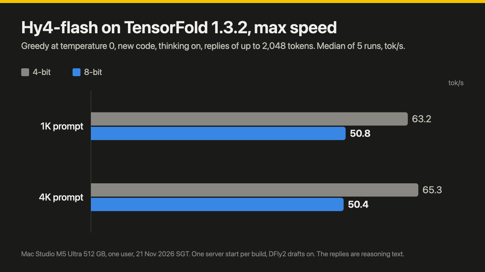

# Finding 10. Tencent Hy4-flash on TensorFold 1.3.2, max and median speed

ELI5: Hy4-flash is Tencent's new open model, released on 16 Nov 2026. TensorFold is the only engine I found that loads it. I ran its two MLX builds, with the engine's drafts on and off. Max is greedy at temperature 0 while writing new code. Median is the model's own sampler on mixed text.

**TensorFold 1.3.2 wrote 65.3 tok/s on Hy4-flash 4-bit and 50.8 on the 8-bit build at their max, with thinking on, the model's default. With the model's own sampler it wrote 50.0 and 36.8. With drafts off the same builds wrote 42.2 and 34.0 on code at a 4K prompt. All but one of the 90 timed replies were reasoning text from start to finish. With thinking switched off through the API the replies went off course on both builds, so I publish no thinking-off line.**

Runs of 21 Nov 2026 SGT. One server start per setting. Mac Studio M5 Ultra 512 GB, one user, median of 5 runs.

| Build | Size on disk | Max, tok/s | Median, tok/s | Drafts off, code | Drafts off, own sampler |
|---|---|---|---|---|---|
| Hy4-flash 4-bit | 121.0 GiB | 65.3 | 50.0 | 42.2 | 41.3 |
| Hy4-flash 8-bit | 222.9 GiB | 50.8 | 36.8 | 34.0 | 33.2 |

- **Max** is the middle of 5 greedy runs on new code, replies of up to 2,048 tokens, at the faster of the 1K and 4K prompts.
- **Median** is the middle of 5 runs with the model's own sampler, mixed text, 512-token replies, 4K prompt.
- **Drafts off** is the same server with `--no-drafts`, 512-token replies, 4K prompt.
- **No `mlx-lm` baseline.** Apple's `mlx-lm` 0.32.2 has no model file for this model type, and neither had its main branch on 21 Nov 2026. oMLX 0.8.0 has none either. I did not try the other engines on this Mac. The drafts-off column is the reference here.

## Chart

ELI5: The top speed on new code for each build, at two prompt sizes.



## Thinking on, the model's default

ELI5: Hy4-flash thinks before it answers unless told not to. These runs leave that alone. Each cell is the middle of 5 runs, with the slowest and fastest run in brackets.

### Hy4-flash 8-bit

Tok/s, run `bdcd2d9ede41` with drafts on and `b8e543b952e1` with drafts off.

| Test | Prompt | Drafts on | Drafts off | Times drafts off |
|---|---|---|---|---|
| Greedy, new code, replies up to 2,048 tokens | 1K | 50.8 (46.4 to 55.0) | not run | |
| Greedy, new code, replies up to 2,048 tokens | 4K | 50.4 (43.5 to 51.3) | not run | |
| Greedy, new code, 512-token replies | 1K | 50.8 (46.5 to 52.1) | 34.4 (33.2 to 34.6) | 1.48 |
| Greedy, new code, 512-token replies | 4K | 46.5 (43.7 to 48.1) | 34.0 (33.9 to 34.2) | 1.37 |
| Own sampler, mixed text, 512-token replies | 4K | 36.8 (35.7 to 47.5) | 33.2 (33.2 to 33.3) | 1.11 |

- **Max.** 50.8 tok/s, greedy on new code at a 1K prompt, at both reply lengths.
- **Median.** 36.8 tok/s with the model's own sampler. Another start wrote 36.9 (36.2 to 44.9), run `10884ddb9c17`.
- **Drafts are worth 1.48 times on code at 1K.** 50.8 / 34.4 = 1.48. Drafts on was faster on 5 of 5 texts in each of the three cells.
- **Drafts are worth 1.11 times on sampled text.** 36.8 / 33.2 = 1.11.
- **Memory.** The server process held 313.3 GiB after loading and 346.7 GiB at the end of the drafts-on start, by `ps`. Its log says it keeps 163.6 GiB wired between requests.
- **Load time.** 20.9 to 26.8 s over four starts, by the server's banner.

### Hy4-flash 4-bit

Tok/s, run `b1f754c43ae4` with drafts on and `df5b641735e6` with drafts off.

| Test | Prompt | Drafts on | Drafts off | Times drafts off |
|---|---|---|---|---|
| Greedy, new code, replies up to 2,048 tokens | 1K | 63.2 (58.3 to 65.9) | not run | |
| Greedy, new code, replies up to 2,048 tokens | 4K | 65.3 (62.4 to 67.3) | not run | |
| Greedy, new code, 512-token replies | 1K | 57.5 (52.4 to 83.5) | 43.0 (41.1 to 43.0) | 1.34 |
| Greedy, new code, 512-token replies | 4K | 58.8 (52.4 to 66.8) | 42.2 (42.1 to 42.4) | 1.39 |
| Own sampler, mixed text, 512-token replies | 4K | 50.0 (43.7 to 55.6) | 41.3 (41.1 to 41.4) | 1.21 |

- **Max.** 65.3 tok/s, greedy on new code with replies of up to 2,048 tokens at a 4K prompt.
- **Median.** 50.0 tok/s with the model's own sampler. Another start wrote 47.2 (43.3 to 50.5), run `cad62d9be2d7`.
- **Drafts are worth 1.39 times on code at 4K.** 58.8 / 42.2 = 1.39. Drafts on was faster on 5 of 5 texts in each of the three cells.
- **Drafts are worth 1.21 times on sampled text.** 50.0 / 41.3 = 1.21.
- **The 4-bit build is 1.29 times the 8-bit build at max.** 65.3 / 50.8 = 1.29. With drafts off on code at 4K it is 42.2 / 34.0 = 1.24 times.
- **Memory.** The server process held 168.7 GiB after loading and 196.3 GiB at the end of the drafts-on start, by `ps`. Its log says it keeps 91.4 GiB wired between requests.
- **Load time.** 13.8 to 14.2 s over five starts on 1.3.2, by the server's banner.

### What the replies were

- **Reasoning text.** 89 of the 90 timed replies here spent their whole budget inside the thinking block, 2,048-token replies included. One 4-bit reply closed its thinking at 1,667 tokens and wrote 381 answer tokens.
- **So these are speeds of reasoning text.** A benchmark that counts only answer tokens will show other numbers.

## Thinking off did not give clean answers

ELI5: I first ran everything with thinking switched off, as I do for most models. The replies planned out loud and lost the thread, on both builds. I then looked at the prompt the server built. It is not the prompt the model's own template builds for "no thinking".

### What the server did with each switch

One short prompt, greedy, 200 tokens, on both builds on 1.3.2.

| Request field | HTTP | Prompt tokens | Server log | Where the text landed |
|---|---|---|---|---|
| none | 200 | 43 | `thinking=True effort=none` | 200 reasoning tokens |
| `chat_template_kwargs: {"enable_thinking": true}` | 200 | 43 | `thinking=True effort=none` | 200 reasoning tokens |
| `chat_template_kwargs: {"enable_thinking": false}` | 200 | 44 | `thinking=False effort=none` | 200 answer tokens |
| `reasoning_effort: "none"`, top level | 200 | 44 | `thinking=False effort=none` | 200 answer tokens, the same reply |
| `chat_template_kwargs: {"reasoning_effort": "no_think"}` | 400 | | | refused, 4-bit build only |

- **The build's own chat template renders "no thinking" as 46 tokens.** I rendered `chat_template.jinja` offline with the build's tokenizer. The default is 43 tokens and ends with an open think tag. With `reasoning_effort` set to `no_think` it is 46 tokens. The system line then says `reasoning_effort:no_think`, and the prompt ends with an open and a closed think tag.
- **The server's thinking-off prompt is 44 tokens.** I can't see which text it built. More than one rendering comes to 44.
- **The template's own value was refused.** The server answered "reasoning_effort must be none, minimal, low, medium, high, xhigh or max". The template itself accepts `no_think`, `high` and `max`, and never reads `enable_thinking`.
- **So I found no request that gives the template's 46-token form** on 1.3.2. If there is one, I will rerun with it.
- **The server also has a `--no-thinking` start flag.** I found it in the help text after these runs and have not tried it.

### What the replies looked like

Greedy, thinking off by `enable_thinking: false`, one extra request each, not in `rows.csv`.

| Question | 8-bit | 4-bit |
|---|---|---|
| Short Fibonacci function | A code block with `a, b = 0, "1"` and an unfinished list, then "The previous response was malformed." | A code block whose docstring says "F(0)=0, F(0)=1", then a line that adds a string to `n`. |
| New code, 4K prompt, 512 tokens | Opened with a plan and a code block. Its last 300 characters were planning notes. | Opened "We need answer the user's request". Its last 300 characters were planning notes. |
| Copy the prompt, 4K, 2,048 tokens | 167 of 180 lines are in the prompt word for word, after 4 lines of planning. | 192 of 201 lines, after 2 lines of planning. |
| Count from 1 to 400, 1K prompt, 512 tokens | 4 of 169, 3 of 192 and 5 of 207 lines were the next number. Each reply wrote a few numbers, a literal `<think>` tag and planning notes, then counted. | 3 of 50 and 5 of 52. One reply wrote five numbers, planning notes, a literal `</think>` tag, then counted from 1. |

- **Both builds did it.** So I do not put it down to 4-bit weights.
- **With thinking on, the short prompt's reasoning read as normal planning** on both builds. I read back no timed thinking-on reply.

### The speeds with that switch

ELI5: These rows are real tokens per second, but of a model that was prompted in a way its template does not use. I keep them out of the summary page.

Tok/s, TensorFold 1.3.2, thinking off by `enable_thinking: false`.

| Test | Prompt | 8-bit, drafts on `8ff5ac9baafa` | 8-bit, drafts off `1d123ec673b6` | 4-bit, drafts on `cf930777f656` | 4-bit, drafts off `fff18d644690` |
|---|---|---|---|---|---|
| Greedy, new code, up to 2,048 tokens | 1K | 51.3 (47.9 to 72.4) | 34.1 (34.1 to 35.7) | 67.4 (59.1 to 96.2) | 42.2 (42.0 to 42.6) |
| Greedy, new code, up to 2,048 tokens | 4K | 49.8 (46.0 to 57.8) | 34.3 (34.3 to 34.5) | 63.1 (55.2 to 82.0) | 42.3 (42.3 to 42.4) |
| Greedy, new code, 512 tokens | 1K | 50.7 (47.9 to 65.3) | 34.7 (33.5 to 34.8) | 62.3 (51.4 to 68.4) | 43.1 (41.3 to 44.6) |
| Greedy, new code, 512 tokens | 4K | 56.3 (51.7 to 57.9) | 34.3 (34.3 to 34.3) | 57.4 (54.3 to 68.6) | 42.5 (42.3 to 42.6) |
| Own sampler, mixed text, 512 tokens | 4K | 38.0 (38.0 to 39.1) | 33.7 (33.6 to 33.7) | 44.8 (41.9 to 56.5) | 41.4 (41.3 to 41.8) |
| Asked to copy the prompt, 512 tokens | 1K | 56.4 (52.5 to 84.0) | not run | 73.7 (60.0 to 104.1) | not run |
| Asked to copy the prompt, 512 tokens | 4K | 60.9 (50.1 to 94.5) | not run | 74.2 (54.5 to 122.7) | not run |
| Asked to copy the prompt, 2,048 tokens | 4K | 90.1 (59.7 to 97.0) | not run | 90.1 (81.0 to 130.9) | not run |
| Asked to count from 1, 512 tokens | 1K | 57.0 (56.6 to 84.8) | not run | 64.3 (54.4 to 111.8) | not run |
| Asked to count from 1, 512 tokens | 4K | 68.9 (51.1 to 71.4) | not run | 60.3 (55.2 to 101.3) | not run |

- **Drafts on and off gave the same short answers.** On 250 short greedy questions, 250 of 250 answers match between the drafts-on and drafts-off starts, on each build.
- **The drafts-off speed is the same in both modes.** 34.3 against 34.0 on the 8-bit build and 42.5 against 42.2 on the 4-bit build, on code with 512-token replies at 4K.
- **The copy and counting rows are not copy and counting speeds.** The replies were part planning notes, as the table above shows. I enter no copy or count line on the summary page.

## TensorFold 1.3.1 against 1.3.2, 4-bit build

ELI5: 1.3.1 was the first release to serve this model. 1.3.2 came out under six hours later. I had already run the 4-bit build on 1.3.1, so here are both. Thinking off by the old switch, one start each.

| Test | Prompt | 1.3.1, drafts on `dfe2fad2ff2c` | 1.3.2, drafts on `cf930777f656` | 1.3.1, drafts off `84354146db7d` | 1.3.2, drafts off `fff18d644690` |
|---|---|---|---|---|---|
| Greedy, new code, up to 2,048 tokens | 1K | 61.8 (59.2 to 102.2) | 67.4 (59.1 to 96.2) | 42.7 (42.7 to 42.8) | 42.2 (42.0 to 42.6) |
| Greedy, new code, up to 2,048 tokens | 4K | 61.8 (59.6 to 111.6) | 63.1 (55.2 to 82.0) | 43.1 (43.0 to 43.1) | 42.3 (42.3 to 42.4) |
| Greedy, new code, 512 tokens | 1K | 60.2 (58.8 to 63.6) | 62.3 (51.4 to 68.4) | 43.7 (41.8 to 43.9) | 43.1 (41.3 to 44.6) |
| Greedy, new code, 512 tokens | 4K | 57.3 (51.4 to 59.4) | 57.4 (54.3 to 68.6) | 43.0 (43.0 to 43.0) | 42.5 (42.3 to 42.6) |
| Own sampler, mixed text, 512 tokens | 4K | 43.9 (43.5 to 44.9) | 44.8 (41.9 to 56.5) | 42.1 (42.0 to 42.1) | 41.4 (41.3 to 41.8) |

- **Drafts on, the ranges overlap in every cell.** I see no change.
- **Drafts off, 1.3.2 was 1% to 2% lower in all five cells.** 42.3 / 43.1 = 0.98 at the widest. One start each, so I do not call it a version change.
- **Same answers.** 250 of 250 short greedy answers match between the two releases with drafts on.
- **The 1.3.2 notes list no speed change for Hy4-flash on Macs.**

## The setup

ELI5: One engine at its newest release, at its defaults. A fresh server start for every setting.

- **Engine.** [TensorFold](https://github.com/ashhart/TensorFold) 1.3.2, published 21 Nov 2026 03:27 SGT, from the author's Homebrew tap. The download's SHA-256 equals the digest GitHub lists for the release file.
- **Serve command.** `--no-drafts` is added for the drafts-off starts. Nothing else is set, and no `TF_` variable is set.

```bash
tensorfold serve <build folder> --name <name> --host 127.0.0.1 --port 8188 --context 131072 --parallel 1 --no-update-check
```

- **Weights.** TensorFold's own MLX conversions of [tencent/Hy4-flash](https://huggingface.co/tencent/Hy4-flash), with the DFly2 drafter in the build.
  - [TensorFold/Hy4-flash-MLX-4bit-MTP](https://huggingface.co/TensorFold/Hy4-flash-MLX-4bit-MTP) @ dd375b3d, 121.0 GiB.
  - [TensorFold/Hy4-flash-MLX-8bit-MTP](https://huggingface.co/TensorFold/Hy4-flash-MLX-8bit-MTP) @ 0a4fe3df, 222.9 GiB.
- **Drafts.** The server's banner says "drafts: MTP + copies" at defaults and "drafts: off" with `--no-drafts`.
- **Sampler.** Temperature 0.9 and top-p 1.0, from the model's `generation_config.json`.
- **Thinking on** is `chat_template_kwargs: {"enable_thinking": true}`, which gave the same 43-token prompt as sending no field.
- **Licence.** The Tencent Hy License. Read it before you ship anything on this model.

| Run id | Build | Release | Drafts | Thinking | Started, SGT |
|---|---|---|---|---|---|
| `bdcd2d9ede41` | 8-bit | 1.3.2 | on | on | 21 Nov, 07:28 |
| `b8e543b952e1` | 8-bit | 1.3.2 | off | on | 21 Nov, 07:40 |
| `b1f754c43ae4` | 4-bit | 1.3.2 | on | on | 21 Nov, 07:45 |
| `df5b641735e6` | 4-bit | 1.3.2 | off | on | 21 Nov, 07:54 |
| `10884ddb9c17` | 8-bit | 1.3.2 | on | on, 5 rows inside the start of `8ff5ac9baafa` | 21 Nov, 05:54 |
| `cad62d9be2d7` | 4-bit | 1.3.2 | on | on, 5 rows inside the start of `cf930777f656` | 21 Nov, 06:44 |
| `8ff5ac9baafa` | 8-bit | 1.3.2 | on | off, old switch | 21 Nov, 05:54 |
| `1d123ec673b6` | 8-bit | 1.3.2 | off | off, old switch | 21 Nov, 06:22 |
| `cf930777f656` | 4-bit | 1.3.2 | on | off, old switch | 21 Nov, 06:44 |
| `fff18d644690` | 4-bit | 1.3.2 | off | off, old switch | 21 Nov, 07:06 |
| `dfe2fad2ff2c` | 4-bit | 1.3.1 | on | off, old switch | 21 Nov, 04:20 |
| `84354146db7d` | 4-bit | 1.3.1 | off | off, old switch | 21 Nov, 04:39 |

- **Two run ids were made after the fact.** Runs `10884ddb9c17` and `cad62d9be2d7` hold five thinking-on rows each that I sent inside a start recorded as thinking off. I moved them to their own run ids so each run has one thinking setting. No measured value changed.

## How I measured

ELI5: Same Mac, same harness and same text rules as findings 3 to 9.

- **Machine.** Mac Studio, Apple M5 Ultra, 80-core GPU, 512 GB, macOS 27.2, low power mode off.
- **Requests.** Chat requests through the model's chat template, streamed, one user at a time.
- **Greedy** means temperature 0 with no top-p or top-k sent.
- **Text.** Code from open-source projects for the greedy tests, and the harness's mixed text for the sampled test, as in finding 2. Each prompt opens with a new session line so no prompt cache can hit. Every timed request shows 0 cached tokens.
- **Sizes** are targets at 3.5 characters per token. A "1K" code prompt came to about 870 tokens on this model and a "4K" one to about 4,120.
- **Repeats.** 5 timed runs per cell. Each block of cells began with one 16-token warm-up request.
- **Writing speed** is tokens per second from the first reply token to the last, reasoning tokens included.
- **The questions** are the three of [finding 5](../05_dsv41_omlx_080_max_push), word for word.

## Things to know before you compare

ELI5: A speed is only comparable with another speed measured the same way.

- **These are reasoning tokens.** With thinking on, this model spent 512 and 2,048-token budgets thinking.
- **One start per setting.** Where I have a sampled median from another start, it differs by 0.1 tok/s on the 8-bit build and 2.8 on the 4-bit build.
- **The author's own M5 Ultra figures** are in [TensorFold pull request 3941](https://github.com/ashhart/TensorFold/pull/3941). They use other prompts, so read them there and not against this table.
- **Max is not what a chat feels like.** The median column is the everyday figure.

## Check it yourself

ELI5: Every timed request is in this folder. You can redo every median.

- **`rows.csv`.** 354 raw rows from the bench database. 315 timed requests and 39 warm-ups.
- **`runs.csv`.** The 12 runs behind them, with engine, version, start time, settings and sampling.
- **`render_template_tokens.py`.** Renders the build's chat template for each thinking setting and counts the tokens. It needs the `tokenizers` and `jinja2` packages.

From the top of this repository.

```bash
python3 tools/summarize.py findings/10_hy4_flash_tensorfold_132
```

## What I did not verify

- **What the timed thinking-on replies say.** I read back one short thinking-on reply per build and no timed one.
- **Which 44-token prompt the server built** for thinking off.
- **A thinking-off run in the template's own 46-token form.** I found no request that produces it.
- **The server's `--no-thinking` and `--reasoning-effort` start flags.** Not tried.
- **Longer replies with drafts off and thinking on.**
- **The switches `TF_HY4_ENGRAM` and `TF_HY4_DRAFT_BITS`**, long prompts, and two users at once.
- **Answer quality** of either build.
- **Peak memory.** The figures above are the process size by `ps` at two moments.
- **Any other engine on this model.** `mlx-lm` 0.32.2 and oMLX 0.8.0 have no model file for it. The rest were not tried.

## Credit

- **Engine and MLX builds.** [TensorFold](https://github.com/ashhart/TensorFold) by [@ashxhart](https://x.com/ashxhart).
- **Model and DFly2 drafter.** Hy4-flash by Tencent.

If a setting here is wrong, open an issue and I will rerun it. That goes double for the thinking switch.
