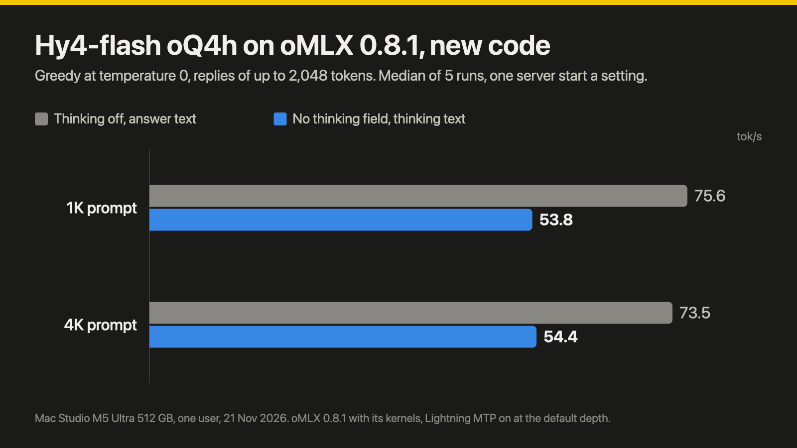

# Finding 12. Tencent Hy4-flash on oMLX 0.8.1, with thinking off and on

By Local LLM L-Plate. Follow [@LazyLocalLLM on X](https://x.com/LazyLocalLLM) for new benchmarks.

ELI5: oMLX 0.8.1 came out on 21 Nov 2026 at 09:17 SGT and is the first oMLX release that loads Hy4-flash. I ran it the same morning on the oMLX author's own 4-bit build. On this engine the thinking switch works, so the model can be timed while it writes a plain answer. Max is greedy at temperature 0 while writing new code. Median is the model's own sampler on mixed text.

**oMLX 0.8.1 wrote 75.6 tok/s on Hy4-flash oQ4h on new code with thinking switched off, and 53.7 with the model's own sampler. Those replies are answer text. With no thinking setting in the request the model thinks, and oMLX wrote 54.4 and 54.0. Thinking off built the 46-token prompt that the model's own chat template renders for it, and the replies I read back were clean. With drafts off the same build wrote 35.1 to 35.5, so the drafts gave 2.1 to 2.2 times with thinking off and 1.5 times on thinking text. One server start per setting. Mac Studio M5 Ultra 512 GB, one user, median of 5 runs, 21 Nov 2026.**

Updated on 21 Nov 2026 at 13:52 SGT with two starts that have drafts off.

| Setting | Max, tok/s | Median, tok/s | What the reply is |
|---|---|---|---|
| Thinking off | 75.6 | 53.7 | Answer text |
| No thinking setting, the model's default | 54.4 | 54.0 | Thinking text, returned as the answer |

- **Max** is the middle of 5 greedy runs on new code with replies of up to 2,048 tokens, at the better of the 1K and 4K prompts.
- **Median** is the middle of 5 runs with the model's own sampler, mixed text, 512-token replies, 4K prompt.
- **The two rows are different kinds of text.** Do not read the gap between them as a cost of thinking.

## Chart

ELI5: The top speed on new code for the two settings. One bar per setting and prompt size.



## Thinking off

ELI5: The request asks the model not to think. It writes the answer straight away. Each cell is the middle of 5 runs, with the slowest and fastest run in brackets.

Decode tok/s, default draft depth, run `61f1f5a70d04`.

| Test | 1K prompt | 4K prompt |
|---|---|---|
| Greedy, new code, replies up to 2,048 tokens | 75.6 (72.7 to 76.8) | 73.5 (67.0 to 78.6) |
| Greedy, new code, 512-token replies | 73.0 (64.5 to 76.9) | 68.2 (63.1 to 74.3) |
| Own sampler, mixed text, 512-token replies | not run | 53.7 (50.8 to 57.5) |
| Copy the prompt, 512-token replies | 101.0 (94.3 to 103.0) | 92.1 (88.1 to 93.3) |
| Count from 1, 512-token replies | 97.4 (92.1 to 98.9) | 92.0 (91.3 to 92.0) |

- **Max.** 75.6 tok/s, greedy on new code with replies of up to 2,048 tokens at 1K.
- **Median.** 53.7 tok/s, temperature 0.9 and top-p 1.0 on mixed text at 4K.
- **8 of the 10 long replies ended by themselves.** The model stopped before the cap, the shortest at 1,310 tokens. The other 2 ran to 2,048.
- **Every timed reply was answer text** by the server's count, with 0 reasoning tokens.
- **What I read back.** A short function request returned a code block with a docstring and examples. One copy reply was 63 lines, and 62 are in the prompt word for word. It began at the prompt's session line, which the question says to skip. One counting reply was 256 lines, each the next number.
- **I did not read a timed code reply.** The harness keeps timings and not text.
- **Copy and counting are ceilings.** Drafts guess that text almost every time. The log of that start's last request, a counting reply, shows 382 of 383 drafted tokens kept.

## No thinking setting

ELI5: The request says nothing about thinking, so the model's template leaves thinking on. On this engine the thinking text comes back as the answer, and the server counts no reasoning tokens.

Decode tok/s, default draft depth, run `7b6ccfb9c907`.

| Test | 1K prompt | 4K prompt |
|---|---|---|
| Greedy, new code, replies up to 2,048 tokens | 53.8 (52.7 to 56.4) | 54.4 (50.0 to 57.8) |
| Greedy, new code, 512-token replies | 57.8 (55.7 to 70.8) | 52.9 (50.5 to 56.2) |
| Own sampler, mixed text, 512-token replies | not run | 54.0 (50.4 to 57.9) |
| Asked to copy, 512-token replies | 71.8 (63.2 to 84.9) | 55.1 (53.6 to 63.6) |
| Asked to count, 512-token replies | 89.2 (84.1 to 92.4) | 65.0 (54.5 to 83.2) |

- **Max.** 54.4 tok/s at 4K and 53.8 at 1K.
- **Median.** 54.0 tok/s.
- **All 10 long replies ran to 2,048 tokens.**
- **The replies I saw were thinking text.** The short function request came back as "The user wants a Python function" and went on planning. All 100 short replies of the answer check open with "We need", as planning text. I did not read the timed replies.
- **`rows.csv` shows 0 thinking tokens for this run.** That is the server's count. It does not mean the model wrote an answer.
- **The copy and counting rows have no read-back**, so they are not on the summary page.

## How the thinking switch behaved

ELI5: Hy4-flash's chat template has its own word for no thinking, `no_think`. An engine has to turn the request's switch into that word. I sent one short prompt six ways and read how long the prompt came out.

One short prompt, greedy, 200 tokens, not streamed, on the start of run `7b6ccfb9c907`.

| Request | Prompt tokens | The reply |
|---|---|---|
| No thinking setting | 43 | Thinking text |
| `enable_thinking: true` | 43 | The same thinking text |
| `chat_template_kwargs: {"reasoning_effort": "high"}` | 43 | The same thinking text |
| `enable_thinking: false`, at the top level and in `chat_template_kwargs` | 46 | A code answer |
| `chat_template_kwargs: {"reasoning_effort": "no_think"}` | 46 | The same code answer |
| `reasoning_effort: "none"` at the top level | 46 | The same code answer |

- **The build's own template renders the same counts.** Rendered offline with the build's `chat_template.jinja` and `tokenizer.json`, the default is 43 tokens and `no_think` is 46. The script is in [finding 10](../10_hy4_flash_tensorfold_132), `render_template_tokens.py`.
- **So on oMLX 0.8.1 thinking off is the template's own form.**
- **The server reported 0 reasoning tokens for all six.**

## Draft depth

ELI5: The model drafts a few tokens ahead and checks them. The depth is how many it drafts at once. I tried fixed depths of 4 and 6 with no thinking setting. Depth 4 was faster on long replies, and the text was not the same as at the default.

Greedy, new code, no thinking setting, one start each, tok/s at 1K and 4K.

| Draft setting | Run | 512-token replies | Replies up to 2,048 tokens |
|---|---|---|---|
| Default depth | `7b6ccfb9c907` | 57.8 and 52.9 | 53.8 and 54.4 |
| Fixed depth 4 | `121f68e9098b` | 61.3 and 54.1 | 59.9 and 58.2 |
| Fixed depth 6 | `0a9efd6711fc` | 60.5 and 50.2 | 53.5 and 55.9 |

- **Fixed depth 4 was faster on every long reply.** Text by text against the default, 10 of 10 with a middle ratio of 1.09. On short replies it was faster on 7 of 10 with 1.03.
- **Fixed depth 6 was level.** Faster on 7 of 10 long replies with a middle ratio of 1.02, and on 4 of 10 short ones with 0.97.
- **The text changed with the depth.** I sent 50 short greedy questions twice to each start and compared the whole reply. Each start gave the same text on both passes, 50 of 50. Against the default start, depth 4 gave the same text on 48 of 100 replies and depth 6 on 50 of 100. Depths 4 and 6 agreed with each other on 98 of 100.
- **Against a start with drafts off the text differs too.** The counts are in the section "Drafts off, the baseline".
- **So the summary page stays on the default depth.**
- **The log shows the depth took.** The last request drafted to depth 3 at the default, 4 at fixed depth 4 and 5 at fixed depth 6.

## Drafts off, the baseline

ELI5: The speeds above have the model's draft helper on. Here it is off, so the model writes one token a step. This is the bar the drafts have to beat.

Decode tok/s with `mtp_enabled` false, one start each. Thinking off is run `7a70518485cc`. No thinking setting is run `0404d67792d9`.

| Test | Prompt | Thinking off, drafts off | Thinking off, drafts on | No setting, drafts off | No setting, drafts on |
|---|---|---|---|---|---|
| Greedy, new code, replies up to 2,048 tokens | 1K | 35.1 (35.0 to 35.4) | 75.6 | 35.2 (35.1 to 35.4) | 53.8 |
| Greedy, new code, replies up to 2,048 tokens | 4K | 35.5 (35.4 to 35.5) | 73.5 | 35.5 (35.4 to 35.6) | 54.4 |
| Greedy, new code, 512-token replies | 1K | 37.4 (34.7 to 38.2) | 73.0 | 37.8 (34.9 to 38.2) | 57.8 |
| Greedy, new code, 512-token replies | 4K | 35.3 (35.3 to 35.5) | 68.2 | 35.6 (35.5 to 35.6) | 52.9 |
| Own sampler, mixed text, 512-token replies | 4K | 35.5 (35.5 to 35.6) | 53.7 | 35.5 (35.4 to 35.6) | 54.0 |

- **Plain decoding is about 35 tok/s whatever the text.** The two starts agree in every cell, and the runs inside a cell sit within 1 tok/s of each other at 4K.
- **Drafts gave 2.1 to 2.2 times on answer text.** 75.6 / 35.1 = 2.15 times at 1K and 73.5 / 35.5 = 2.07 times at 4K, on long code replies with thinking off.
- **Drafts gave 1.5 times on thinking text.** 53.8 / 35.2 = 1.53 times at 1K and 54.4 / 35.5 = 1.53 times at 4K.
- **With the model's own sampler drafts gave 1.5 times** on both settings. 53.7 / 35.5 = 1.51 and 54.0 / 35.5 = 1.52.
- **The log shows no draft line on either start**, against 122 to 403 on the starts with drafts on.
- **Memory.** The server held 114.2 GiB at the end of the first of these starts and 125.0 GiB at the end of the second, by `ps`.

### The text with drafts on and off

ELI5: Drafts are checked by the model, so one would expect the same words with them on or off. On this build that is not what I measured. I report the counts and no cause.

50 short greedy questions sent twice to each start, 64 tokens each, the whole reply compared.

| Compared | Replies with the same text |
|---|---|
| Each start against itself, second pass against first | 50 of 50, on all six starts |
| Thinking off, drafts off against drafts on | 30 of 100 |
| No thinking setting, drafts off against drafts on at the default depth | 38 of 100 |
| No thinking setting, drafts off against fixed depth 4 | 34 of 100 |
| No thinking setting, drafts off against fixed depth 6 | 36 of 100 |
| Default depth against fixed depth 4 | 48 of 100 |
| Fixed depth 4 against fixed depth 6 | 98 of 100 |

- **Every start repeats itself.** So the text is fixed once a server is up.
- **Different settings gave different text on most replies.**
- **I have not run one setting twice.** So I can't say how much of this is the setting and how much is two starts differing. That is the next check.
- **A reply is 64 tokens.** One early token that differs changes all the text after it.
- **This says nothing about which text is better.** I did not grade the answers.

## Reference points

ELI5: My usual baseline is Apple's `mlx-lm` on the same weights. It can't load this model, and this build is in a format only oMLX reads. So there is no baseline bar.

- **No `mlx-lm` baseline.** `mlx-lm` 0.32.2 has no model file for Hy4-flash.
- **The baseline here is the same build with drafts off**, about 35 tok/s, in the section above.
- **The same model on TensorFold 1.3.2**, on TensorFold's own 4-bit build, is in [finding 10](../10_hy4_flash_tensorfold_132). Those are different weights. Like for like is thinking on. TensorFold wrote 63.2 and 65.3 on long code replies, against 53.8 and 54.4 here. With the model's own sampler, three TensorFold starts wrote 45.1 to 50.0, against 54.0 here.
- **Thinking off is where the two differ most.** On TensorFold 1.3.2 the thinking-off replies went off course, as finding 10 shows, so I have no clean answer speed there to set against the 75.6.
- **The oMLX author's own figures** for this model are in the [0.8.1 release notes](https://github.com/jundot/omlx/releases/tag/v0.8.1), on another Mac.

## The setup

ELI5: One engine, one build from the engine's author, and a fresh server start for every setting.

- **Added 21 Nov 2026 17:07 SGT.** oMLX 0.8.2 came out at 12:20 SGT on 21 Nov 2026. The drafts-off starts on this page began at 13:16 SGT, after it. I had not seen it. Its notes call it a hotfix for click positions on screenshots and say everything else is the same as 0.8.1. Every run here is on 0.8.1. The thinking-off, drafts-on start was rerun on 0.8.2 that evening, in [finding 16](../16_omlx_082_refresh). It wrote 76.8 against 75.6 at the max and gave the same text on 100 of 100 short replies.

- **Engine.** [oMLX](https://github.com/jundot/omlx) 0.8.1, released 21 Nov 2026 09:17 SGT, installed from the tagged source with its custom kernels built (`OMLX_WITH_CUSTOM_KERNEL=1`). The source tarball's SHA-256 equals the one in the project's Homebrew formula. `omlx --version` prints 0.8.1, and all five kernel families report available.
- **Serve command.**

```bash
omlx serve --model-dir <models> --host 127.0.0.1 --port 8193 --max-concurrent-requests 1 --headless --no-hf-cache --base-path <home>
```

- **Weights.** [Jundot/Hy4-flash-oQ4h-mtp](https://huggingface.co/Jundot/Hy4-flash-oQ4h-mtp) @ 6255edf3, 123.4 GiB, the oMLX author's oQ4h build of [tencent/Hy4-flash](https://huggingface.co/tencent/Hy4-flash) with the DFly2 drafter in it. Every file was verified against the pinned commit.
- **Hugging Face's security scan of that repository was not finished** when I read it on 21 Nov 2026 at 12:29 SGT. No file was flagged. The files I loaded are safetensors, JSON and text.
- **Model settings**, in oMLX's own `model_settings.json`. `mtp_enabled` true, `a8_prefill_enabled` false, `activation_fp16_enabled` false. The log reads "Speculative backend selected ... Lightning MTP (model_type=hy_v4_flash, active)". On the two drafts-off starts `mtp_enabled` was false.
- **Fixed depth.** `mtp_fixed_depth` set to 4 or 6. Unset is the default.
- **Burst decode.** `server.burst_decode_mode` at `balanced`, the default.
- **Sampler.** Temperature 0.9 and top-p 1.0, from the model's `generation_config.json`.
- **Memory.** The server held 124.5 to 124.6 GiB at the end of each start, by `ps`.
- **Licence.** The Tencent Hy License. Read it before you ship anything on this model.

| Run id | Thinking | Draft setting | Started, SGT, 21 Nov 2026 |
|---|---|---|---|
| `7b6ccfb9c907` | No setting | Default depth | 11:28 |
| `61f1f5a70d04` | Off | Default depth | 11:44 |
| `121f68e9098b` | No setting | Fixed depth 4 | 12:02 |
| `0a9efd6711fc` | No setting | Fixed depth 6 | 12:13 |
| `7a70518485cc` | Off | Drafts off | 13:16 |
| `0404d67792d9` | No setting | Drafts off | 13:32 |

## How I measured

ELI5: Same Mac, same harness, same texts and same three questions as findings 5 to 11.

- **Machine.** Mac Studio, Apple M5 Ultra, 80-core GPU, 512 GB, macOS 27.2, low power mode off.
- **Requests.** Chat requests through the model's chat template, streamed, one user at a time.
- **Greedy** means temperature 0 with no top-p or top-k sent.
- **Text.** Code from open-source projects for the greedy tests, and the harness's mixed text for the sampled test. Each prompt opens with a new session line so no prompt cache can hit. Every timed request shows 0 cached tokens.
- **Sizes.** "1K" and "4K" are targets at 3.5 characters per token.
- **Repeats.** 5 timed runs per cell. Each block of cells began with one 16-token warm-up request.
- **Writing speed** is tokens per second from the first streamed piece of the reply to the last.
- **The three questions** are those of [finding 5](../05_dsv41_omlx_080_max_push), word for word.
- **The answer check** here sends 50 short greedy questions twice and compares the thinking and answer text together. My older check compared answer text only.

## Things to know before you compare

ELI5: A speed is only comparable with another speed measured the same way.

- **Thinking text is not answer text.** The 75.6 is an answer speed. The 54.4 is a thinking speed.
- **Max is not what a chat feels like.** The median is the everyday figure.
- **One start per setting.** Finding 3 measured 7% between two starts of one setting on this engine.
- **The release is hours old.** A setting I missed is likely. Tell me and I will rerun it.

## Check it yourself

ELI5: Every timed request is in this folder. You can redo every median.

- **`rows.csv`.** 200 raw rows from the bench database. 180 timed requests and 20 warm-ups.
- **`runs.csv`.** The 6 runs behind them, with engine, version, start time, settings and sampling.

From the top of this repository.

```bash
python3 tools/summarize.py findings/12_hy4_flash_omlx_081
```

## What I did not verify

- **What the timed replies say.** I read back the probe, two thinking-off replies and the short previews of the answer check.
- **Two starts of one setting.** Without that I can't separate a setting's effect on the text from a start's.
- **A second start** of any setting.
- **The model's own sampler at a fixed depth**, and any fixed depth with thinking off.
- **Answer quality.**
- **Peak memory during a request**, long prompts, and two users at once.
- **Images.** The build takes image input. I sent text only.

## Credit

- **Engine and build.** [oMLX](https://github.com/jundot/omlx) and the oQ4h build by [@jundotkim](https://x.com/jundotkim).
- **Model.** Hy4-flash by Tencent.

If a setting here is wrong, open an issue and I will rerun it.

Follow [@LazyLocalLLM on X](https://x.com/LazyLocalLLM) for new benchmarks.
