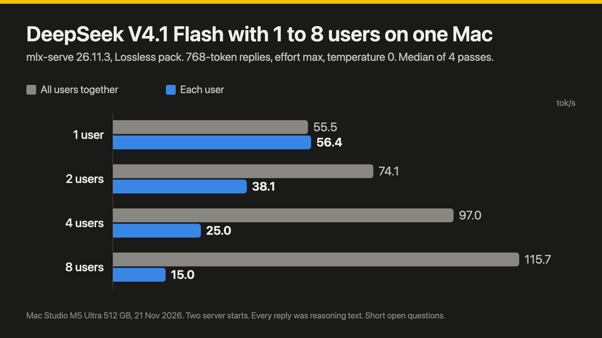

# Finding 13. DeepSeek V4.1 Flash with 1 to 8 users on one Mac, mlx-serve 26.11.3

By Local LLM L-Plate. Follow [@LazyLocalLLM on X](https://x.com/LazyLocalLLM) for new benchmarks.

ELI5: Every finding before this one times one user. Here I asked what happens when 2, 4 or 8 people ask at once. I borrowed the test from a public write-up of two Mac Studios joined by cable, so that one Mac with 512 GB can be read against it. The questions are short and open, and the model thinks at its highest effort. On that text the engine's drafts hardly land, so this is close to plain decoding.

**One Mac Studio M5 Ultra 512 GB wrote 55.5 to 57.4 tok/s for one user on DeepSeek V4.1 Flash at full precision, on stock mlx-serve 26.11.3. With 8 users at once it wrote 115.0 to 116.2 tok/s in total, which is about 15 tok/s each. Short open questions, 768-token replies, reasoning effort max, temperature 0. Every reply was reasoning text. Four passes over two server starts, 21 Nov 2026.**

| Users at once | All users together, tok/s | Each user, tok/s | First token, s |
|---|---|---|---|
| 1 | 55.5 (54.5 to 56.2) | 56.4 (55.5 to 57.4) | 0.26 |
| 2 | 74.1 (72.3 to 74.4) | 38.1 (37.0 to 40.6) | 0.37 |
| 4 | 97.0 (96.4 to 98.0) | 25.0 (24.5 to 30.6) | 0.69 |
| 8 | 115.7 (115.0 to 116.2) | 15.0 (14.5 to 16.7) | 1.18 |

- **All users together** is the reply tokens of every stream over the wall time, from the start to the last stream's end. The figure is the middle of the 4 passes, with the lowest and highest pass in brackets.
- **Each user** is one stream's own speed, from its first streamed piece to its last. The figure is the middle of every stream at that count, with the slowest and fastest stream in brackets.
- **First token** is the middle of every stream at that count. At 8 users the slowest stream waited 2.32 s.
- **This is not a median of 5 like my other findings.** It is 4 passes. With one user, every pass asked the same first question of the eight.

## Chart

ELI5: Grey is what the Mac writes in total. Blue is what each person gets.



## What more users cost and buy

ELI5: The Mac can serve several people in one pass over the model. The total goes up and each person's share goes down.

- **Eight users got 2.1 times the total of one.** 115.7 / 55.5 = 2.08 times.
- **Each of the eight got about a quarter of a lone user's speed.** 15.0 / 56.4 = 0.27 times.
- **Two users got 1.3 times the total.** 74.1 / 55.5 = 1.34 times, at 38.1 each.
- **The passes agree.** At every count the four totals sit within 4% of each other.
- **Memory.** The server process held 99.2 GiB after load and 99.6 GiB at the end, by `ps`. The context was 65,536 tokens with 16 slots.

## Why this is lower than my code figures

ELI5: mlx-serve drafts a few tokens ahead and checks them. When the drafts are right the speed jumps. On this text they were almost never right, so the model wrote one token a step.

- **[Finding 8](../08_dsv41_mlxserve_26113) has the same engine and the same weights at 84.0 to 95.3 tok/s.** That is greedy on new code with thinking off, one user.
- **The server's own counts show the difference.** On this test it kept a middle value of 0.06 to 0.08 drafted tokens a round over the two starts. On finding 8's first start it kept 1.27.
- **So one user here is plain decoding.** The server's log gives its plain step time for each request. The middle value was 17.70 ms on both starts, and 1000 / 17.70 = 56.5 tok/s.
- **Two things differ from finding 8 at once**, the questions and the thinking. I did not separate them.

## The test

ELI5: The requests are not mine. They come from a public benchmark of this model on two Mac Studios, so that anyone can line up the two.

- **Where the test is from.** A [post on r/MacStudio](https://www.reddit.com/r/MacStudio/s/gcFkKGbfUq) of 21 Nov 2026 and its [how-to](https://github.com/daflood/mlx-serve/blob/dsv41-two-macs/TWO-MACS.md). The figures for one and two 256 GB Studios are there. I do not repeat them here.
- **What I took.** The several-users suite of the script `two-macs/scripts/rw_bench.py` in that branch. Its eight questions, 768-token replies, `reasoning_effort` of `max`, temperature 0, streamed. I read the script and sent the same requests with my own client.
- **How a pass runs.** The streams start together. Stream 1 asks question 1, stream 2 asks question 2, and so on. Each prompt opens with a tag that names the pass, so no prompt cache can hit. Every request shows 0 cached tokens.
- **The questions** are short and open, about a CPU's memory system, replication protocols, a bakery's oven, a star's life, a job scheduler's API, stagflation, TLS 1.3 and a rail trip. The prompts came to 77 to 93 tokens.
- **What is not the same as the post.** The pack. Mine is the full-precision Lossless pack below. The post ran a 3-bit pack on one Studio and a different 4-bit pack on two. One machine here, and no patches.

## The setup

ELI5: One engine at its newest release, at its defaults, with the context and slot count of the how-to.

- **Engine.** [mlx-serve](https://github.com/ddalcu/mlx-serve) 26.11.3, the newest release on 21 Nov 2026, installed from the project's Homebrew formula.
- **Weights.** [ddalcu/DeepSeek-V4.1-Flash-1017-MLX-Serve-Lossless](https://huggingface.co/ddalcu/DeepSeek-V4.1-Flash-1017-MLX-Serve-Lossless), the mlx-serve author's pack at the precision DeepSeek ships, 4-bit experts and an 8-bit trunk.
- **Serve command.**

```bash
mlx-serve --model <model folder> --serve --host 127.0.0.1 --port <port> --ctx-size 65536 --max-concurrent 16 --warmup-full
```

- **What the log says about the start.** "batched decode on". "PLD speculative decoding: ENABLED". "DSpark 3 stages". "lm head requantized to 8-bit (MLX_SERVE_DSV41_HEAD8=0 keeps it dense)". So this is not a bit-exact run, as in finding 8.
- **Two starts.** Run `462a77fa2dc4` from 12:52 SGT with passes a and b, and run `9013484edbf3` from 12:58 SGT with passes c and d.

## How I measured

- **Machine.** Mac Studio, Apple M5 Ultra, 80-core GPU, 512 GB, macOS 27.2, low power mode off.
- **One stream's speed** is its reply tokens minus one, over the time from its first streamed piece to its last. That is the script's own formula.
- **The total** is the reply tokens of all streams over the wall time of the pass.
- **Reply tokens** are the server's count in the stream's usage block. Every stream wrote 768 tokens, and the server counted all 768 as reasoning tokens.
- **No request failed.** 60 streams in all.

## Things to know before you compare

ELI5: A speed is only comparable with another speed measured the same way.

- **Reasoning text.** Nothing here is an answer speed.
- **One user is one question.** The other seven questions were asked only when several users ran.
- **Drafted speed depends on the text.** The same engine and weights wrote 84.0 to 95.3 on code. Neither figure is the model's one speed.
- **A different pack will read differently.** I have run one.

## Check it yourself

ELI5: Every stream is in this folder. Open `rows.csv` on GitHub and it shows as a table you can search.

- **`rows.csv`.** 60 lines, one per stream. The run, the pass, the number of users, the stream, the question number, its own speed, the pass total, the wall time, the first token time and the token counts.
- **`runs.csv`.** The two server starts, with the version, the weights, the flags and what the log said.
- **No script.** The requests are those of the script linked above. `tools/summarize.py` does not read this folder.

## What I did not verify

- **The post's own packs on this Mac.** Its 3-bit pack on one Mac is the like-for-like run, and it is next.
- **Any other engine on this test.**
- **The same questions with thinking off**, or with the model's own sampler.
- **Long prompts with several users**, and more than 8 users.
- **What the replies say.** I kept the counts and not the text.
- **Peak memory during a pass.**

## Credit

- **The test.** u/runlocalmodels on r/MacStudio, and the `daflood/mlx-serve` branch `dsv41-two-macs`.
- **Engine and weights.** [mlx-serve](https://github.com/ddalcu/mlx-serve) and the Lossless pack by ddalcu.
- **Model.** DeepSeek V4.1 Flash by DeepSeek.

If a setting here is wrong, open an issue and I will rerun it.

Follow [@LazyLocalLLM on X](https://x.com/LazyLocalLLM) for new benchmarks.
