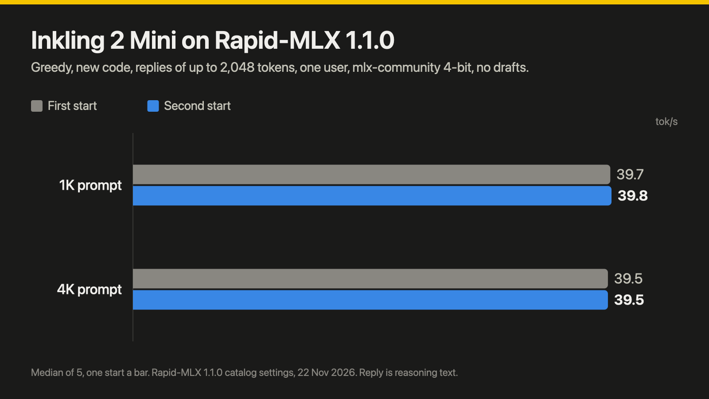

# Finding 23. Inkling 2 Mini on Rapid-MLX 1.1.0, max and median speed

By Local LLM L-Plate. Follow [@LazyLocalLLM on X](https://x.com/LazyLocalLLM) for new benchmarks.

ELI5: Rapid-MLX 1.1.0 added Inkling 2 Mini to its catalog. Its catalog names the pack, mlx-community's 4-bit, and turns speculative decoding off for it. I served it by the catalog name with those settings. Max is greedy at temperature 0 while writing new code. Median is the model's own sampler on mixed text.

**Rapid-MLX 1.1.0 wrote 39.8 tok/s on Inkling 2 Mini at its max, on its latest start, and 39.7 on the start before. With the model's own sampler it wrote 39.4. Every test sat between 39.4 and 40.0, greedy or sampled, 1K or 4K prompt, 512 or 2,048-token replies. The first token came after 0.50 s at a 1K prompt and 1.59 s at 4K. The replies were reasoning text, though the request switched thinking off. 54 of 55 timed replies streamed no answer text. Mac Studio M5 Ultra 512 GB, one user, median of 5 runs, 22 Nov 2026.**

| Setting | Max, tok/s | Median, tok/s |
|---|---|---|
| The catalog's settings, latest start | 39.8 | not run on this start |
| The catalog's settings, first start | 39.7 | 39.4 |

- **Max** is the middle of 5 greedy runs on new code with replies of up to 2,048 tokens, at the faster of the 1K and 4K prompts.
- **Median** is the middle of 5 runs with the model's own sampler, mixed text, 512-token replies, 4K prompt.
- **The summary page shows the latest start**, 39.8, by my rule. The two starts are level.
- **These are reasoning speeds.** The section "What the replies were" says why.
- **No drafts.** Rapid-MLX's catalog marks this model with speculative decoding off, and its log says "spec decode OFF".

## Chart

ELI5: The top speed on new code for each start. One bar per start and prompt size.



## Every test

ELI5: Each cell is the middle of 5 runs, with the slowest and fastest run in brackets.

Decode tok/s. The first start is run `3bef921b4076` and the second is `3c2cb9130c7b`.

| Test | Prompt | First start | Second start |
|---|---|---|---|
| Greedy, new code, replies up to 2,048 tokens | 1K | 39.7 (39.5 to 39.7) | 39.8 (39.5 to 40.0) |
| Greedy, new code, replies up to 2,048 tokens | 4K | 39.5 (39.3 to 39.5) | 39.5 (39.4 to 39.5) |
| Greedy, new code, 512-token replies | 1K | 39.8 (39.5 to 40.0) | not run |
| Greedy, new code, 512-token replies | 4K | 39.6 (39.6 to 40.1) | not run |
| Own sampler, mixed text, 512-token replies | 4K | 39.4 (39.3 to 39.9) | not run |
| Greedy, copy task, 512-token replies | 1K | 39.9 (39.2 to 40.2) | not run |
| Greedy, copy task, 512-token replies | 4K | 39.7 (39.5 to 39.8) | not run |
| Greedy, counting toy, 512-token replies | 1K | 40.0 (39.9 to 40.3) | not run |
| Greedy, counting toy, 512-token replies | 4K | 40.0 (39.8 to 40.1) | not run |

- **The speed hardly moves with the text.** Code, mixed text, a copy task and a counting toy all sit within 0.6 tok/s. That is what decoding one token a step looks like, with no drafts to gain on easy text.
- **The prompt size hardly matters either.** 39.7 at 1K and 39.5 at 4K on long code replies.
- **The first token** came after 0.50 s (0.47 to 0.77) at 1K and 1.59 s (1.39 to 1.79) at 4K.
- **Every timed reply ran to its token limit**, 2,048 or 512.
- **No copy or counting line goes on the summary.** The model spent those replies reasoning, as on the other tests.

## What the replies were

ELI5: The request asked the model not to think. It thought anyway, as on oMLX and mlx-serve in findings 16 and 20.

- **The timed replies streamed no answer text.** 54 of the 55 timed rows have no time for a first answer piece. The stream carried the text as reasoning.
- **The stream carried the reasoning in its own field.** One greedy check request on 23 Nov 2026 at 02:20 SGT, with thinking off as above and 512 tokens. 468 of 469 text pieces came in `reasoning_content`, 1,808 characters. The answer field got one piece of 3 characters, the opening of a code block.
- **A plain request split the same way.** 1,808 characters of reasoning and 3 of answer.
- **Rapid-MLX's own count says half.** Its usage field reported 250 of the 512 tokens as reasoning tokens. The harness takes an engine's own count when there is one, so `rows.csv` shows about half of each reply as answer tokens. By the stream, nearly all of it was reasoning. I read the stream.
- **The answer check.** 50 short greedy questions asked twice, 64-token replies, on 22 Nov 2026 at 21:19 SGT. The second pass equalled the first on 50 of 50. All 100 replies opened as thinking, each starting "The user", such as "The user pasted a session ID". In those short replies the reasoning field and the answer field held text of the same length, 100 of 100.
- **The check runs have no timed rows.** They are `3017b2f7c443` for the stream check and `b7340aa0cf1d` for the answer check.

## Reference points

ELI5: My usual baseline is Apple's `mlx-lm` on the same weights. Its newest release can't run this model, so there is no multiple of `mlx-lm` here.

- **`mlx-lm` 0.32.2 has no Inkling 2 model.**
- **The same model on other engines,** each with another pack, is in [finding 20](../20_inkling2_mini_mlxserve_pre) on mlx-serve, [finding 21](../21_inkling2_mini_mtplx_213) on MTPLX, and findings [14](../14_inkling2_mini_omlx_081) and [16](../16_omlx_082_refresh) on oMLX. Findings 14, 20 and 21 also have lines with drafts off. Those are different weights, so a ratio to them would mix the engine with the pack. I give none.

## The setup

ELI5: One engine at its newest release, the pack its own catalog names, and a fresh server start for each block.

- **Engine.** [Rapid-MLX](https://github.com/raullenchai/Rapid-MLX) 1.1.0, the newest release, from PyPI with `uv tool install --python 3.12 'rapid-mlx==1.1.0'`. Telemetry off by its own switches.
- **Serve command.** The catalog name, bound to this Mac, downloads off, served from a local Hugging Face cache.

```bash
rapid-mlx serve inkling-2-mini-4bit --host 127.0.0.1 --port 8224 --disable-model-downloads
```

- **What its log said.** "Model profile: inkling-2-mini-4bit → hybrid (linear-attention/Mamba), throttle ON, spec decode OFF, tool=inkling, reasoning=inkling" and "KV cache dtype: bf16".
- **The throttle** spaces new requests apart when several users arrive, by its source. One user at a time would not meet it. That is my reading of the code, not a test.
- **Weights.** [mlx-community/Inkling-2-Mini-4bit](https://huggingface.co/mlx-community/Inkling-2-Mini-4bit) @ 9856dc53, the revision Rapid-MLX 1.1.0's catalog pins for that name. 16.1 GiB, every file verified against the pinned commit. Hugging Face's scan was done with no file flagged.
- **The model.** [thinkingmachines/Inkling-2-Mini](https://huggingface.co/thinkingmachines/Inkling-2-Mini), 26.4B weights with 3.4B active per token. Apache 2.0.
- **Sampler.** Temperature 1.0 and top-p 1.0, the model's own.
- **Thinking** switched off in every request the way Rapid-MLX takes it, `reasoning_effort: none`. Its log reads "reasoning_effort=none translated".

| Run id | Setting | Started, SGT, 22 Nov 2026 |
|---|---|---|
| `3bef921b4076` | The catalog's settings | 20:47 |
| `3c2cb9130c7b` | The catalog's settings, second start | 21:04 |

## How I measured

ELI5: Same Mac, same harness, same texts and same questions as findings 5 to 22.

- **Machine.** Mac Studio, Apple M5 Ultra, 80-core GPU, 512 GB, macOS 27.2, low power mode off.
- **Requests.** Chat requests through the model's chat template, streamed, one user at a time.
- **Greedy** means temperature 0 with no top-p or top-k sent.
- **Text.** Code from open-source projects for the greedy tests, and the harness's mixed text for the sampled test. Each prompt opens with a new session line.
- **Cached tokens.** Rapid-MLX reported 6 cached tokens on 54 of the 55 timed requests. Each prompt opens with a new session line, so at most the first few tokens could match.
- **Sizes.** "1K" and "4K" are targets at 3.5 characters per token. On this model's tokenizer the code prompts came to 1,065 to 2,072 tokens and 4,414 to 6,072.
- **Repeats.** 5 timed runs per cell. Each block of cells began with one 16-token warm-up request.
- **Writing speed** is tokens per second from the first streamed piece of the reply to the last, reasoning tokens included.

## Things to know before you compare

ELI5: A speed is only comparable with another speed measured the same way.

- **Reasoning text is not answer text.** Nothing here is an answer speed.
- **No drafts here.** Engines that draft several tokens a step show higher greedy speeds on the same model.
- **Different packs are different weights.** This 4-bit pack is not the packs of findings 16, 20 and 21.

## Check it yourself

ELI5: Every timed request is in this folder. You can redo every median.

- **`rows.csv`.** 61 raw rows from the bench database. 55 timed requests and 6 warm-ups.
- **`runs.csv`.** The 2 runs behind them, with engine, version, start time, settings and sampling.

From the top of this repository.

```bash
python3 tools/summarize.py findings/23_inkling2_mini_rapidmlx_110
```

## What I did not verify

- **Why decode stays at 39.7 tok/s.** I did not profile it.
- **Other settings.** I ran the catalog's settings only, with thinking off.
- **Answer quality, long prompts, several users at once, and images.**

## Credit

- **Engine.** [Rapid-MLX](https://github.com/raullenchai/Rapid-MLX) by [@rapidmlx](https://x.com/rapidmlx).
- **Pack.** [mlx-community](https://huggingface.co/mlx-community).
- **Model.** Inkling 2 Mini by [Thinking Machines](https://x.com/thinkymachines).

If a setting here is wrong, open an issue and I will rerun it.

Follow [@LazyLocalLLM on X](https://x.com/LazyLocalLLM) for new benchmarks.
