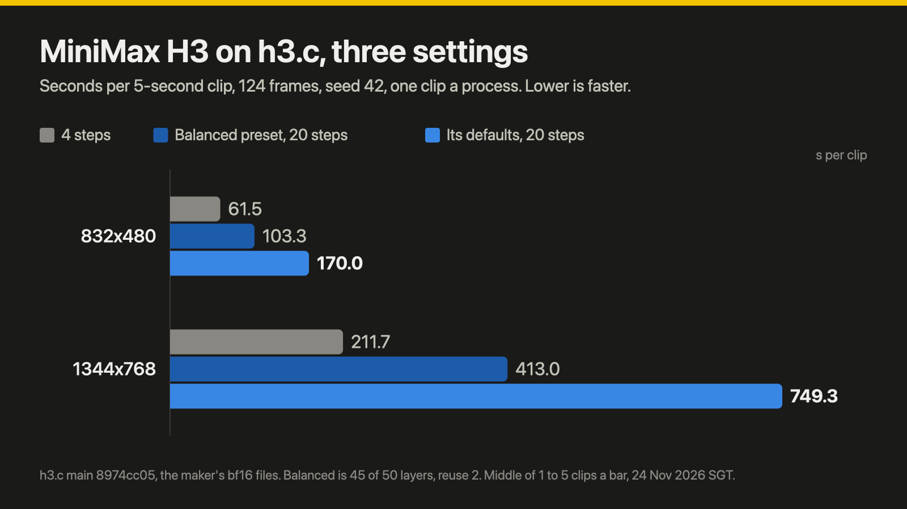

# Finding 36. MiniMax H3 video on h3.c, antirez's engine in C and Metal, main at 8974cc05

By Local LLM L-Plate. Follow [@LazyLocalLLM on X](https://x.com/LazyLocalLLM) for new benchmarks.

ELI5: h3.c is a MiniMax H3 engine written from scratch in C with Metal for Apple chips, by antirez. It reads the maker's own full-size files and, by its README, makes a video with sound from one command. I timed it at four of its settings, from its quickest to its slow reference, at two sizes.

**h3.c made a 5-second MiniMax H3 clip at 832 by 480 in 61.5 s at 4 steps, 103.3 s with its README's balanced preset and 170.0 s at its default 20 steps. At 1344 by 768, H3's native size, it took 211.7 s at 4 steps, 413.0 s balanced, 749.3 s at 20 steps and 1760.6 s, 29.3 minutes, at the 50-step reference. One clip a process on the maker's bf16 files, main at 8974cc05, no release. Mac Studio M5 Ultra 512 GB, 24 Nov 2026 SGT.**

| Setting on h3.c main 8974cc05 | 832x480, 5 s | 1344x768, 5 s |
|---|---|---|
| 4 steps, all 50 layers | 61.5 | 211.7 |
| Balanced preset, 20 steps, 45 layers, reuse 2 | 103.3 | 413.0 |
| Its defaults, 20 steps, all 50 layers | 170.0 | 749.3 |
| 50 steps, the reference | not run | 1760.6 |

- **Seconds per clip,** from starting the process to its exit, by the wall clock. Each clip is its own process, so each one loads the text encoder and the DiT again. h3.c wrote no MP4 (`-o ''`). The middle of the timed clips, warm-ups left out.
- **Clips.** 5 s is 124 frames at 24 fps. Each warm-up wrote its frames to a scratch folder, and the count and size were right on every one. Those frames were then deleted.
- **Runs.** 5 timed clips for 4 steps and for the defaults at 832x480, 3 for 4 steps at 1344x768, 2 for the balanced preset at each size, and 1 each for 20 and 50 steps at 1344x768, which take 12.5 and 29.3 minutes. The 20-step 832x480 figure pools two starts. Each cell's range is under "Every cell".
- **Per second of video.** 4 steps at 832x480 took 61.5 / 5.17 = 11.9 s of work per second of clip. 124 frames / 24 fps = 5.17 s.
- **No `mlx-lm` multiple.** `mlx-lm` makes no video, so this page has no baseline.

## Chart

ELI5: Seconds for one clip at three settings and two sizes. A shorter bar is faster.

The 50-step clip is in the tables, not on the chart.

## Where the time goes

ELI5: h3.c's `--profile` times each part of every clip. Loading the text encoder and the DiT, the denoising, then turning the result into frames and sound.

h3.c, by its own `--profile` lines, middle of the timed clips, seconds.

| Setting | Clip | Text encoder | DiT load | DiT, less its load | Video decode | Sound decode |
|---|---|---|---|---|---|---|
| 4 steps, 832x480 | 61.5 | 3.0 | 6.5 | 25.7 | 25.4 | 0.4 |
| Balanced, 832x480 | 103.3 | 3.4 | 5.9 | 66.5 | 26.7 | 0.4 |
| Defaults, 20 steps, 832x480 | 170.0 | 3.1 | 6.3 | 133.0 | 26.9 | 0.4 |
| 4 steps, 1344x768 | 211.7 | 3.1 | 6.5 | 131.1 | 70.2 | 0.4 |
| Balanced, 1344x768 | 413.0 | 3.2 | 6.0 | 332.4 | 70.5 | 0.4 |
| Defaults, 20 steps, 1344x768 | 749.3 | 3.3 | 6.2 | 668.7 | 70.3 | 0.4 |
| 50 steps, 1344x768 | 1760.6 | 3.3 | 6.5 | 1679.7 | 70.2 | 0.4 |

- **A step at 832x480 took 6.4 s at 4 steps and 6.7 s at 20.** The method is the DiT less its load, over the steps, from the table. 25.7 / 4 = 6.4 s. 133.0 / 20 = 6.7 s.
- **A step at 1344x768 took 32.8 s at 4 steps, 33.4 s at 20 and 33.6 s at 50.** 131.1 / 4 = 32.8 s. 668.7 / 20 = 33.4 s. 1679.7 / 50 = 33.6 s. So a longer run cost a little more a step.
- **The size costs more than its pixels.** 1344x768 has 1,032,192 / 399,360 = 2.58 times the pixels of 832x480, and a step at 4 steps took 32.8 / 6.4 = 5.1 times as long.
- **Video decode is fixed by the size.** 25.4 to 26.9 s at 832x480 and 70.2 to 70.3 s at 1344x768, whatever the steps.
- **The rest of the clip** is under 1 s, the process start and the tokenizer.
- **The first process of the night** read the files from disk. Its text encoder took 6.4 s and its DiT load 12.1 s, against 2.9 to 3.5 s and 5.9 to 6.5 s on every later process. It was a warm-up, so no table uses it.

## Its settings

ELI5: h3.c's README offers a few knobs. I used its own named settings, not my own mix.

- **Its defaults** are `--steps 20 --layers 50 --reuse 1`, by its README. Every step runs all 50 transformer blocks.
- **The balanced preset,** `--layers 45 --reuse 2`, is where its tutorial starts. It runs 45 of the 50 blocks and works out 11 of the 20 steps fresh, filling in the rest from them, by its README.
- **4 steps** is the quick end of its README's table, with all 50 layers and no reuse. Its README says 4 to 7 passes use one schedule, and that more of them add detail and motion. It runs H3's own weights, with no Turbo adapter.
- **50 steps** is its README's slow reference, the one to check a quick setting against.
- **Int8 maths.** On an M5, by its README's Metal 4 sections and its `--help`, h3.c's default path turns the DiT's MLP, QKV and attention-output weights into int8 as it loads them. Flags such as `--use-slower-bf16-mlp` keep them in bf16. I did not find a log line that confirms it on each clip.
- **Clips slowed within each start at 20 steps.** By its profile, the DiT less its load, over 20, at 832x480. Round one took 5.8 s a step on its warm-up, then 6.3 and 6.8 s. Round two took 5.7 s on its warm-up, then 6.3, 6.7 and 6.7 s. The five timed 4-step clips held at 6.4 to 6.5 s a step by the same sum. Its README warns that this work is sensitive to heat and suggests alternating settings. I ran each setting in one block. I did not find the cause of the slowing.

## Beside the other engines on this Mac

ELI5: Other engines ran the same prompt, seed and frame count on this Mac on 23 and 24 Nov. Their weights, adapters and step counts differ, so these are reference points, not a ranking.

| Engine and setting | Weights | Steps | 832x480 | 1344x768 | Where |
|---|---|---|---|---|---|
| h3.c, 4 steps | maker's bf16, int8 at load | 4 | 61.5 | 211.7 | here |
| h3.c, balanced preset | maker's bf16, int8 at load | 20, 11 fresh | 103.3 | 413.0 | here |
| h3.c, its defaults | maker's bf16, int8 at load | 20 | 170.0 | 749.3 | here |
| mlx-serve 26.11.3, Turbo | author's 8-bit pack, Turbo LoRA | 4 | 35.1 | 135.1 | [finding 34](../34_minimax_h3_video_mlxserve_round2) |
| mlx-serve 26.11.3, its default | author's 8-bit pack | 30, step cache | 109.3 | 471.4, 1 clip | [finding 33](../33_minimax_h3_video_mlxserve_rapidmlx) |
| mlx-serve 26.11.3, fast recipe off | author's 8-bit pack | 30 | 213.2, 1 clip | not run | [finding 33](../33_minimax_h3_video_mlxserve_rapidmlx) |
| Rapid-MLX 1.1.0, Turbo LoRA merged | maker's bf16 | 9 | 116.6 | 446.2 | [finding 33](../33_minimax_h3_video_mlxserve_rapidmlx) |

- **A step at 4 steps, by each engine's own clock.** At 832x480 h3.c took 6.4 s, and mlx-serve's 8-bit pack 6.1 s, its sampling of 24.5 s over 4, with its int8 path on. 6.4 / 6.1 = 1.05. At 1344x768, 32.8 s against 27.3 s. 32.8 / 27.3 = 1.20.
- **At the same 4 steps, h3.c's clip took 26.4 s longer at 832x480.** 61.5 − 35.1 = 26.4 s. Video decode took 25.4 s against mlx-serve's 9.7 s, so 15.7 s of it. h3.c's text encoder phase and DiT load, run in each process, took 3.0 + 6.5 = 9.5 s. mlx-serve's server keeps its model loaded, and reading the prompt took it about 0.15 s in finding 33. h3.c's 4 steps took 25.7 s against mlx-serve's 24.5 s of sampling, so 1.2 s. 15.7 + 9.5 + 1.2 = 26.4. All are middles from each engine's own clock.
- **The same step count is not the same work.** mlx-serve's Turbo runs a LoRA trained for 4 steps. h3.c's 4 steps run H3's own weights. I did not judge which clip looks better.
- **h3.c keeps the model loaded in its interactive session,** by its README. That would skip the per-process loading. The session writes an MP4 through FFmpeg, which this Mac does not have, so I did not time it.

## Every cell

ELI5: Every setting, its range and the number of clips.

| Setting | Size | Steps | Seconds | Range | Clips | Warm-ups | Run |
|---|---|---|---|---|---|---|---|
| 4 steps | 832x480 | 4 | 61.5 | 61.3 to 62.1 | 5 | 1 | `h3c11240422` |
| Balanced preset | 832x480 | 20 | 103.3 | 103.1 to 103.5 | 2 | 0 | `h3c11240311` |
| Defaults | 832x480 | 20 | 170.0 | 162.7 to 174.7 | 5 | 2 | `h3c11240311`, `h3c11240422` |
| 4 steps | 1344x768 | 4 | 211.7 | 211.2 to 211.9 | 3 | 1 | `h3c11240422` |
| Balanced preset | 1344x768 | 20 | 413.0 | 412.9 to 413.0 | 2 | 1 | `h3c11240453` |
| Defaults | 1344x768 | 20 | 749.3 | 749.3 | 1 | 1 | `h3c11240311` |
| 50 steps | 1344x768 | 50 | 1760.6 | 1760.6 | 1 | 0 | `h3c11240311` |

- **The defaults at 832x480 in each start.** Round one's 2 clips took 162.7 and 174.7 s. Round two's 3 took 162.9, 170.5 and 170.0 s. The two starts overlap, so they are pooled.
- **The 1344x768 warm-ups against the timed clips.** 763.6 s against 749.3 s at 20 steps, and 209.8 s against 211.7 s at 4 steps. The balanced preset's warm-up was quicker, 390.5 s against 412.9 and 413.0 s. Its DiT took 316.1 s on the warm-up and 338.3 to 338.4 s on the timed clips, by its profile.
- **Two cells had no warm-up of their own,** the balanced preset at 832x480 and the 50-step clip. They ran right after a warm-up at the same size, so their frames were not counted. Each process exited cleanly and its progress showed every denoising pass done.

## The setup

ELI5: h3.c at the head of its main branch, run as its README shows, one clip a process, with the network shut off.

- **h3.c** main at `8974cc05`, committed 11 Aug 2026, still the head of main on 24 Nov 2026 at 04:54 SGT. It has no tags or releases. MIT licence. Built with `make -j8`. Its shaders compile at run time.
- **The command for each clip.** `h3 --profile -d <FL2VA folder> -p "<prompt>" --width <W> --height <H> --frames 124 --steps <S> --seed 42 -o ''`, adding `--layers 45 --reuse 2` for the balanced preset and `--frames-dir <scratch>` on warm-ups. Each ran under `sandbox-exec` with all network denied, started in h3.c's own folder.
- **Weights.** [MiniMaxAI/MiniMax-H3](https://huggingface.co/MiniMaxAI/MiniMax-H3) @ 1cc7549f, the FL2VA folder, 134.1 GiB, bf16, every file checked against its SHA-256. h3.c's `--info` read the Qwen3-VL text encoder (62.1 GiB), the FL2VA DiT (61.7 GiB), the video VAE (9.7 GiB) and the audio VAE (0.6 GiB).
- **Prompt.** One sentence about a sailing boat at sunrise, the same as findings 33 and 34, seed 42.

| Run id | Cells | Started, SGT, 24 Nov 2026 |
|---|---|---|
| `h3c11240311` | Defaults and balanced at 832x480, 20 and 50 steps at 1344x768 | 03:11 |
| `h3c11240422` | Defaults again and 4 steps at 832x480, 4 steps at 1344x768 | 04:22 |
| `h3c11240453` | Balanced at 1344x768 | 04:53 |

## Licence

- **MiniMax H3's licence** covers use worldwide except the European Union, the United Kingdom, the Republic of Korea and the United States, and limits where outputs may be shown. The Mac is in Singapore. I publish timings only, no clip and no frame. h3.c wrote no MP4, and the warm-ups' frames were deleted after the count.

## Check it yourself

ELI5: Every clip's timing is in one file, with h3.c's own clock for each part.

- **`gen_video_rows.csv`.** 25 rows, one a clip, warm-ups included and marked. It holds the settings, the wall-clock seconds and h3.c's `--profile` phase times, plus the denoising passes its progress showed and the frame check on warm-ups.
- **`peak_tensor_gib`** is h3.c's own "peak live tensor storage", by its README. It was 18.7 to 20.6 GiB at 832x480 and 22.2 to 24.6 GiB at 1344x768. It is not the process's memory, so I quote no memory figure.

## What I did not verify

- **Clip quality.** I did not watch or grade the frames, so this page does not say which setting or engine looks better.
- **Sound.** h3.c decoded sound on every clip by its profile. With no MP4 written, I did not check it.
- **Its other speed switches.** `--ssd-streaming`, `--use-int8-row-fc2`, `--core-reuse`, `--token-reduction` and a smaller internal canvas. None were timed.
- **Its interactive session,** which keeps the model loaded between clips.
- **More prompts.** One prompt and seed throughout.

## Credit

- **h3.c.** [h3.c](https://github.com/antirez/h3.c) by [@antirez](https://x.com/antirez).
- **Model.** MiniMax H3 by MiniMax.

If a setting here is wrong, open an issue and I will rerun it.

Follow [@LazyLocalLLM on X](https://x.com/LazyLocalLLM) for new benchmarks.
