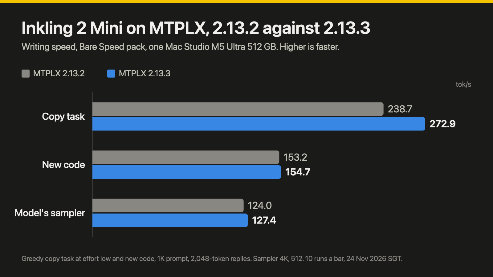

# Finding 39. Inkling 2 Mini on MTPLX 2.13.3, the copy task 1.1 times as fast and new code level

By Local LLM L-Plate. Follow [@LazyLocalLLM on X](https://x.com/LazyLocalLLM) for new benchmarks.

ELI5: MTPLX 2.13.3 came out on 24 Nov 2026 at 13:10 SGT. Its notes say code rewrites on Inkling 2 Mini now keep the speed of its copy lane, the path that writes text the model has already seen. Its author's post gives that lane's peak speed on another Mac. I ran 2.13.3 and 2.13.2 back to back on the Bare Speed pack, two starts each, on the same prompts.

**On the copy task, where Inkling 2 Mini repeats code from its prompt, MTPLX 2.13.3 wrote 272.9 tok/s against 2.13.2's 238.7, at a 1K prompt with reasoning effort low and replies of up to 2,048 tokens. It was faster on 18 of 20 same-prompt pairs, middle ratio 1.12. At a 4K prompt it wrote 265.7 against 224.6, faster on 17 of 20, 1.14. On new code and with the model's own sampler it was level, 154.7 against 153.2 and 127.4 against 124.0. The 50 short greedy replies match, 50 of 50.**

| Test, Bare Speed pack | 2.13.3 | 2.13.2 | Faster pairs | Middle ratio |
|---|---|---|---|---|
| Copy task, 1K prompt, effort low, 2,048 tokens | 272.9 | 238.7 | 18 of 20 | 1.12 |
| Copy task, 4K prompt, effort low, 2,048 tokens | 265.7 | 224.6 | 17 of 20 | 1.14 |
| New code, 1K prompt, 2,048 tokens | 154.7 | 153.2 | 8 of 20 | 0.99 |
| Model's own sampler, 4K mixed, 512 tokens | 127.4 | 124.0 | 11 of 20 | 1.03 |

- **Each figure** is the middle of 10 timed runs, a release's two starts pooled, in tok/s by my client's clock.
- **A pair** is one prompt on one 2.13.3 start against the same prompt on one 2.13.2 start. Two starts a release give 20 pairs a test.
- **Every reply here thinks first.** On the copy task it thought for 250 to 2,046 tokens before it copied. The split moved from run to run, even on one release, so part of a copy-task gap is what the model chose to write. The section below has a like-for-like check.
- **No `mlx-lm` multiple.** `mlx-lm` 0.32.2 has no Inkling 2 model, as finding 21 notes.

## Chart

ELI5: Both releases on the Bare Speed pack. Each bar is the middle of the 10 runs of a release's two starts.

## The copy task

ELI5: The copy task asks the model to repeat the code in its prompt word for word. That is text the model has seen, so MTPLX's copy lane can draft it in long runs. Inkling 2 Mini thinks before it answers. At its default effort and with 512-token replies it never got past the thinking, so I gave it reasoning effort low and room for 2,048 tokens.

| Prompt | 2.13.3 | 2.13.2 | Faster pairs | Middle ratio | Range |
|---|---|---|---|---|---|
| 1K | 272.9 | 238.7 | 18 of 20 | 1.12 | 0.86 to 1.23 |
| 4K | 265.7 | 224.6 | 17 of 20 | 1.14 | 0.95 to 1.69 |

- **Like for like.** On two of the five 1K prompts all four runs thought for 1,179 to 1,292 tokens, then copied for the rest. There 2.13.3 was faster on 8 of 8 pairs, 1.08 to 1.17 times over the whole reply and 1.05 to 1.18 times over the copied part alone.
- **Replies that were all thinking.** At 4K, 6 of 2.13.3's 10 replies and 7 of 2.13.2's 10 never finished thinking. Those ran 232.0 to 299.5 tok/s on 2.13.3, middle 270.1, and 180.9 to 247.1 on 2.13.2, middle 225.7. The thinking quotes the code it is asked to repeat, which may be why it runs this fast. I did not check that.
- **The fastest single reply** was 314.4 tok/s over 2,048 tokens on 2.13.3, and 343.0 over its copied part alone. The author's peak is from a different Mac, so this page is not a comparison with it.
- **Reasoning effort low.** The requests send `reasoning_effort: low`. By my reading of `mtplx/server/openai.py` and `mtplx/models/inkling/protocol.py` at the tag, MTPLX passes it into Inkling's chat template and uses "high" when a request sends none. MTPLX's log does not record it, so I did not confirm that the model saw "low".
- **At the default effort,** in the first job with 512-token replies, every copy-task reply was about 509 thinking tokens of 512. Those rows are thinking text, and 2.13.3 read 1.07 and 1.14 there. They are in rows.csv, labelled.
- **Not a rewrite.** The notes' speed-up is for a rewrite with edits in the MTPLX app, on an M5 Max. This is a word-for-word copy through the API. I did not test a rewrite.

## Thinking switched off

ELI5: Switching thinking off would let the model copy at once. On this pack it gave no text at all.

- **What I sent.** `chat_template_kwargs: {"enable_thinking": false}`, the switch MTPLX's API docs give for turning thinking off.
- **What came back.** On 2.13.3, run 705aaa0cd034, the stream returned no text on the copy task at 1K and 4K, so no speed could be timed. MTPLX's log shows 512 tokens generated for each request, each one opening with a `<think>` block. [Finding 21](../21_inkling2_mini_mtplx_213) found the same on 2.13.0 and 2.13.1.
- **The job stopped there,** as written. 2.13.2 was not run with thinking off tonight.

## New code, the sampler and counting

ELI5: The first job, with no thinking field, as in finding 29. Two starts each, 20 pairs a test.

| Test | 2.13.3 | 2.13.2 | Faster pairs | Middle ratio |
|---|---|---|---|---|
| New code, 1K, 512 tokens | 145.6 | 145.1 | 12 of 20 | 1.02 |
| New code, 4K, 512 tokens | 140.1 | 135.2 | 12 of 20 | 1.05 |
| New code, 1K, 2,048 tokens | 154.7 | 153.2 | 8 of 20 | 0.99 |
| New code, 4K, 2,048 tokens | 153.0 | 147.7 | 14 of 20 | 1.03 |
| Model's own sampler, 4K mixed, 512 tokens | 127.4 | 124.0 | 11 of 20 | 1.03 |
| Counting toy, 1K, 512 tokens | 159.7 | 164.2 | 10 of 20 | 1.00 |
| Counting toy, 4K, 512 tokens | 166.2 | 163.8 | 12 of 20 | 1.01 |

- **Level.** Single starts spread by 0.93 to 1.06 text by text (finding 29), so a change under about 5% would not show here.
- **Optimized Quality,** one start each. New code at 512 tokens read 1.02 and 0.98. The copy task at the default effort, all thinking, read 1.11 and 1.03.
- **Not run on 2.13.3.** Optimized Speed, the draft head off, and Optimized Quality's sampler and 2,048-token tests. Those lines stay on 2.13.2.

## Did the text change

ELI5: 50 short questions, asked twice, greedy, on each start.

- **50 of 50 the same** between 2.13.3 and 2.13.2 on both packs, and between the two starts of each release. Every reply was thinking text with an empty answer, as in finding 29. The release notes say greedy output is bit-for-bit the same.
- **Long replies drifted.** On the copy task, replies of up to 2,048 tokens split between thinking and copying differently from start to start, even on one release. I did not trace why.

## The summary page

- **Bare Speed with the draft head on moves to 2.13.3,** start b, run c879c4240423, the latest start, as for finding 29. Max 154.2 at 1K and 154.8 at 4K, median 127.0. The three 2.13.2 lines are marked older release.
- **The copy task is not on the summary page.** Its replies mix thinking and copying, so it is not the plain copy figure the summary's ceiling table holds.

## The setup

ELI5: The same pack, serve line and harness as finding 29, with 2.13.3 in its own folder.

- **Engine.** [MTPLX](https://github.com/youssofal/MTPLX) 2.13.3, tag v2.13.3 at commit b16e30ee, released on GitHub 24 Nov 2026 13:10 SGT, not a pre-release. Installed from source with `uv sync --locked --no-dev --extra server --python 3.12` into its own folder. `mtplx --version` prints 2.13.3. 2.13.2 at 3890be55 stayed in its own folder.
- **Serve.** `mtplx serve --model <pack folder> --host 127.0.0.1 --port <port> --context-window 131072 --no-stats-footer`, with `HF_HUB_OFFLINE=1` and no internet while it ran. The log reads the Sustained profile and the active Inkling drafter, as in finding 29.
- **Packs.** [Youssofal/Inkling-2-Mini-MTPLX-Bare-Speed](https://huggingface.co/Youssofal/Inkling-2-Mini-MTPLX-Bare-Speed) and Optimized Quality, the files of finding 21.
- **Requests.** One user, streamed. Greedy, temperature 0, for new code, the copy task and counting. The model's own sampler, temperature 1.0 and top-p 1.0, for mixed text. 5 timed runs a test after a warm-up.
- **Three jobs, 24 Nov 2026 SGT.** No thinking field, 19:48 to 20:23. Thinking switched off, 20:28 to 20:30. Reasoning effort low, 20:32 to 20:41. Each ran the order 2.13.3, 2.13.2, 2.13.2, 2.13.3, with a new server for every start.
- **Mac.** Mac Studio M5 Ultra 512 GB, macOS 27.2.

## How I measured

ELI5: Same Mac, same harness and same prompts as finding 29.

- **Writing speed** is tokens written less one, over the time from the first streamed piece to the last, by my client's clock. Thinking counts, so a reply that is all thinking has a speed.
- **Same prompts.** Each run uses the seed target times 1,000 plus the run number, so run 3 at 1K reads the same prompt on every release.
- **Not quiet.** 11 timed rows of run c37a57b4f6c2, 19:48:54 to 19:49:38 SGT, ran beside two X page loads and GitHub API calls on this Mac. The second 2.13.3 start read 144.5 and 144.1 on those new-code tests, against 146.6 and 140.0 on the first.

## Check it yourself

ELI5: Every timed request is in this folder. You can redo every median.

- `rows.csv` holds every request of the eleven runs, warm-ups marked. `runs.csv` holds each run's engine, pack and settings.
- From the top of the repository, `python3 tools/summarize.py findings/39_inkling2_mini_mtplx_2133` prints the median and range of each run.

## What I did not verify

- A rewrite with edits, the release notes' own test.
- The Flash-Next speed-up the notes give for M5 Ultra (#682). No MTPLX Flash-Next pack is on this Mac.
- That `reasoning_effort: low` reached the model.
- Whether any reply is a good answer. I read none of them for quality.

## Credit

MTPLX is by Youssof Al Toukhi, [@Youssofal_](https://x.com/Youssofal_). Inkling 2 Mini is by Thinking Machines. If I have set MTPLX up wrong, [open an issue](https://github.com/LazyLocalLLM/m5-ultra-512-benchmarks/issues) and I will rerun it.

Follow [@LazyLocalLLM on X](https://x.com/LazyLocalLLM) for new benchmarks.
