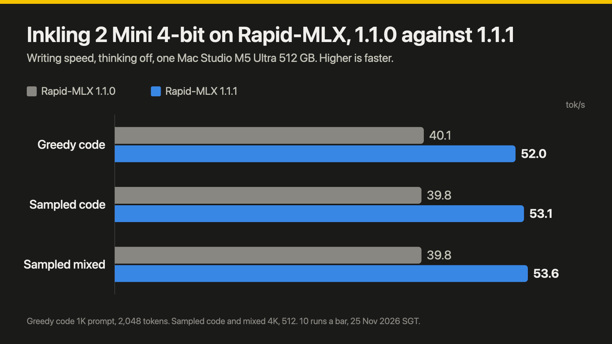

# Finding 41. Inkling 2 Mini on Rapid-MLX 1.1.1, 1.3 times as fast as 1.1.0

By Local LLM L-Plate. Follow [@LazyLocalLLM on X](https://x.com/LazyLocalLLM) for new benchmarks.

ELI5: Rapid-MLX 1.1.1 came out on 24 Nov 2026 at 06:41 SGT. Its notes say Inkling 2 Mini decodes faster, from three changes that fuse small per-token steps into single Metal kernels. I ran 1.1.1 and 1.1.0 back to back on the same 4-bit weights, two starts each, on the same prompts.

**Rapid-MLX 1.1.1 wrote Inkling 2 Mini 4-bit at 52.0 tok/s against 1.1.0's 40.1, on greedy code at a 1K prompt with 2,048-token replies. It was faster on 20 of 20 same-prompt pairs, middle ratio 1.30. Every test read the same way, 20 of 20 pairs and 1.30 to 1.35 times. The text changed. The 50 short greedy replies of 1.1.1 match none of 1.1.0's, 0 of 100, while each release matches itself across its two starts, 100 of 100.**

| Test, thinking off | 1.1.1 | 1.1.0 | Faster pairs | Middle ratio |
|---|---|---|---|---|
| Greedy code, 1K prompt, 2,048 tokens | 52.0 | 40.1 | 20 of 20 | 1.30 |
| Greedy code, 4K prompt, 2,048 tokens | 51.8 | 39.7 | 20 of 20 | 1.31 |
| Model's own sampler, new code, 4K, 512 tokens | 53.1 | 39.8 | 20 of 20 | 1.33 |
| Model's own sampler, 4K mixed, 512 tokens | 53.6 | 39.8 | 20 of 20 | 1.35 |

- **Each figure** is the middle of 10 timed runs, a release's two starts pooled, in tok/s by my client's clock, on 25 Nov 2026 SGT.
- **A pair** is one prompt on one 1.1.1 start against the same prompt on one 1.1.0 start. Two starts a release give 20 pairs a test.
- **The pairs differ in text.** The two releases wrote different words for the same prompt, so a pair is the same prompt, not the same reply. Speed still compares. Neither release drafts, and 1.1.0 read 39.7 to 40.4 on every test here, as it did on 22 Nov in [finding 23](../23_inkling2_mini_rapidmlx_110).
- **Every reply is reasoning text.** Inkling 2 Mini thought for the whole reply on both releases, with thinking off and on. The section below has the details.
- **No `mlx-lm` multiple.** `mlx-lm` 0.32.2 has no Inkling 2 model, as finding 21 notes.

## Chart

ELI5: Both releases with thinking off. Each bar is the middle of the 10 runs of a release's two starts.

## Thinking on

ELI5: Four more starts with no thinking field in the request, in the same order. More greedy code rows on each release.

| Test, thinking on | 1.1.1 | 1.1.0 | Faster pairs | Middle ratio |
|---|---|---|---|---|
| Greedy code, 1K prompt, 512 tokens | 53.9 | 40.4 | 20 of 20 | 1.34 |
| Greedy code, 4K prompt, 512 tokens | 53.7 | 40.0 | 20 of 20 | 1.34 |

- **Range.** The 40 pairs ran 1.31 to 1.40 times.
- **First token** was about level. 0.46 s on 1.1.1 against 0.50 s on 1.1.0 at 1K, and 1.57 s against 1.60 s at 4K, middles of 10.

## Did the text change

ELI5: 50 short questions, asked twice, greedy, 64-token replies, on each start. The check hashes the reasoning and the answer together.

- **Within a release, 100 of 100 the same.** Between the two starts of 1.1.1, and between the two starts of 1.1.0.
- **Between releases, 0 of 100.** Every pair parted at the third word. On 1.1.0, 84 of 100 replies opened "The user pasted a". On 1.1.1, 72 of 100 opened "The user asks to".
- **The prompt changed.** For the same request 1.1.1 counted 268 prompt tokens where 1.1.0 counted 270, on all 50 questions. On the 10 greedy code prompts of the first start of each, 1.1.1 counted 0 to 4 fewer on 9 and 1 more on 1. I did not trace which change in 1.1.1 does it.
- **I read none of the replies for quality.**

## Thinking switched off

ELI5: The bench switches Inkling's thinking off on Rapid-MLX by sending reasoning effort "none". 1.1.1's notes say a request that turns thinking off is now sent to the model at that effort.

- **What I sent.** `reasoning_effort: "none"` in every thinking-off request, the switch used in finding 23.
- **What came back.** On each release the 100 short replies with that field equal the 100 with no field, 100 of 100. Every timed reply, 512 or 2,048 tokens, streamed as reasoning text on both releases.
- **Not tested.** `enable_thinking: false`, the switch the notes name.

## The summary page

- **Inkling 2 Mini 4-bit on Rapid-MLX moves to 1.1.1,** start b with thinking off, run da2de99a1514, the latest start, as in findings 29 and 39. Max 51.9 at 1K and 51.7 at 4K with 2,048-token replies, median 53.6. The three 1.1.0 lines are marked older release.
- **Code column.** The same run, the model's own sampler on new code at 4K with 512-token replies, 53.2.

## The setup

ELI5: The same weights, serve line and harness as finding 23, with 1.1.1 in its own folder.

- **Engine.** [Rapid-MLX](https://github.com/raullenchai/Rapid-MLX) 1.1.1, the newest release on PyPI, uploaded 24 Nov 2026 06:41 SGT, tag v1.1.1. Installed from the PyPI wheel after checking its SHA-256 against PyPI's (147a4355), with `uv tool install --python 3.12` into its own folder. `rapid-mlx --version` prints 1.1.1. 1.1.0 stayed in its own folder. Both use mlx 0.32.4 and mlx-lm 0.31.3.
- **Serve.** `rapid-mlx serve inkling-2-mini-4bit --host 127.0.0.1 --port <port> --disable-model-downloads`, the catalog name, with `HF_HUB_OFFLINE=1`, telemetry and the version check off, and no internet while it ran. The log reads the Inkling reasoning parser on both releases. No drafts.
- **Weights.** [mlx-community/Inkling-2-Mini-4bit](https://huggingface.co/mlx-community/Inkling-2-Mini-4bit) at revision 9856dc53, the revision Rapid-MLX pins, the files of finding 23.
- **Requests.** One user, streamed, ctx 131072. Greedy, temperature 0, for greedy code. The model's own sampler, temperature 1.0 and top-p 1.0, for sampled code and mixed text. 5 timed runs a test after a warm-up.
- **One job, 25 Nov 2026 SGT, 08:27 to 09:41.** Thinking off in the order 1.1.1, 1.1.0, 1.1.0, 1.1.1, then thinking on in the same order, with a new server for every start.
- **Mac.** Mac Studio M5 Ultra 512 GB, macOS 27.2.

## How I measured

ELI5: Same Mac, same harness and same prompts as finding 23.

- **Writing speed** is tokens written less one, over the time from the first streamed piece to the last, by my client's clock. Thinking counts, so a reply that is all thinking has a speed.
- **Same prompts.** Each run uses the seed target times 1,000 plus the run number, so run 3 at 1K reads the same prompt on every release.

## Check it yourself

ELI5: Every timed request is in this folder. You can redo every median.

- `rows.csv` holds every request of the eight runs, warm-ups marked. `runs.csv` holds each run's engine, weights and settings.
- From the top of the repository, `python3 tools/summarize.py findings/41_inkling2_mini_rapidmlx_111` prints the median and range of each run.

## What I did not verify

- `enable_thinking: false`, the notes' own switch for thinking off.
- Which change in 1.1.1 moved the prompt token counts.
- Whether any reply is a good answer.
- Hy4 flash, which 1.1.1 adds. Its 4-bit build is not on this Mac.

## Credit

Rapid-MLX is by [@rapidmlx](https://x.com/rapidmlx). Inkling 2 Mini is by Thinking Machines. The 4-bit weights are by [mlx-community](https://huggingface.co/mlx-community). If I have set Rapid-MLX up wrong, [open an issue](https://github.com/LazyLocalLLM/m5-ultra-512-benchmarks/issues) and I will rerun it.

Follow [@LazyLocalLLM on X](https://x.com/LazyLocalLLM) for new benchmarks.
