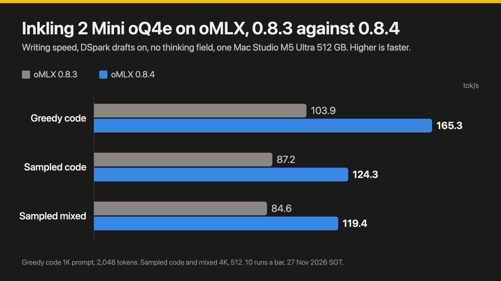

# Finding 44. Inkling 2 Mini on oMLX 0.8.4, 1.4 to 1.6 times as fast as 0.8.3

By Local LLM L-Plate. Follow [@LazyLocalLLM on X](https://x.com/LazyLocalLLM) for new benchmarks.

ELI5: oMLX 0.8.4 came out on 26 Nov 2026 at 21:37 SGT. Its notes say Inkling 2 Mini got much faster, from new fused Metal kernels. I ran 0.8.4 and 0.8.3 back to back on the same weights, two starts each, on the same prompts, for three setups that sit on the summary page.

**oMLX 0.8.4 wrote Inkling 2 Mini oQ4e at 165.3 tok/s against 0.8.3's 103.9, on greedy code at a 1K prompt with 2,048-token replies. It was faster on 20 of 20 same-prompt pairs, middle ratio 1.59. Every test of every setup read the same way, 240 of 240 pairs faster, middle ratios 1.43 to 1.61. The greedy text changed. Only 8 to 18 of 100 short greedy replies match across the two releases, while each release matches itself across its two starts, 100 of 100.**

| Inkling 2 Mini oQ4e, no thinking field | 0.8.4 | 0.8.3 | Faster pairs | Middle ratio |
|---|---|---|---|---|
| Greedy code, 1K prompt, 2,048 tokens | 165.3 | 103.9 | 20 of 20 | 1.59 |
| Greedy code, 4K prompt, 2,048 tokens | 151.3 | 97.0 | 20 of 20 | 1.59 |
| Model's own sampler, new code, 4K, 512 tokens | 124.3 | 87.2 | 20 of 20 | 1.44 |
| Model's own sampler, 4K mixed, 512 tokens | 119.4 | 84.6 | 20 of 20 | 1.43 |

- **Each figure** is the middle of 10 timed runs, a release's two starts pooled, in tok/s by my client's clock, on 27 Nov 2026 SGT.
- **A pair** is one prompt on one 0.8.4 start against the same prompt on one 0.8.3 start. Two starts a release give 20 pairs a test.
- **The pairs differ in text.** The two releases wrote different words for the same prompt, so a pair is the same prompt, not the same reply. Both releases drafted with DSpark on every start, and the server log shows draft lines on all 12.
- **Every reply is mostly reasoning text.** Inkling 2 Mini thought for most or all of each reply on both releases, with no thinking field and with thinking switched off. Thinking counts in the speed.
- **No `mlx-lm` multiple.** `mlx-lm` 0.32.2 has no Inkling 2 model, as finding 21 notes.

## Chart

ELI5: The setup of the summary's median line, no thinking field. Each bar is the middle of the 10 runs of a release's two starts.



## Thinking switched off, and the oQ3e build

ELI5: Four more starts each, in the same order. One with the oQ4e build and thinking switched off. One with the smaller oQ3e build and thinking switched off.

| Inkling 2 Mini oQ4e, thinking off | 0.8.4 | 0.8.3 | Faster pairs | Middle ratio |
|---|---|---|---|---|
| Greedy code, 1K prompt, 2,048 tokens | 152.7 | 96.9 | 20 of 20 | 1.61 |
| Greedy code, 4K prompt, 2,048 tokens | 145.6 | 92.2 | 20 of 20 | 1.56 |
| Model's own sampler, new code, 4K, 512 tokens | 121.5 | 83.2 | 20 of 20 | 1.47 |
| Model's own sampler, 4K mixed, 512 tokens | 111.2 | 71.4 | 20 of 20 | 1.56 |

| Inkling 2 Mini oQ3e, thinking off | 0.8.4 | 0.8.3 | Faster pairs | Middle ratio |
|---|---|---|---|---|
| Greedy code, 1K prompt, 2,048 tokens | 166.3 | 104.7 | 20 of 20 | 1.49 |
| Greedy code, 4K prompt, 2,048 tokens | 150.6 | 99.4 | 20 of 20 | 1.47 |
| Model's own sampler, new code, 4K, 512 tokens | 129.5 | 88.2 | 20 of 20 | 1.48 |
| Model's own sampler, 4K mixed, 512 tokens | 120.0 | 80.3 | 20 of 20 | 1.50 |

- **Range.** The 240 pairs of the three setups ran 1.02 to 2.27 times. The lowest pair is one sampled code prompt on oQ4e with no thinking field.
- **Prompt reading** got faster too. At 4K, middles of 10, 0.8.4 read 4,960.2 tok/s on greedy code against 3,231.0 on 0.8.3 (oQ4e, no thinking field), so first token came at 1.13 s against 1.69 s. The other setups read the same way, 4,445.2 to 4,784.0 against 3,076.6 to 3,211.0.

## Did the text change

ELI5: 50 short questions, asked twice, greedy, 64-token replies, on each start. The check hashes the reasoning and the answer together.

- **Within a release, 100 of 100 the same.** Between the two starts of 0.8.4, and between the two starts of 0.8.3, for all three setups.
- **Between releases, 8 to 18 of 100.** oQ4e with no thinking field 18 of 100, oQ4e with thinking off 8 of 100, oQ3e with thinking off 14 of 100. Most pairs part within the first 2 to 15 words. One pair, the same question on both releases. 0.8.3 wrote "two file excerpts from a Rust exercise", 0.8.4 wrote "two files from a Rust exercise".
- **The prompt did not change.** Both releases counted the same prompt tokens on all 50 questions.
- **My reading.** The notes put the gain in new fused Metal kernels for attention, experts and the loop layers. Fused kernels can add numbers in a different order, which can flip a close greedy choice. I did not trace which change moves the text.
- **I read none of the replies for quality.**

## The summary page

- **Inkling 2 Mini oQ4e on oMLX moves to 0.8.4,** the latest start of each setup, as in findings 39 and 41.
  - No thinking field, run 8aa06119f472. Max 165.9 at 1K and 145.5 at 4K with 2,048-token replies, median 116.6.
  - Thinking off, run f92fdb3c535b. Max 153.9 at 1K and 135.9 at 4K, median 109.1.
- **Inkling 2 Mini oQ3e on oMLX moves from 0.8.1 to 0.8.4,** run 2bd52e23895b. Max 169.2 at 1K and 158.1 at 4K, median 122.1.
- **Code column.** The same runs, the model's own sampler on new code at 4K with 512-token replies. oQ4e 122.6, oQ3e 130.7.
- **Left on 0.8.3.** The oQ4e drafts-off line, not rerun.
- **Qwen3.8 Flash Next full** ran in the same job, and its two start pairs did not agree. It is being rerun and is not in this finding.

## The setup

ELI5: The same weights, settings and harness as finding 26, with 0.8.4 in its own folder.

- **Engine.** [oMLX](https://github.com/jundot/omlx) 0.8.4, released 26 Nov 2026 21:37 SGT, tag commit bc55984a, installed from the tagged source with its custom kernels built (`OMLX_WITH_CUSTOM_KERNEL=1`). The source tarball's SHA-256 equals the one in the project's Homebrew formula. `omlx --version` prints 0.8.4, and all five kernel families report available. 0.8.3 stayed in its own folder.
- **Libraries.** 0.8.4 requires mlx 0.32.5 and ran on it, with mlx-vlm 0.8.1. 0.8.3 ran on mlx 0.32.4 and mlx-vlm 0.7.11. Both use mlx-lm at commit 0d4d3d04.
- **Serve command,** the same for both releases, each on its own port and folder.

```bash
omlx serve --model-dir <models> --host 127.0.0.1 --port <port> --max-concurrent-requests 1 --headless --no-hf-cache --base-path <home>
```

- **Weights,** each verified against its pinned commit.
  - [mlx-community/Inkling-2-Mini-oQ4e-mtp](https://huggingface.co/mlx-community/Inkling-2-Mini-oQ4e-mtp) @ 3eea0427.
  - [mlx-community/Inkling-2-Mini-oQ3e-mtp](https://huggingface.co/mlx-community/Inkling-2-Mini-oQ3e-mtp) @ 5552e32e.
- **Model settings**, in oMLX's own `model_settings.json`. `mtp_enabled` true, `a8_prefill_enabled` false, `activation_fp16_enabled` false, `mtp_fixed_depth` unset. `server.burst_decode_mode` at `balanced`, the default. The server loaded the DSpark drafter at block 8, depth 7, adaptive, on every start.
- **Thinking.** No thinking field for the first setup, as the summary's median line. `enable_thinking: false` for the other two.
- **Requests.** One user, streamed, ctx 131072. Greedy, temperature 0, for greedy code. The model's own sampler, temperature 1.0 and top-p 1.0, for sampled code and mixed text. 5 timed runs a test after a warm-up.
- **One job, 27 Nov 2026 SGT, 10:16 to 11:29.** Each setup in the order 0.8.4, 0.8.3, 0.8.3, 0.8.4, with a new server for every start, and oMLX's prompt cache pages cleared after each stop.
- **Mac.** Mac Studio M5 Ultra 512 GB, macOS 27.2.

| Run id | Release | Setup | Started, SGT |
|---|---|---|---|
| `405816455fba` | 0.8.4 | oQ4e, no thinking field, start a | 10:16 |
| `9f1d15856703` | 0.8.3 | oQ4e, no thinking field, start a | 10:21 |
| `7de401d80fc5` | 0.8.3 | oQ4e, no thinking field, start b | 10:28 |
| `8aa06119f472` | 0.8.4 | oQ4e, no thinking field, start b | 10:35 |
| `84fed3ba2c75` | 0.8.4 | oQ4e, thinking off, start a | 10:40 |
| `86a910b74067` | 0.8.3 | oQ4e, thinking off, start a | 10:45 |
| `51ea9adca7cd` | 0.8.3 | oQ4e, thinking off, start b | 10:53 |
| `f92fdb3c535b` | 0.8.4 | oQ4e, thinking off, start b | 11:00 |
| `8d1740b79001` | 0.8.4 | oQ3e, thinking off, start a | 11:05 |
| `512d2fafaf4a` | 0.8.3 | oQ3e, thinking off, start a | 11:10 |
| `ffbb3a21f863` | 0.8.3 | oQ3e, thinking off, start b | 11:17 |
| `2bd52e23895b` | 0.8.4 | oQ3e, thinking off, start b | 11:24 |

## How I measured

ELI5: Same Mac, same harness and same prompts as finding 26.

- **Writing speed** is tokens written less one, over the time from the first streamed piece to the last, by my client's clock. Thinking counts, so a reply that is all thinking has a speed.
- **Same prompts.** Each run uses the seed target times 1,000 plus the run number, so run 3 at 1K reads the same prompt on every release.

## Check it yourself

ELI5: Every timed request is in this folder. You can redo every median.

- `rows.csv` holds every request of the twelve runs, warm-ups marked. `runs.csv` holds each run's engine, weights and settings.
- From the top of the repository, `python3 tools/summarize.py findings/44_inkling2_mini_omlx_084` prints the median and range of each run.

## What I did not verify

- The notes' long-prompt claims at 128K, and the claims for two requests at once. Both runs here are one user at 1K and 4K.
- LoopCD, the new decoding option. It is off by default and stayed off.
- Which change in 0.8.4 moves the greedy text.
- Whether any reply is a good answer.

## Credit

oMLX is by [@jundotkim](https://x.com/jundotkim). Inkling 2 Mini is by Thinking Machines. The oQ weights are by [mlx-community](https://huggingface.co/mlx-community). If I have set oMLX up wrong, [open an issue](https://github.com/LazyLocalLLM/m5-ultra-512-benchmarks/issues) and I will rerun it.

Follow [@LazyLocalLLM on X](https://x.com/LazyLocalLLM) for new benchmarks.
